# Knowledge Graph Performance and Usability Plan: Overview, Focus View, Single Renderer

> **Status:** Proposed. Not implemented.
> **Scope:** Graph page UI, graph renderer (JavaScript), new server-side view projection and layout services, options, tests, docs
> **Related docs:** [implementation-plan.md](implementation-plan.md), [screen-descriptions.md](screen-descriptions.md), [knowledge-graph-connections-plan.md](knowledge-graph-connections-plan.md), [SecurityReview.md](SecurityReview.md)

All examples use made-up names (`contoso-web`, `contoso-sql`, `ContosoDb`, `contosostorage01`). This repository is public, so real organization identifiers, hosts, keys, or setting values must never be added to this document, to tests, or to fixtures.

---

## Table of Contents

1. [Summary](#1-summary)
2. [Goals and non-goals](#2-goals-and-non-goals)
3. [Assumptions and decisions](#3-assumptions-and-decisions)
4. [Current state](#4-current-state)
5. [Proposed design](#5-proposed-design)
6. [Data model and contracts](#6-data-model-and-contracts)
7. [Process flows](#7-process-flows)
8. [File-by-file changes](#8-file-by-file-changes)
9. [Error handling and edge cases](#9-error-handling-and-edge-cases)
10. [Security and privacy](#10-security-and-privacy)
11. [Testing](#11-testing)
12. [Rollout and backward compatibility](#12-rollout-and-backward-compatibility)
13. [Risks and mitigations](#13-risks-and-mitigations)
14. [Implementation tasks](#14-implementation-tasks)
15. [Acceptance criteria](#15-acceptance-criteria)
16. [Open questions](#16-open-questions)
17. [Spike S1 results](#17-spike-s1-results)

---

## 1. Summary

The Knowledge Graph draws every node and edge of the scan (often more than 1,000 nodes) as one force-directed "hairball". It is slow to lay out and slow to pan, zoom, hover, and filter. When a user searches for one web app, the page only zooms to it: every other node and every edge stays on screen, every edge is labeled `CONNECTS_TO`, and every node has an info icon, so the user **cannot tell what that app talks to**. This plan replaces the current renderer (vis-network) with **one** faster renderer, **Cytoscape.js** with its WebGL mode. It moves the expensive work (layout, projection, tag matching) to the server, where results are cached per graph. The page gets two modes. **Overview** shows a decluttered estate map: dependency edges only, child resources folded into their parents, no edge labels, labels only when readable. **Focus** shows one resource and its direct neighbours in an Aspire-style radial view, with a plain-text "Talks to" list in the side panel. Search, `?focus=` deep links, and a **Focus** button open Focus mode, and neighbours can be expanded one hop at a time. Focus state lives in the URL (`focus` and `expand`), so views can be shared and bookmarked, and the browser Back button works. Nodes use Fluent UI System Icons (MIT), so the repository stays open-source friendly.

---

## 2. Goals and non-goals

### 2.1 Goals

| # | Goal | Measured by |
|---|------|-------------|
| G1 | Initial render of the Overview is fast | Under 2 s with a cached layout and under 5 s with a cold layout, for the 1,000-node fixture (see [section 15](#15-acceptance-criteria)) |
| G2 | Pan, zoom, and hover stay smooth | At least 30 FPS on the 1,000-node fixture with WebGL on |
| G3 | Filter changes feel instant | Under 150 ms from the toggle to the repaint |
| G4 | A user can answer "what does this app talk to?" in one step | Search for the app, then read the Focus view and the "Talks to" list |
| G5 | Less visual clutter | No edge labels, no per-node info icons, child nodes collapsed in Overview, a grouped filter panel |
| G6 | Use exactly one graph-rendering library | vis-network removed. Cytoscape.js is the only graph library in `libman.json` |
| G7 | Aspire-like look and feel | Circular nodes with Fluent UI glyphs (the icon family Aspire uses), labels below, size by degree, highlighting of the hovered or selected neighbourhood |
| G8 | Focus views can be shared and bookmarked | `graph?focus=<id>&expand=<id>` reproduces the same view. The browser Back button steps back through Focus and Expand |

### 2.2 Non-goals

- Changing scan, analysis, or graph-builder semantics ([InventoryGraphBuilder.cs](../BlazorAzureInventory/Services/Graph/InventoryGraphBuilder.cs)). Node and edge types stay the same.
- Persisting the computed layout across app restarts or to the user data store.
- Embedding or reusing the Aspire dashboard itself. We borrow its *visual ideas* only.
- Changes to the AI chat and its graph tools.
- Mobile or touch-first layouts beyond what Cytoscape supports out of the box.
- Live (push) updates of the graph while a scan runs.
- A third "group by resource group" Overview mode (not needed yet).
- Browser end-to-end tests (Playwright or similar). Coverage comes from .NET unit tests, bUnit tests, and the manual checklist.

---

## 3. Assumptions and decisions

### 3.1 Decisions agreed before writing

| Topic | Decision | Source |
|-------|----------|--------|
| Renderer | **One** library, chosen for performance: **Cytoscape.js 3.34.x** with `renderer.webgl = true`, falling back to its canvas renderer. vis-network is removed | User: "whichever is better for performance, but make sure to just use one" |
| Default view | **Simplified Overview.** Picking a node (search, Focus button, or `?focus=`) switches to **Focus** | User |
| Focus depth | **1 hop plus the parent of each target** (for example, a database inside its SQL server box). Clicking a neighbour lets the user **Expand** it by one more hop | User |
| Performance symptoms to fix | Slow initial load ("Laying out graph..."), laggy pan, zoom, and hover, and slow filter changes | User |
| Shareable Focus URL | **Yes.** Focus and expanded neighbours are kept in the URL (`?focus=<id>&expand=<id>&expand=<id>`). See [section 6.9](#69-url-contract) | User (follow-up) |
| Persist the Overview layout across restarts | **No.** In-memory cache per session only | User (follow-up) |
| Node icons | **Fluent UI System Icons** (`@fluentui/svg-icons`, MIT, Microsoft). The official Azure architecture icons are **not** used: their terms allow use only in "architectural diagrams, training materials, or documentation", they are not an open-source license, and they cannot be redistributed under this repo's MIT license. See [section 5.5](#55-node-icons-fluent-ui-system-icons) | User (follow-up, option 1) |
| "Only connected" for existing users | **Turn it on once** for users whose saved filter predates this release. After that their choice sticks. See [section 6.6](#66-changes-to-existing-types) | Best judgement (user deferred) |
| Browser end-to-end tests | **No** | User (follow-up) |
| Group-by-resource-group mode | **Not needed yet** | User (follow-up) |

### 3.2 What Aspire uses, and why we do not copy it directly

The Aspire dashboard resource graph (`src/Aspire.Dashboard/wwwroot/js/app-resourcegraph.js` in the `microsoft/aspire` repo) uses **D3.js v7**: SVG elements, a `d3.forceSimulation` with link, charge, collide (radius scaled by degree), and x/y forces, `d3.zoom` for pan and zoom, and CSS classes that highlight the hovered or selected node, its neighbours, and its links.

| Option | Rendering | Fits ~1,000+ nodes | Works without a JS bundler under our CSP (`script-src 'self'`) | Built-in layouts | Compound (parent) nodes | Verdict |
|--------|-----------|-------------------|---------------------------------------------------------------|------------------|-------------------------|---------|
| D3.js (Aspire) | SVG DOM | Poor. One DOM element per node, edge, and label | Yes | Force only | Manual | Great for Aspire's tens of nodes, too slow for our Overview |
| vis-network (current) | Canvas 2D | Moderate. Physics on the main thread | Yes | Physics, hierarchical | No | Current pain points |
| Sigma.js + graphology | WebGL | Best | **No.** Plugins (`@sigma/node-image`) ship ESM with bare imports and no UMD build, so they need a bundler or an inline import map | Separate packages | No | Rejected: adds a build step and CSP changes |
| **Cytoscape.js** | Canvas 2D or **WebGL** (since 3.31) | Good. WebGL gives about 5x FPS on 1k+ node graphs according to the Cytoscape team | **Yes.** Single self-contained `dist/cytoscape.esm.min.mjs` | `preset`, `concentric`, `breadthfirst`, `cose`, `grid` | **Yes** | **Chosen** |

What we borrow from Aspire: circle nodes with an icon, the label under the node, node size scaled by degree, neighbourhood and link highlighting on hover and select, a slightly larger selected node, no edge labels, and a calm colour palette.

### 3.3 Assumptions (not blocking, change if wrong)

| # | Assumption |
|---|------------|
| A1 | Typical tenants have 300 to 3,000 graph nodes and up to about 2x as many edges. The screenshot showed about 150 web apps and about 140 SQL databases in one subscription. |
| A2 | The Overview layout is computed **on the server** with **MSAGL** (`Microsoft.Msagl` 1.1.6, MIT, Microsoft). It is cached per `GraphDocument` instance in the user's `InventorySession`. Focus layouts are computed in the browser with Cytoscape's built-in `concentric` layout, which is fast because Focus graphs are small. |
| A3 | Focus view ignores Overview *scope and type* filters (subscription, resource group, node types, tag, Only connected, Hide external). It still honours **Hide emulator** and **Show low-confidence edges**. Rationale: the user explicitly asked to see this resource. |
| A4 | The mode lives in the URL only: no `focus` parameter means Overview. The mode is not stored in preferences. |
| A5 | Everyone starts with `ShowChildResources = false`. New users get `OnlyConnected = true`. Existing users get `OnlyConnected = true` **once** (filter version migration), then keep whatever they choose. Rationale: the old default was `false`, so most saved values reflect the default, not a decision, and orphan databases are the main source of Overview clutter. |
| A6 | Node identity is **not** sent in the graph payload. The payload uses integer indexes, and the server maps them back to node IDs. (The URL does carry the focused and expanded resource IDs. See [section 10](#10-security-and-privacy).) |
| A7 | Tag filtering moves to the server, so tag keys and values no longer go to the browser in the graph payload. |
| A8 | Double-click on a node keeps opening the Resource Properties popup, as today. The per-node "(i)" icon is removed. |
| A9 | "Export JSON" keeps exporting the full `GraphDocument`, unchanged. |
| A10 | Icons are Fluent UI System Icons (MIT), vendored with LibMan under `wwwroot/lib/fluent-icons/` with their MIT license file. They are monochrome glyphs, drawn white on a circle filled with the type colour (the Aspire style). No Microsoft product icons and no third-party logos are used. |
| A11 | No CLI or deploy-script changes. [Publish-AzInventory.ps1](../deploy/Publish-AzInventory.ps1) is unaffected. |

---

## 4. Current state

### 4.1 Components

| Concern | File | Relevant members |
|---------|------|------------------|
| Page | [Graph.razor](../BlazorAzureInventory/Components/Pages/Graph.razor) | `OnInitializedAsync`, `RestoreFilter`, `Load`, `ApplyFilterAsync`, `FindNodeAsync`, `OnNodeSelected`, `OnEdgeSelected`, `OpenDetailsAsync`, `OnTagsChanged`, `ToggleChangesAsync`, `ExportJsonAsync`, `RebuildAsync`, `[SupplyParameterFromQuery] Focus` |
| Canvas wrapper | [GraphCanvas.razor](../BlazorAzureInventory/Components/Graph/GraphCanvas.razor) | `RenderGraphAsync` (streams the full `GraphDocument`), `ApplyFilterAsync`, `FocusAsync`, `TogglePhysicsAsync`, `UpdateNodeTagsAsync`, `HighlightChangesAsync`, `[JSInvokable] OnRenderComplete / OnNodeSelected / OnNodeOpen / OnEdgeSelected` |
| Renderer | [graph-view.js](../BlazorAzureInventory/wwwroot/js/graph-view.js) | `init`, `renderFromStream`, `applyFilter`, `matchesTag`, `focusNode`, `highlight`, `highlightChanges`, `updateNodeTags`, `baseOptions`, `toVisNode`, `toVisEdge`, `infoIconPositions`, `drawInfoIcons`, `infoIconAt`, `onMouseMove` |
| Left panel | [GraphFilterPanel.razor](../BlazorAzureInventory/Components/Graph/GraphFilterPanel.razor) | Search (`RadzenAutoComplete`), Scope, Tag, Display toggles, Node types (19 checkboxes), `OnParametersSet` builds `_nodeOptions` and `_tagNames` |
| Right panel | [NodePropertiesPanel.razor](../BlazorAzureInventory/Components/Graph/NodePropertiesPanel.razor) | Uses `ResourceInspector.BuildProperties` and `ResourceInspector.BuildConnections` |
| Connections rows | [ResourceInspector.cs](../BlazorAzureInventory/Services/Resources/ResourceInspector.cs) | `ConnectionRow`, `BuildConnections`, `PortalUrl` |
| Graph model | [GraphModels.cs](../BlazorAzureInventory/Models/Graph/GraphModels.cs) | `GraphDocument`, `GraphNode`, `GraphEdge`, `EdgeTypes.Structural`, `EdgeTypes.Children`, `GraphIndex` (`Out`, `In`, `NodesById`), `GraphFilterState`, `GraphFacets`, `NodeTypeStyles` (`All`, `HiddenByDefault`, `RestoreVisibleTypes`) |
| Facets | [GraphQueryService.cs](../BlazorAzureInventory/Services/Graph/GraphQueryService.cs) | `GetFacets`, `GraphJson.Options` |
| Session | [InventorySessionStore.cs](../BlazorAzureInventory/Services/Graph/InventorySessionStore.cs) | `InventorySession` (`Graph`, `Index`, `SyncRoot`), `TagsChanged` event |
| Graph (re)build sites | [InventoryScanOrchestrator.cs](../BlazorAzureInventory/Services/Scan/InventoryScanOrchestrator.cs), [InventorySessionLoader.cs](../BlazorAzureInventory/Services/Persistence/InventorySessionLoader.cs) | `session.Graph = graph; session.Index = new GraphIndex(graph);`, `RebuildGraphAsync` |
| Neighbour queries (AI) | [InventoryGraphTools.cs](../BlazorAzureInventory/Services/AI/GraphTools/InventoryGraphTools.cs) | `GetNeighbors`, `GetAppDependencies`, `FindConsumers` (reference logic for the dependency summary) |
| Preferences | [PersistenceModels.cs](../BlazorAzureInventory/Services/Persistence/PersistenceModels.cs), [UserPreferencesService.cs](../BlazorAzureInventory/Services/Persistence/UserPreferencesService.cs) | `UserPreferences.GraphFilter`, `Sanitize`, `UpdateAsync` (already debounced 2 s) |
| Options and DI | [Options.cs](../BlazorAzureInventory/Models/Options/Options.cs), [Program.cs](../BlazorAzureInventory/Program.cs) | `GraphSessionOptions`, CSP header (`script-src 'self'; img-src 'self' data:`) |
| Vendored library | [libman.json](../BlazorAzureInventory/libman.json) | `vis-network@10.1.2` |
| Deep links into the graph | `Components/Inventory/*Grid.razor`, `ConfigEntriesGrid.razor` | `graph?focus={resourceId}` |
| Styles | [app.css](../BlazorAzureInventory/wwwroot/app.css) | `.graph-page`, `.graph-canvas`, `.graph-overlay`, `.graph-tip-*` |

### 4.2 Why the screenshot is unreadable

| # | Cause | Location |
|---|-------|----------|
| U1 | Search only centres and selects the node. Nothing is hidden | `FindNodeAsync` calls `focusNode`, which calls `network.focus` |
| U2 | Selection fades non-neighbour **nodes** to 25% but leaves **all edges** at full opacity, so the hairball stays | `highlight(id)` |
| U3 | Every `CONNECTS_TO`, `REFERENCES_SECRET`, and `PULLS_IMAGE_FROM` edge draws its type as a text label | `toVisEdge` |
| U4 | Every visible node gets an "(i)" icon drawn on top of it | `drawInfoIcons` |
| U5 | Shared hubs (for example the SendGrid node) pull many apps into one giant component, and the force layout piles them up | `baseOptions` (Barnes-Hut) |
| U6 | Child nodes (databases, containers, queues, slots) and their structural edges are drawn in addition to their parents | `NodeTypeStyles.All`, structural edges |

### 4.3 Performance root causes

| # | Symptom | Cause | Location |
|---|---------|-------|----------|
| P1 | Slow initial load | `layout.improvedLayout` (Kamada-Kawai pre-clustering) is on below 1,500 nodes, followed by `network.stabilize(400)`, all on the browser main thread | `renderFromStream`, `baseOptions` |
| P2 | Slow initial load | The **entire** `GraphDocument` (all `Data`, tags, `references` lists) is serialized, streamed, decoded, and parsed, although the renderer uses a handful of fields | `GraphCanvas.RenderGraphAsync`, `renderFromStream` |
| P3 | Pan and zoom lag | `afterDrawing` runs `infoIconPositions()` on **every frame**. It loops over all nodes, calling `nodes.get` and `network.getBoundingBox` for each | `drawInfoIcons` |
| P4 | Hover lag | Every `mousemove` runs `infoIconAt`, which repeats the full loop from P3 | `onMouseMove` |
| P5 | Pan and zoom lag | Edge labels, `smooth: continuous` curves (below 1,500 nodes), and drop shadows (500 nodes or fewer) are drawn every frame | `baseOptions`, `toVisNode`, `toVisEdge` |
| P6 | Filter lag | `applyFilter` calls `DataSet.update` on **every** node and edge, then redraws. The tag filter builds a `RegExp` per node | `applyFilter`, `matchesTag` |
| P7 | Filter lag | Each filter change re-renders `GraphFilterPanel`, whose `OnParametersSet` re-sorts all node labels and re-scans all tags with a regex | `GraphFilterPanel.OnParametersSet` |
| P8 | Select lag | `highlight` and `highlightChanges` rebuild or update every node through the `DataSet` | `highlight`, `highlightChanges` |
| P9 | Slow deep links | `?focus=` renders the full graph first, then focuses | `Graph.OnRenderedAsync` |

Preference saving is **not** a cause: `UserPreferencesService.UpdateAsync` already debounces writes by 2 s.

---

## 5. Proposed design

### 5.1 Overview

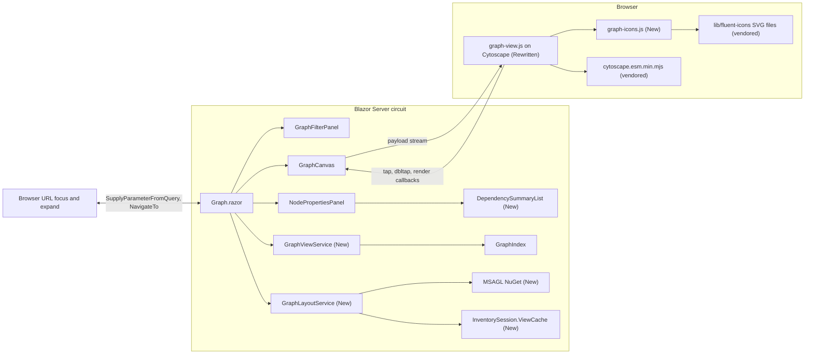

### 5.2 Responsibilities

| Component | Status | Responsibility |
|-----------|--------|----------------|
| `GraphViewService` | **New** | Projects a `GraphIndex` into a slim `GraphViewPayload` for Overview (collapses children, drops structural and scope edges, merges parallel edges) or Focus (1 hop plus parents, hub aggregation, expansion). Builds the "Talks to" summary. Matches tags on the server. Pure and deterministic, with no I/O |
| `GraphLayoutService` | **New** | Computes Overview positions with MSAGL on a worker thread, with a timeout and a deterministic fallback. Caches the result per `GraphDocument` instance in `InventorySession.ViewCache`, with one in-flight computation per session |
| `GraphViewCache` | **New** | A per-session cache holding the graph reference and two `Lazy<Task<GraphLayout>>` (with and without child resources) |
| `GraphViewOptions` | **New** | Options for the WebGL switch, layout timeout, and node caps |
| `NodeCategories` | **New** | Maps node types to user-facing categories (Apps, Data, Storage, Messaging, Secrets, Registry, External, Scope). Used by the filter panel, the legend, the Focus ring order, and the summary |
| `GraphFocusRoute` | **New** | Validates and normalizes the `focus` and `expand` query values (length, count, duplicates). Pure and unit-testable |
| `Graph.razor` | Modified | Owns the mode (`Overview` or `Focus`), the breadcrumb, the expanded set, and filter wiring. **The URL is the source of truth** for mode, focus, and expanded set: user actions navigate, and `OnParametersSetAsync` renders. Maps indexes from JS back to node IDs. **Copy link** button |
| `GraphCanvas.razor` | Modified | Streams the `GraphViewPayload`. Drops physics. Exposes `RenderAsync`, `ApplyFilterAsync`, `CenterAsync`, `HighlightChangesAsync`, `FitAsync` |
| `graph-view.js` | Rewritten | The Cytoscape renderer: `preset` layout for Overview and `concentric` for Focus, batched class toggles for filters and highlighting, no info icons or edge labels, WebGL with canvas fallback |
| `graph-icons.js` | **New** | Maps each node type to a vendored Fluent icon, loads the SVG once, sets its fill to white, and caches it as a `data:` URI for Cytoscape |
| `GraphFilterPanel.razor` | Modified | Grouped "Resource types" by category (tri-state), collapsible Tags and Advanced sections, **active-filter chips** (for example "Only connected x", so the migrated toggle is visible without opening Advanced), and per-graph caching of search options and tag names |
| `NodePropertiesPanel.razor` | Modified | **Focus** and **Expand** buttons, a "Talks to" grouped list, and the existing Properties and Connections sections collapsed by default |
| `DependencySummaryList.razor` | **New** | Accessible text list of dependencies grouped by category, with setting keys (never values) |

### 5.3 Screen layout (target)

```text
+----------------------------------------------------------------------------------------------+
| (hub) Knowledge Graph                  Scanned 5 min ago . 1 tenant, 1 subscription  [...]   |
+-------------------+-------------------------------------------------------+------------------+
| Find a resource   | Overview > contoso-web    [Copy link] [Fit] [Changes] | contoso-web      |
| [contoso-w...   ] |                                                       | WebApp           |
|                   |            (contoso-sql)      (contoso-kv)            | [Focus] [Details]|
| SCOPE      Reset  |                 \               /                     |                  |
| [All subs      v] |   (contoso-bus)--( contoso-web )--(SendGrid +48)      | TALKS TO (5)     |
| [All RGs       v] |                 /               \                     | Data             |
|                   |     (contosostorage01)       (contoso-cache)          |  contoso-sql /   |
| RESOURCE TYPES    |                                                       |    ContosoDb     |
| [x] Apps      157 |                                                       | Secrets          |
| [x] Data      151 |                                                       |  contoso-kv      |
| [x] Storage    40 |                                                       | External         |
| [-] Messaging   3 |                                                       |  SendGrid (Email)|
| > Tags            | Showing 6 of 1,034 nodes . [Legend]                   | > Properties     |
| > Advanced        |                                                       | > Connections    |
+-------------------+-------------------------------------------------------+------------------+
```

- The `[...]` overflow menu in the header holds **Rebuild graph** and **Export JSON**.
- The **Freeze/Resume physics** button is removed, because there is no physics.
- **Legend** is a small collapsible overlay with the icon and colour for each category.

### 5.4 Visual rules (Cytoscape style)

| Element | Overview | Focus |
|---------|----------|-------|
| Node shape | `ellipse` filled with the type colour, with a white Fluent glyph inside (`background-image: <data URI>`, `background-fit: contain`, `background-width: 55%`, `background-height: 55%`) | Same. SqlServer and StorageAccount become **compound parents** (rounded rectangles) that contain their databases, containers, and queues. Each parent shows its glyph at the top left |
| Node size | `24 + 6 * sqrt(degree)`, clamped to 24..64 px. ExternalService uses a fixed 72 px | Centre node 72 px, others 40 px |
| Node colour | Fill is the `NodeTypeStyles.All` colour (unchanged palette). ExternalService uses the validated per-service colour. `External` uses a light grey fill with a dark glyph | Same |
| Label | Under the node (`text-valign: bottom`), truncated to 28 chars, `min-zoomed-font-size: 9` so labels are only drawn when readable. Always shown for the selected node, hovered node, and their neighbours (class `.show-label`) | Always shown |
| Collapsed children badge | Label suffix, for example `contoso-sql (+3 db)` | n/a |
| Hub badge | n/a | `SendGrid (+48 apps)` when other consumers are hidden |
| Edges | Straight (`curve-style: straight`, which WebGL supports), `target-arrow-shape: triangle`, **no labels**. Width `1 + log2(count)`, clamped to 1..4 | Same, width 2 |
| Edge colour | CONNECTS_TO `#0078D4`, REFERENCES_SECRET `#C8A400`, PULLS_IMAGE_FROM `#008575` | Same |
| Low-confidence edge | Opacity 0.35 (dashes are not supported in WebGL mode) | Same |
| Hover or select | Node, neighbours, and connecting edges get `.hl`. Everything else gets `.faded` (opacity 0.12, labels hidden). Applied in one `cy.batch()` | Same |
| Changed since last scan | Border 4 px, green `#16a34a` (added) or orange `#ea580c` (changed) | Same |

### 5.5 Node icons (Fluent UI System Icons)

**Why not the official Azure architecture icons:** their terms allow use "in architectural diagrams, training materials, or documentation" and allow copying and distribution "only for the permitted use", with all other rights reserved. That is not an open-source license. Committing them to this MIT-licensed public repo would distribute them for any purpose, and forks would inherit no rights. They are therefore not used anywhere in the repository.

**Chosen set:** Fluent UI System Icons, npm package `@fluentui/svg-icons` (MIT, published by Microsoft). It is the icon family the Aspire dashboard uses, so it also matches the requested Aspire look.

| Item | Value |
|------|-------|
| Package | `@fluentui/svg-icons@1.1.344` (pinned) |
| Files | `icons/<name>_24_regular.svg`, one per node type (see the table below) |
| Vendored to | `BlazorAzureInventory/wwwroot/lib/fluent-icons/` through `libman.json` (jsdelivr provider, same as Cytoscape) |
| License | MIT. The license text from the `microsoft/fluentui-system-icons` repository is committed as `wwwroot/lib/fluent-icons/LICENSE`, because MIT requires the notice to ship with the files |
| Recolouring | Allowed by MIT. `graph-icons.js` fetches each SVG once (`connect-src 'self'`), sets the root `fill` to `#ffffff` (or `#374151` for `External`), and caches the result as a `data:image/svg+xml` URI (`img-src data:` is already allowed) |

Candidate icon per type. Names are checked against the pinned package in T6. If a name does not exist, use the closest existing glyph and update this table.

| Node type | Fluent icon (candidate) |
|-----------|-------------------------|
| WebApp, WebAppSlot | `globe_24_regular` |
| FunctionApp | `flash_24_regular` |
| ContainerApp | `cube_24_regular` |
| ContainerRegistry | `box_multiple_24_regular` |
| SqlServer | `server_24_regular` |
| SqlDatabase | `database_24_regular` |
| StorageAccount | `storage_24_regular` |
| BlobContainer | `folder_24_regular` |
| StorageQueue | `list_24_regular` |
| CosmosAccount | `data_usage_24_regular` |
| RedisCache | `top_speed_24_regular` |
| ServiceBusNamespace | `arrow_routing_24_regular` |
| KeyVault | `key_24_regular` |
| ExternalService | `cloud_24_regular` (on the per-service colour, **no third-party logos**) |
| External | `link_24_regular` |
| Tenant | `building_24_regular` |
| Subscription | `receipt_24_regular` |
| ResourceGroup | `group_24_regular` |

Technical notes:

- Fluent SVGs are 24 by 24 with explicit `width` and `height`, so they draw onto a canvas (Cytoscape's WebGL mode builds node sprites through a canvas).
- About 18 files of under 2 KB each, fetched in parallel once per page load and cached by the browser.
- If a glyph fails to load, the node is drawn as a plain coloured circle. The label and the colour still identify it.

---

## 6. Data model and contracts

### 6.1 New view models (`Models/Graph/GraphViewModels.cs`, New)

```csharp
public enum GraphViewMode { Overview, Focus }

/// <summary>What the browser receives. Node and edge IDs stay on the server (see NodeIds / EdgeSources).</summary>
public sealed record GraphViewPayload(
    [property: JsonPropertyName("mode")] GraphViewMode Mode,
    [property: JsonPropertyName("focus")] int? FocusIndex,
    [property: JsonPropertyName("subs")] IReadOnlyList<string> Subscriptions,   // subscription IDs, indexed by ViewNode.Sub
    [property: JsonPropertyName("rgs")] IReadOnlyList<string> ResourceGroups,   // lower-case RG names, indexed by ViewNode.Rg
    [property: JsonPropertyName("nodes")] IReadOnlyList<ViewNode> Nodes,
    [property: JsonPropertyName("edges")] IReadOnlyList<ViewEdge> Edges,
    [property: JsonPropertyName("totalNodes")] int TotalNodes,
    [property: JsonPropertyName("totalEdges")] int TotalEdges,
    [property: JsonPropertyName("fallbackLayout")] bool FallbackLayout)
{
    [JsonIgnore] public IReadOnlyList<string> NodeIds { get; init; } = [];                     // index -> GraphNode.Id
    [JsonIgnore] public IReadOnlyList<IReadOnlyList<string>> EdgeSources { get; init; } = [];  // index -> GraphEdge.Id list
}

public sealed record ViewNode(
    [property: JsonPropertyName("t")] string Type,
    [property: JsonPropertyName("l")] string Label,
    [property: JsonPropertyName("s")] int? Sub = null,
    [property: JsonPropertyName("g")] int? Rg = null,
    [property: JsonPropertyName("x")] float? X = null,
    [property: JsonPropertyName("y")] float? Y = null,
    [property: JsonPropertyName("d")] int Degree = 0,
    [property: JsonPropertyName("p")] int? Parent = null,          // Focus only: compound parent index
    [property: JsonPropertyName("k")] int? CollapsedChildren = null,// Overview only
    [property: JsonPropertyName("m")] int? HiddenNeighbours = null, // Focus only: "+48 apps"
    [property: JsonPropertyName("c")] string? Color = null,         // validated #RRGGBB only
    [property: JsonPropertyName("cat")] string? Category = null,    // ExternalService category, e.g. "Email"
    [property: JsonPropertyName("emu")] bool? Emulator = null,
    [property: JsonPropertyName("agg")] bool? Aggregate = null);    // "+N more" nodes

public sealed record ViewEdge(
    [property: JsonPropertyName("s")] int Source,
    [property: JsonPropertyName("t")] int Target,
    [property: JsonPropertyName("y")] string Type,
    [property: JsonPropertyName("lo")] bool? Low = null,
    [property: JsonPropertyName("n")] int? Count = null);           // merged parallel edges in Overview

public sealed record DependencyItem(string NodeId, string Label, string Type, string EdgeType, string SettingKeys, string? Confidence);
public sealed record DependencyGroup(string Category, IReadOnlyList<DependencyItem> Items);

public sealed record GraphLayout(
    GraphDocument Graph,                                        // reference identity is the cache key
    IReadOnlyDictionary<string, (float X, float Y)> Positions,  // by GraphNode.Id
    bool IsFallback,
    TimeSpan Elapsed);
```

Serialization uses a new `GraphViewJson.Options` (Web defaults, `DefaultIgnoreCondition = WhenWritingNull`, enums as strings). It is a separate instance so `GraphJson.Options` (used by Export JSON) is unaffected.

### 6.2 Sample payload (Focus, sanitized)

```json
{
  "mode": "Focus",
  "focus": 0,
  "subs": ["<subscription-id>"],
  "rgs": ["rg-contoso-web"],
  "nodes": [
    { "t": "WebApp", "l": "contoso-web", "s": 0, "g": 0, "d": 5 },
    { "t": "SqlServer", "l": "contoso-sql", "s": 0, "g": 0, "d": 1 },
    { "t": "SqlDatabase", "l": "ContosoDb", "s": 0, "g": 0, "d": 1, "p": 1 },
    { "t": "KeyVault", "l": "contoso-kv", "s": 0, "g": 0, "d": 1 },
    { "t": "ExternalService", "l": "SendGrid", "c": "#1A82E2", "cat": "Email", "d": 49, "m": 48 }
  ],
  "edges": [
    { "s": 0, "t": 2, "y": "CONNECTS_TO" },
    { "s": 0, "t": 3, "y": "REFERENCES_SECRET" },
    { "s": 0, "t": 4, "y": "CONNECTS_TO" }
  ],
  "totalNodes": 1034,
  "totalEdges": 2210,
  "fallbackLayout": false
}
```

Overview payloads look the same, plus `x` and `y` on each node, `k` on parents with collapsed children, and `n` on merged edges. Overview payloads have no `p` or `m`.

### 6.3 Service contracts (New)

```csharp
public sealed class GraphViewService(IOptions<GraphViewOptions> options)
{
    public GraphViewPayload BuildOverview(GraphIndex index, GraphLayout layout, bool showChildResources);
    public GraphViewPayload? BuildFocus(GraphIndex index, string focusId, IReadOnlyCollection<string> expandedIds,
                                        bool hideEmulator, bool showLowConfidence);       // null if focusId is unknown
    public IReadOnlyList<int> MatchTag(GraphViewPayload payload, GraphIndex index, string tagName, string? tagValue);
    public IReadOnlyList<DependencyGroup> SummarizeDependencies(GraphIndex index, string nodeId);
    public static string CategoryOf(string nodeType);                                   // delegates to NodeCategories
}

public sealed class GraphLayoutService(IOptions<GraphViewOptions> options, ILogger<GraphLayoutService> logger)
{
    public Task<GraphLayout> GetOverviewLayoutAsync(InventorySession session, bool showChildResources, CancellationToken ct);
    public void WarmUp(InventorySession session);                                       // fire-and-forget, logs failures
    internal static GraphLayout ComputeMsagl(GraphDocument graph, IReadOnlyList<string> nodeIds,
                                             IReadOnlyList<(int S, int T)> edges, TimeSpan budget, CancellationToken ct);
    internal static GraphLayout ComputeFallback(GraphDocument graph, IReadOnlyList<string> nodeIds,
                                                IReadOnlyList<(int S, int T)> edges);   // deterministic component-packed grid
}

internal sealed class GraphViewCache(GraphDocument graph)
{
    public GraphDocument Graph { get; } = graph;
    public Lazy<Task<GraphLayout>>? Collapsed { get; set; }
    public Lazy<Task<GraphLayout>>? Expanded { get; set; }
}
```

MSAGL usage, to be confirmed in spike S1: build a `Microsoft.Msagl.Core.Layout.GeometryGraph` with one `Node(CurveFactory.CreateCircle(r, new Point()))` per visible node and one `Edge(src, tgt)` per projected edge. Run `LayoutHelpers.CalculateLayout(graph, new MdsLayoutSettings(), cancelToken)`; MSAGL lays out disconnected components separately and packs them. Read `node.Center`, flip the y axis, and normalize to 0..10,000: the layout is moved to start at (0, 0) and is scaled down uniformly only if its larger side exceeds 10,000, so one layout unit stays one screen pixel at zoom 1 and node sizes match the spacing MSAGL left for them (implemented in T4; circle radii follow the [section 5.4](#54-visual-rules-cytoscape-style) node size rule).

### 6.4 Overview projection rules (`BuildOverview`)

| Rule | Detail |
|------|--------|
| Scope nodes | `Tenant`, `Subscription`, `ResourceGroup` are **excluded** from the payload. Their facets still come from `GraphQueryService.GetFacets` |
| Structural edges | `EdgeTypes.Structural` edges are not sent |
| Child collapse (`showChildResources = false`) | `SqlDatabase` goes to its `SqlServer`, `BlobContainer` and `StorageQueue` go to their `StorageAccount`, and `WebAppSlot` goes to its `WebApp`. Each is found through the incoming `HOSTS_DATABASE`, `HAS_CONTAINER`, `HAS_QUEUE`, or `HAS_SLOT` edge. A dependency edge that touches a child is re-pointed to the parent. The parent gets `k = childCount` |
| Edge merge | Edges with the same `(source, target, type)` after re-pointing are merged: `n = count`, `lo = true` only if **all** merged edges are low confidence, and `EdgeSources` keeps every original `GraphEdge.Id` |
| Orphans | Nodes with no dependency edge are still sent (so "Only connected" can be toggled on the client) |
| Degree | The count of projected dependency edges (in plus out) |
| Cap | If visible nodes exceed `OverviewMaxNodes`, the fallback layout is used and the UI shows "Large estate: simplified layout. Use Scope or Search to narrow down." |
| Ordering | Nodes ordered by `GraphNode.Id` (ordinal), edges by source index, then target, then type, so the output is deterministic |

### 6.5 Focus projection rules (`BuildFocus`)

| Rule | Detail |
|------|--------|
| Centre | `focusId` resolved through `GraphIndex.NodesById`. Scope nodes cannot be focused (returns null) |
| Neighbours | All `In` and `Out` edges of the centre whose type is `CONNECTS_TO`, `REFERENCES_SECRET`, or `PULLS_IMAGE_FROM`, plus `HAS_SLOT` (slots of an app) |
| Parent context | For each neighbour that is a child (`EdgeTypes.Children` target, or a slot), add its parent and set `p` (compound). Children of the centre itself (for example, the databases of a focused SqlServer) are included through `HOSTS_DATABASE`, `HAS_CONTAINER`, and `HAS_QUEUE` |
| Hub aggregation | If the centre has more than `FocusMaxNeighbours` neighbours of one category, keep the first N by label and add one aggregate node `+K more <category>` (`agg = true`) |
| Hidden neighbours | Each neighbour gets `m` = its degree minus the edges shown, so the user sees that SendGrid has 48 other consumers |
| Expansion | Each ID in `expandedIds` is processed like the centre (1 hop plus parents). The union is capped at `FocusMaxNodes`. Beyond the cap, expansion is refused |
| Filters honoured | `hideEmulator` (drops `isLocalEmulator` nodes) and `showLowConfidence` (drops `confidence == Low` edges when false) |

### 6.6 Changes to existing types

| Type | Change | Default | Compatibility |
|------|--------|---------|---------------|
| `GraphFilterState` | Add `bool ShowChildResources` | `false` | Missing in old saved JSON, so the default applies |
| `GraphFilterState` | Add `int FilterVersion` and `public const int CurrentFilterVersion = 2` | `0` when missing (no initializer) | Saved filters from before this release read as version 0 |
| `GraphFilterState` | Add `public void Upgrade()`: if `FilterVersion < 2`, set `OnlyConnected = true`. Then set `FilterVersion = CurrentFilterVersion` | n/a | Called by `Graph.RestoreFilter` before the values are copied. `ApplyFilterAsync` saves `FilterVersion = CurrentFilterVersion`, so after the first saved change the user's own choice sticks |
| `GraphFilterState.OnlyConnected` | Initializer changes from `false` to `true` | `true` | New users get `true`. Existing users are switched on **once** through `Upgrade()` |
| `GraphFocusRoute` (New, `Services/Graph/GraphFocusRoute.cs`) | `public sealed record GraphFocusRoute(string Focus, IReadOnlyList<string> Expand)` with `public static GraphFocusRoute? Parse(string? focus, IEnumerable<string>? expand, int maxExpand, out int droppedExpand)` | n/a | See [section 6.9](#69-url-contract) |
| `InventorySession` | Add `internal GraphViewCache? ViewCache { get; set; }` | `null` | In memory only |
| `NodeCategories` (in `GraphModels.cs`) | **New** static `IReadOnlyDictionary<string,string> ByType`, `IReadOnlyList<string> Order` | n/a | n/a |

Category map:

| Category | Types |
|----------|-------|
| Apps | WebApp, FunctionApp, WebAppSlot, ContainerApp |
| Data | SqlServer, SqlDatabase, CosmosAccount, RedisCache |
| Storage | StorageAccount, BlobContainer, StorageQueue |
| Messaging | ServiceBusNamespace |
| Secrets | KeyVault |
| Registry | ContainerRegistry |
| External | ExternalService, External |
| Scope | Tenant, Subscription, ResourceGroup |

### 6.7 Configuration (`appsettings.json`, section `GraphView`, New)

| Key | Type | Default | Range | Purpose |
|-----|------|---------|-------|---------|
| `GraphView:UseWebGl` | bool | `true` | n/a | Kill switch for Cytoscape WebGL mode. `false` forces the canvas renderer |
| `GraphView:LayoutTimeoutSeconds` | int | `10` | 1..60 | MSAGL budget before falling back |
| `GraphView:OverviewMaxNodes` | int | `3000` | 100..20000 | Above this, use the fallback layout |
| `GraphView:FocusMaxNeighbours` | int | `60` | 5..500 | Per-category cap before the `+K more` aggregate |
| `GraphView:FocusMaxNodes` | int | `250` | 20..2000 | Cap on the expanded Focus graph |
| `GraphView:HoverHighlightMaxElements` | int | `4000` | 0..50000 | Above this many visible elements, highlight on click only (not hover) |
| `GraphView:MaxExpandInUrl` | int | `20` | 0..100 | Maximum `expand` values accepted from the URL. Extra values are dropped |

```csharp
public sealed class GraphViewOptions   // Models/Options/Options.cs, New
{
    public bool UseWebGl { get; set; } = true;
    [Range(1, 60)] public int LayoutTimeoutSeconds { get; set; } = 10;
    [Range(100, 20000)] public int OverviewMaxNodes { get; set; } = 3000;
    [Range(5, 500)] public int FocusMaxNeighbours { get; set; } = 60;
    [Range(20, 2000)] public int FocusMaxNodes { get; set; } = 250;
    [Range(0, 50000)] public int HoverHighlightMaxElements { get; set; } = 4000;
    [Range(0, 100)] public int MaxExpandInUrl { get; set; } = 20;
}
```

Registered in `Program.cs` as `AddOptions<GraphViewOptions>().BindConfiguration("GraphView").ValidateDataAnnotations()`. `GraphViewService` and `GraphLayoutService` are singletons.

**CLI parameters:** none. This feature has no command-line surface, and `deploy/Publish-AzInventory.ps1` does not change.

### 6.8 JS module contract (`wwwroot/js/graph-view.js`, rewritten)

| Export | Signature | Notes |
|--------|-----------|-------|
| `init` | `init(containerId: string, dotNetRef, opts: { webgl: boolean, hoverMax: number })` | Creates `cytoscape({ container, renderer: { name: 'canvas', webgl }, textureOnViewport: false, hideEdgesOnViewport: !webgl, pixelRatio: 'auto', minZoom: 0.05, maxZoom: 3, wheelSensitivity: 0.2 })`. Falls back to `webgl: false` if creation throws or no WebGL context is available, and calls `OnWebGlFallback` |
| `render` | `render(streamRef): Promise<void>` | Parses the payload and adds elements inside `cy.batch()`. Overview uses `cy.layout({ name: 'preset' })`. Focus uses `{ name: 'concentric', concentric: n => centre ? 2 : 1, levelWidth: () => 1, sort: by category order, animate: false }`. Calls `OnRenderComplete(nodes, edges, ms)` |
| `applyFilter` | `applyFilter(filter: GraphFilterState, tagMatches: number[] \| null)` | Computes the visible set in plain arrays, then one `cy.batch()` toggles class `.off` (`display: none`). Ignored in Focus mode, apart from `showLowConfidence` and `hideEmulator` |
| `center` | `center(index: number): boolean` | Selects and animates to the node. Returns false if it is not present |
| `highlightChanges` | `highlightChanges(added: number[], changed: number[])` | Toggles `.added` and `.changed` classes |
| `fit` | `fit()` | `cy.animate({ fit: { eles: cy.elements(':visible'), padding: 40 } })` |
| `copyText` | `copyText(text: string): Promise<boolean>` | `navigator.clipboard.writeText`, only called from the **Copy link** click. Returns false if the clipboard is unavailable |
| `dispose` | `dispose()` | `cy.destroy()` and clears references |

Callbacks to .NET (all `[JSInvokable]` on `GraphCanvas`):

| Callback | Signature |
|----------|-----------|
| `OnNodeSelected` | `Task OnNodeSelected(int? index)` |
| `OnNodeOpen` | `Task OnNodeOpen(int index)`. Fired on double-tap |
| `OnEdgeSelected` | `Task OnEdgeSelected(int? index)` |
| `OnRenderComplete` | `Task OnRenderComplete(int nodes, int edges, double ms)` |
| `OnWebGlFallback` | `Task OnWebGlFallback()`. Logged at Information level, no UI noise |

Removed: `setPhysics`, `updateNodeTags`, `focusNode` (replaced by `center`), `renderFromStream`, and all info-icon code.

### 6.9 URL contract

The URL fully describes the mode, so links can be shared and bookmarked and the browser Back and Forward buttons work.

| URL | Mode |
|-----|------|
| `graph` | Overview |
| `graph?focus=<resource-id>` | Focus on one resource |
| `graph?focus=<resource-id>&expand=<resource-id>&expand=<resource-id>` | Focus plus expanded neighbours, in breadcrumb order |

All values are URL-encoded ARM resource IDs, in the same format the Inventory grids already use for `graph?focus=`, for example `/subscriptions/<subscription-id>/resourceGroups/rg-contoso-web/providers/Microsoft.Web/sites/contoso-web`.

| Parameter | Binding in `Graph.razor` | Validation (`GraphFocusRoute.Parse`) |
|-----------|--------------------------|--------------------------------------|
| `focus` | `[SupplyParameterFromQuery(Name = "focus")] public string? Focus { get; set; }` (exists) | Trimmed. Empty or longer than 2,048 characters gives `null` (Overview) |
| `expand` | `[SupplyParameterFromQuery(Name = "expand")] public string[]? Expand { get; set; }` (New) | Ignored without `focus`. Trimmed, values over 2,048 characters dropped, duplicates (case-insensitive) and the focus ID removed, first `MaxExpandInUrl` kept in order. `droppedExpand` reports how many were dropped |

After parsing, each ID is only **looked up** in `GraphIndex.NodesById`. Unknown IDs are never sent to Azure (see [section 9](#9-error-handling-and-edge-cases)).

Navigation behaviour:

| User action | URL change | History |
|-------------|-----------|---------|
| Pick a resource in Search, click **Focus**, or follow an Inventory "Show in graph" link | `graph?focus=<id>` | Push |
| Click **Expand** on a neighbour | Appends `&expand=<id>` | Push |
| Click a breadcrumb segment | Truncates `expand` after that segment | Push |
| Click the **Overview** breadcrumb | `graph` | Push |
| Browser Back or Forward | Any of the above | Browser |
| **Copy link** | None. Copies `Nav.Uri` | n/a |

URLs are built with `Nav.GetUriWithQueryParameters(new Dictionary<string, object?> { ["focus"] = id, ["expand"] = expanded.ToArray() })` and applied with `Nav.NavigateTo(uri)`. Because the route is the same page, Blazor keeps the component and calls `OnParametersSetAsync`. That method compares the parsed route with the rendered one and only re-renders when they differ, so filter state, the cached layout, and the circuit are preserved.

Filters are **not** in the URL. A shared Focus link looks the same for the recipient, apart from their own **Hide emulator** and **Show low-confidence edges** choices, which Focus honours.

---

## 7. Process flows

### 7.1 Mode state

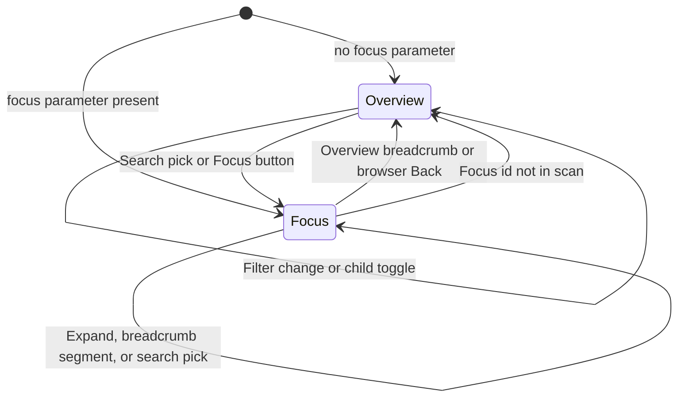

Every transition except a filter change is a URL navigation, so the browser Back button reverses it.

### 7.2 Open the page (Overview)

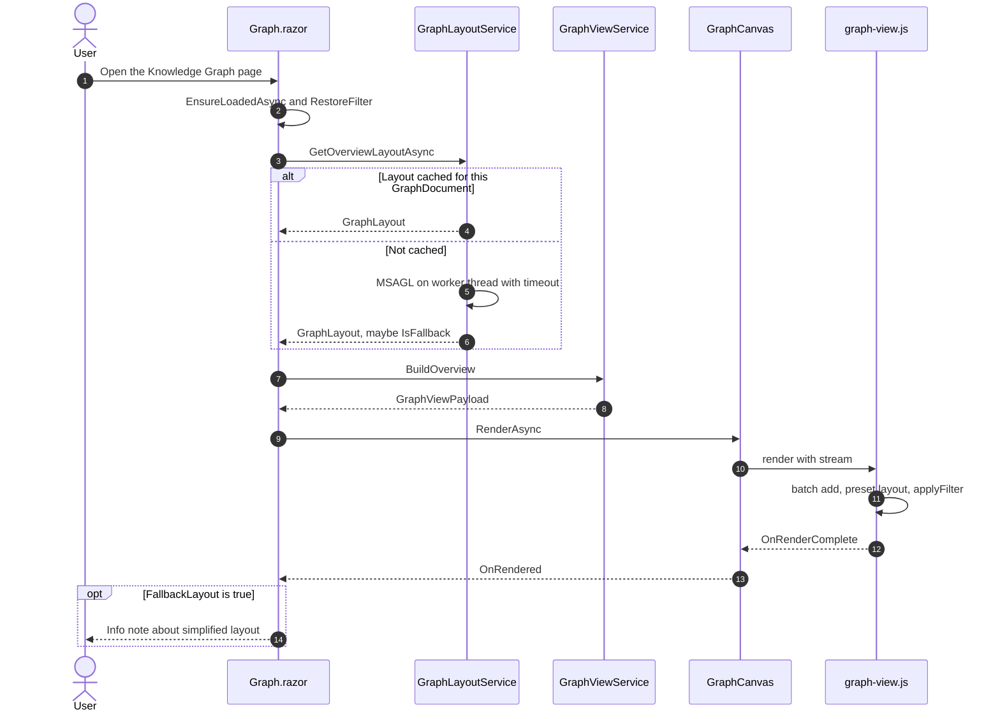

### 7.3 Overview layout with error paths

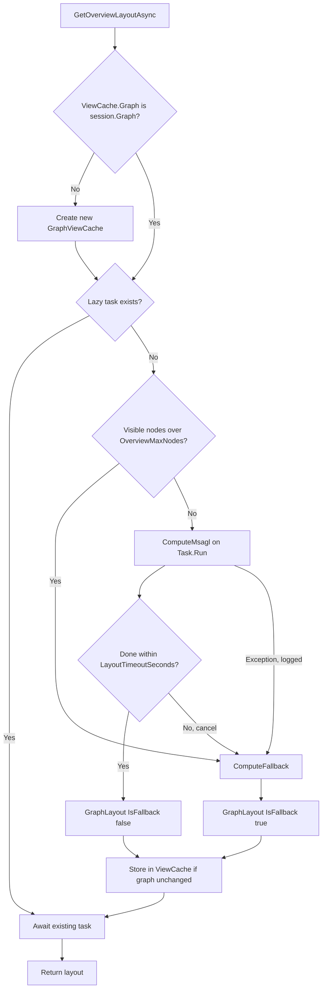

### 7.4 Focus a resource (search, Focus button, or deep link)

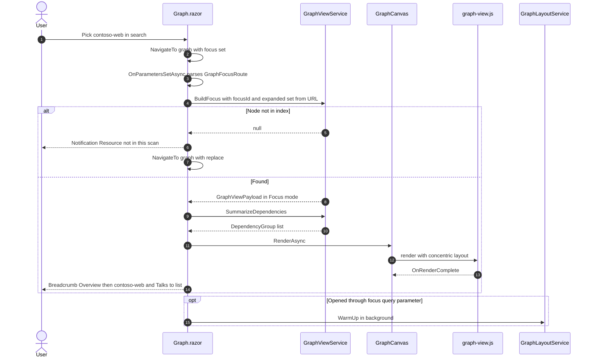

### 7.5 Expand a neighbour

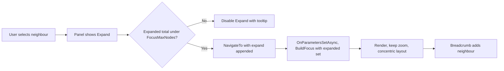

### 7.8 URL changes (Back, Forward, shared link)

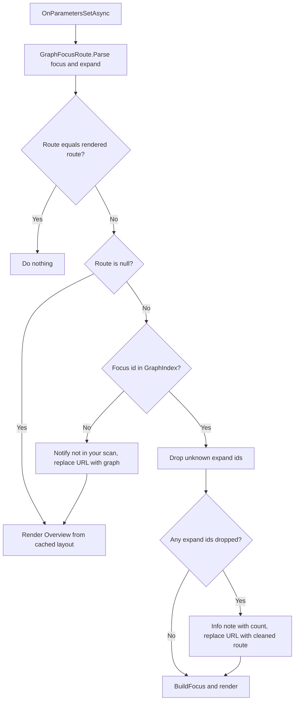

### 7.9 Saved filter migration (Only connected)

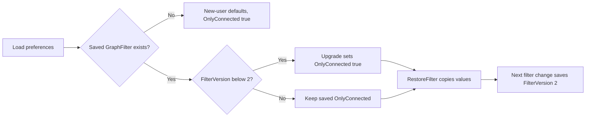

### 7.6 Filter change (Overview)

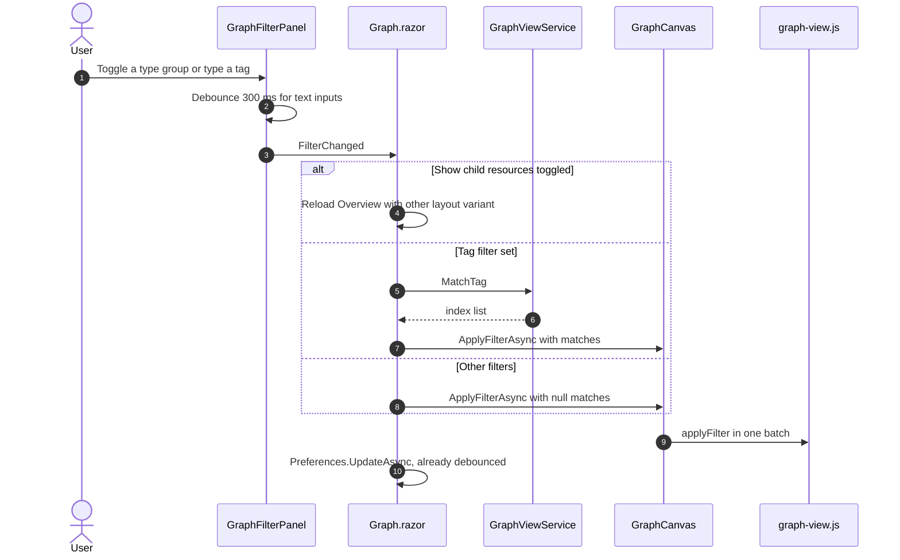

### 7.7 Hover and select highlighting (browser only)

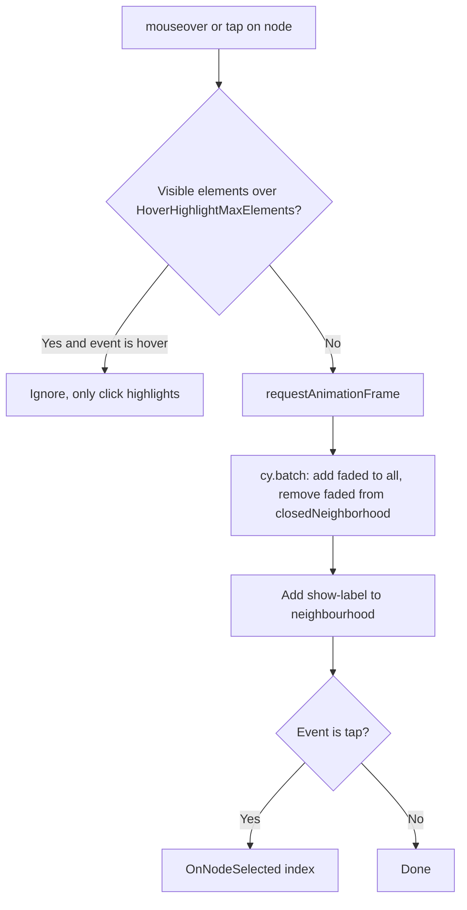

---

## 8. File-by-file changes

Paths are relative to the repository root.

| File | New/Modified | Change | Functions |
|------|--------------|--------|-----------|
| `BlazorAzureInventory/Models/Graph/GraphViewModels.cs` | New | View payload, nodes, edges, dependency summary, layout records | `GraphViewMode`, `GraphViewPayload`, `ViewNode`, `ViewEdge`, `DependencyGroup`, `DependencyItem`, `GraphLayout` |
| `BlazorAzureInventory/Models/Graph/GraphModels.cs` | Modified | Add `ShowChildResources`, `FilterVersion`, `CurrentFilterVersion`, `Upgrade()`. `OnlyConnected` initializer becomes `true`. Add `NodeCategories` | `GraphFilterState`, `GraphFilterState.Upgrade`, `NodeCategories.ByType`, `NodeCategories.Order` |
| `BlazorAzureInventory/Services/Graph/GraphFocusRoute.cs` | New | Parse and normalize `focus` and `expand` query values | `GraphFocusRoute`, `Parse` |
| `BlazorAzureInventory/Models/Options/Options.cs` | Modified | Add options class | `GraphViewOptions` |
| `BlazorAzureInventory/Services/Graph/GraphViewService.cs` | New | Overview and Focus projection, tag matching (port of `matchesTag`, including overflow keys such as `name-2`), dependency summary | `BuildOverview`, `BuildFocus`, `MatchTag`, `SummarizeDependencies`, `CategoryOf` |
| `BlazorAzureInventory/Services/Graph/GraphLayoutService.cs` | New | MSAGL layout, fallback, per-session cache, warm-up | `GetOverviewLayoutAsync`, `WarmUp`, `ComputeMsagl`, `ComputeFallback`, `GraphViewCache` |
| `BlazorAzureInventory/Services/Graph/GraphQueryService.cs` | Modified | Add `GraphViewJson.Options` next to `GraphJson` | `GraphViewJson.Options` |
| `BlazorAzureInventory/Services/Graph/InventorySessionStore.cs` | Modified | Add the cache slot | `InventorySession.ViewCache` |
| `BlazorAzureInventory/Services/Scan/InventoryScanOrchestrator.cs` | Modified | Call `GraphLayoutService.WarmUp(session)` after the graph is set (scan and `RebuildGraphAsync`) | `RebuildGraphAsync`, scan completion |
| `BlazorAzureInventory/Services/Persistence/InventorySessionLoader.cs` | Modified | Call `WarmUp(session)` after loading a saved scan | `EnsureLoadedAsync` |
| `BlazorAzureInventory/Program.cs` | Modified | Register options and the two services | `AddOptions<GraphViewOptions>`, `AddSingleton<GraphViewService>`, `AddSingleton<GraphLayoutService>` |
| `BlazorAzureInventory/appsettings.json` | Modified | Add the `GraphView` section with defaults | n/a |
| `BlazorAzureInventory/BlazorAzureInventory.csproj` | Modified | `PackageReference Microsoft.Msagl 1.1.6` | n/a |
| `BlazorAzureInventory/Components/Pages/Graph.razor` | Modified | URL-driven mode (`focus` plus new `expand` query parameter), breadcrumb, **Copy link**, `?focus=` fast path, expand, server-side tag matching, index-to-ID mapping, overflow menu (Rebuild, Export), filter migration through `Upgrade()`. Remove `_pendingFocus` | `OnParametersSetAsync` (New: parse the route and render on change), `RenderRouteAsync(GraphFocusRoute?)`, `NavigateToFocus(string id, IReadOnlyList<string> expand)`, `ExpandAsync(string id)`, `BackToOverview()`, `CopyLinkAsync`, `LoadOverviewAsync`, `RestoreFilter` (calls `Upgrade`), `ApplyFilterAsync` (saves `FilterVersion`), `OnNodeSelected(int?)`, `OnEdgeSelected(int?)`, `OpenDetailsAsync(int)`, `OnTagsChanged` (recompute matches), `ApplyChangeHighlightAsync` (map IDs to indexes) |
| `BlazorAzureInventory/Components/Graph/GraphCanvas.razor` | Modified | Stream `GraphViewPayload`. Remove physics. New callbacks. Count caption "Showing X of Y" with `aria-live="polite"`. Legend overlay | `RenderAsync`, `ApplyFilterAsync(GraphFilterState, IReadOnlyList<int>?)`, `CenterAsync(int)`, `HighlightChangesAsync(IReadOnlyList<int>, IReadOnlyList<int>)`, `FitAsync`, `OnWebGlFallback`. Removed: `TogglePhysicsAsync`, `UpdateNodeTagsAsync`, `FocusAsync` |
| `BlazorAzureInventory/Components/Graph/GraphFilterPanel.razor` | Modified | Group types by `NodeCategories` (tri-state group checkbox, expandable to individual types). Collapsible Tags and Advanced (`RadzenPanel`). "Show child resources" toggle. Active-filter chips (each removable) and **Reset all**. Cache `_nodeOptions` and `_tagNames` per `Nodes` reference. 300 ms debounce on the tag inputs | `OnParametersSet` (cache by reference), `ToggleCategoryAsync`, `ResetAllAsync`, `RemoveChipAsync`, `DisplayToggles` (adds child toggle) |
| `BlazorAzureInventory/Components/Graph/NodePropertiesPanel.razor` | Modified | **Focus** and **Expand** buttons, `DependencySummaryList` on top, Properties and Connections in collapsed `RadzenPanel`s. Edge view lists every merged underlying edge | New parameters `EventCallback<string> OnFocus`, `EventCallback<string> OnExpand`, `bool CanExpand`, `IReadOnlyList<DependencyGroup>? Dependencies`, `IReadOnlyList<GraphEdge>? Edges` |
| `BlazorAzureInventory/Components/Graph/DependencySummaryList.razor` | New | Grouped "Talks to" and "Used by" list, encoded text only, items clickable (`OnSelect`) | Parameters `Groups`, `EventCallback<string> OnSelect` |
| `BlazorAzureInventory/wwwroot/js/graph-view.js` | Modified (rewrite) | Cytoscape renderer per [section 6.8](#68-js-module-contract-wwwrootjsgraph-viewjs-rewritten) | `init`, `render`, `applyFilter`, `center`, `highlightChanges`, `fit`, `copyText`, `dispose`, internal `buildStyle`, `toElements`, `highlightNeighbourhood`, `clearHighlight` |
| `BlazorAzureInventory/wwwroot/js/graph-icons.js` | New | Map from node type to the vendored Fluent icon. Loads, recolours, and caches each SVG as a `data:` URI | `loadIcons(): Promise<void>`, `iconFor(type): string`, `legendEntries(): { type, label, uri }[]` |
| `BlazorAzureInventory/wwwroot/lib/fluent-icons/icons/*.svg` | New (vendored) | About 18 Fluent UI System Icons (see [section 5.5](#55-node-icons-fluent-ui-system-icons)), restored by LibMan and committed | n/a |
| `BlazorAzureInventory/wwwroot/lib/fluent-icons/LICENSE` | New | MIT license text of Fluent UI System Icons | n/a |
| `BlazorAzureInventory/libman.json` | Modified | Remove `vis-network@10.1.2`. Add `cytoscape@3.34.3` with files `dist/cytoscape.esm.min.mjs` and `LICENSE` to `wwwroot/lib/cytoscape/`. Add `@fluentui/svg-icons@1.1.344` with the `icons/*_24_regular.svg` files from [section 5.5](#55-node-icons-fluent-ui-system-icons) to `wwwroot/lib/fluent-icons/` | n/a |
| `BlazorAzureInventory/wwwroot/lib/vis-network/**` | Modified (deleted) | Remove the vendored files | n/a |
| `BlazorAzureInventory/wwwroot/app.css` | Modified | Remove `.graph-tip-*` and `div.vis-tooltip`. Add `.graph-breadcrumb`, `.graph-legend`, `.graph-count` | n/a |
| `BlazorAzureInventory.Tests/Fixture.cs` | Modified | Add `LargeSnapshot(int apps, int seed)` that generates a contoso-named estate with hubs, children, and orphans | `LargeSnapshot` |
| `BlazorAzureInventory.Tests/GraphViewServiceTests.cs` | New | Projection, focus, tag matching, summary tests | See [section 11](#11-testing) |
| `BlazorAzureInventory.Tests/GraphFocusRouteTests.cs` | New | URL parsing and filter migration tests | See [section 11](#11-testing) |
| `BlazorAzureInventory.Tests/GraphLayoutServiceTests.cs` | New | Layout determinism, fallback, cache, and concurrency tests | See [section 11](#11-testing) |
| `BlazorAzureInventory.Tests/ComponentTests.cs` | Modified | bUnit tests for the filter panel groups, the panel Focus/Expand buttons, and hostile labels in `DependencySummaryList` | See [section 11](#11-testing) |
| `Docs/screen-descriptions.md` | Modified | Rewrite section 7 (Knowledge Graph) for Overview and Focus, and update the renderer note at the top | n/a |
| `Docs/implementation-plan.md` | Modified | Replace vis-network references with Cytoscape.js and link this plan | n/a |
| `Docs/SecurityReview.md` | Modified | Third-party table: Cytoscape.js version and hash, the MSAGL NuGet package, and `@fluentui/svg-icons` (version, MIT) | n/a |
| `README.md` | Modified | Renderer name | n/a |

---

## 9. Error handling and edge cases

| Case | Behaviour |
|------|-----------|
| No scan or graph | The existing "No graph available" alert. No layout work |
| Graph with 0 visible nodes after filters | The canvas shows an empty-state hint "No resources match the filters" with a **Reset all** link. Count caption "Showing 0 of N" |
| MSAGL throws | Logged as a warning (counts only), fallback layout, `fallbackLayout = true`, info note in the UI |
| MSAGL exceeds `LayoutTimeoutSeconds` | `CancelToken` cancelled, fallback layout used. A late result is discarded |
| Visible nodes over `OverviewMaxNodes` | Fallback layout without trying MSAGL. Info note suggests Scope or Search |
| Graph replaced (Rebuild or new scan) while a layout is running | The result is stored only if `session.Graph` is still the same reference. Otherwise it is dropped and the next request computes a fresh layout |
| Two tabs open the page at the same time | `Lazy<Task<GraphLayout>>` in `GraphViewCache` makes sure only one computation runs |
| Circuit disposed during layout | The layout task continues and fills the cache (it is cheap to keep). The page ignores the result (`JSDisconnectedException` is caught as today) |
| `?focus=` ID not in the scan (deleted resource, other subscription, or a shared link opened by a user whose scan does not include it) | `BuildFocus` returns null. Show a notification "This resource is not in your current scan", then replace the URL with `graph` (Overview) |
| `expand` without `focus` | Ignored. The URL is replaced with `graph` |
| More than `MaxExpandInUrl` `expand` values | The first N are kept. An info note says how many were ignored. The URL is replaced with the cleaned route |
| `expand` IDs that are duplicates, equal to `focus`, longer than 2,048 characters, or not in the scan | Dropped. If any unknown IDs were dropped, show "N expanded resources are not in your scan" and replace the URL |
| Expanded set from the URL exceeds `FocusMaxNodes` | Expansion stops at the cap (in URL order). The rest are dropped from the URL with an info note |
| Back or Forward to a route that is already rendered | `OnParametersSetAsync` sees an equal route and does nothing |
| Clipboard unavailable (insecure context or permission denied) | `copyText` returns false. Show a dialog with the URL in a read-only text box to copy manually |
| Fluent icon file missing or fails to load | Cytoscape draws a plain coloured circle. The label still identifies it. A console warning is logged once per type |
| SVG without intrinsic size not drawn on canvas | Prevented: T6 checks that every vendored SVG has `width` and `height` |
| `?focus=` points to a scope node (Tenant, Subscription, RG) | Treated as not focusable. Apply it as a Scope filter instead (subscription or RG), then load the Overview |
| Focus on a hub with hundreds of consumers | Per-category cap `FocusMaxNeighbours`, then one `+K more apps` aggregate node. Selecting the aggregate lists the hidden items in the panel |
| Expand beyond `FocusMaxNodes` | Expand disabled, tooltip "Focus view is limited to 250 resources. Start a new focus from this resource instead." |
| Node with no dependencies | Focus shows the node alone with "No connections detected", plus the `configFilesStatus` hint if config files were not read (data already on the node) |
| WebGL unavailable or context lost | Recreate Cytoscape with `webgl: false`, call `OnWebGlFallback`. On `webglcontextlost`, re-render once with canvas |
| `GraphView:UseWebGl = false` | The canvas renderer with `hideEdgesOnViewport: true` keeps pan and zoom smooth |
| Very long labels | Truncated to 28 characters with an ellipsis. The full label appears in the panel and the tooltip (text only) |
| Tag write while a tag filter is active | `OnTagsChanged` recomputes `MatchTag` and re-applies the filter |
| "Show changes" while in Focus | IDs are mapped to indexes present in the current payload. IDs that are missing are ignored |
| Saved filter refers to a removed or unknown type | Unchanged: `NodeTypeStyles.RestoreVisibleTypes` |
| Browser zoomed out very far | `min-zoomed-font-size` hides labels. Node icons are still drawn |
| Payload stream fails (`JSException`) | Overlay shows "Could not draw the graph" with a **Retry** button. The error is logged |

---

## 10. Security and privacy

| Topic | Rule |
|-------|------|
| Data minimization | The browser receives **only** type, label, subscription and RG lookup indexes, layout coordinates, counts, the validated colour, and the category. **Not sent:** resource IDs, `Data` dictionaries, tags, setting keys, `references`, file names, environment names, endpoints. Today the full `GraphDocument` is sent. This plan reduces exposure |
| Tags | Tag matching runs on the server (`GraphViewService.MatchTag`). Tag keys and values never reach the graph payload. The existing tag-name autocomplete in the filter panel is rendered server-side by Radzen, as today |
| Setting values and secrets | Never included in any payload or panel. `DependencySummaryList` shows **setting keys only**, reusing the same `EdgeReference.SettingKey` source as `ResourceInspector.BuildConnections` |
| XSS | Cytoscape draws labels on canvas or WebGL (no HTML). No HTML-label extensions are used. Any DOM text (legend, empty state, tooltips) uses `textContent`. Razor output is encoded. The existing hostile-label test is extended to `DependencySummaryList` |
| Colours | Only `#RRGGBB` values pass (same `HEX_COLOR` rule, now enforced on the server in `GraphViewService`) |
| CSP | Unchanged: `script-src 'self'`. Cytoscape is a local ES module. Icons are static SVG files from `'self'` (already allowed by `img-src 'self' data:`). No `unsafe-eval`, which spike S1 verifies through the console |
| Icon licensing | Only MIT-licensed Fluent UI System Icons are committed, with their `LICENSE` file. The official Azure architecture icons and third-party service logos (for example, SendGrid) are **not** included anywhere in the repository |
| Resource IDs in the URL | `focus` and `expand` carry ARM resource IDs (subscription GUID, resource group, and resource names). These appear in browser history, bookmarks, shared links, and web server request logs. This is the same exposure as the existing `graph?focus=` links from the Inventory grids. `Referrer-Policy: strict-origin-when-cross-origin` keeps the path and query from being sent to other origins. A link carries **no inventory data**: the recipient must sign in and sees only what their own scan contains. No new application logging of query strings is added |
| Clipboard | Write-only (`navigator.clipboard.writeText`), triggered only by a user click on **Copy link**. Nothing is read from the clipboard |
| Supply chain | Pin `cytoscape@3.34.3`. Commit the vendored file and record its SHA-256 in the CI hash check (SEC-019). `Microsoft.Msagl 1.1.6` goes through the existing `dotnet list package --vulnerable` gate |
| Input validation | `?focus=`, `&expand=`, and indexes from JS are only **looked up** in the session index or the current payload (bounds-checked). Query values are length- and count-capped by `GraphFocusRoute.Parse`. They are never used to call Azure, and an out-of-range index is ignored |
| Resource exhaustion | Layout runs once per graph per session (cached, single in-flight), is bounded by `LayoutTimeoutSeconds` and `OverviewMaxNodes`, and Rebuild already goes through the orchestrator. Focus size is capped by `FocusMaxNodes` |
| Logging | Perf logs contain counts and durations only, for example `Overview layout: 1034 nodes, 2210 edges, 840 ms, fallback=false`. No labels, IDs, or tag values |
| Least privilege | No new Azure permissions or API calls. All data comes from the existing session |
| Public repo | Fixtures and docs use contoso names only |

---

## 11. Testing

### 11.1 Test data

`Fixture.LargeSnapshot(int apps = 400, int seed = 1)` (New) builds a deterministic estate:

| Element | Count (apps = 400) | Notes |
|---------|-------------------|-------|
| Web apps (`contoso-app-001`..) | 400 | 10% have 1 slot |
| SQL servers and databases | 40 servers, 380 databases | Most apps connect to 1 database |
| Storage accounts, containers, queues | 30, 300, 60 | Apps connect to containers |
| Key vaults | 20 | `REFERENCES_SECRET` |
| External service (SendGrid) | 1 hub | 120 consumers |
| Orphans | about 60 databases | No consumers |
| Low-confidence edges | 5% | Hidden by default |

That is 1,286 nodes and 2,716 edges after build (1,432 dependency edges, the rest structural). A second size (`apps = 1200`) is used for the perf trait only.

### 11.2 Automated tests

| Test class | Test | Asserts |
|------------|------|---------|
| `GraphViewServiceTests` | `Overview_excludes_scope_nodes_and_structural_edges` | No Tenant, Subscription, or RG nodes. No `CONTAINS` or `HOSTS_DATABASE` edges |
| | `Overview_collapses_children_into_parents` | App to `ContosoDb` becomes app to `contoso-sql`. Parent `k` = database count |
| | `Overview_merges_parallel_edges_and_keeps_sources` | `n = 2`. `EdgeSources[i]` has both original IDs |
| | `Overview_low_flag_only_when_all_merged_edges_low` | Mixed confidence gives `lo` null |
| | `Overview_with_children_keeps_child_nodes` | `showChildResources = true` keeps databases, and no `k` |
| | `Overview_is_deterministic` | Two builds serialize to identical JSON |
| | `Payload_contains_no_ids_tags_or_references` | Serialized JSON has no `/subscriptions/`, no tag values, no `references`, and no setting keys from the fixture |
| | `Payload_rejects_invalid_colour` | `#12345G` and `red` are dropped |
| | `Focus_returns_one_hop_and_parents` | `contoso-web` focus contains the database **and** its server (`p` set) and the vault. It does not contain other apps of the same database |
| | `Focus_hub_is_aggregated_above_cap` | Focusing SendGrid with a cap of 60 gives 60 apps plus 1 `agg` node `+60 more apps` |
| | `Focus_sets_hidden_neighbour_count` | SendGrid node in an app focus has `m = 119` |
| | `Focus_expand_adds_neighbour_hop_and_respects_cap` | Expanding the database adds its other consumers. The cap blocks further growth |
| | `Focus_unknown_or_scope_id_returns_null` | |
| | `Focus_honours_hide_emulator_and_low_confidence` | |
| | `MatchTag_matches_overflow_keys_and_value_substring` | `conn-out-SqlDatabase-2` matches `conn-out-SqlDatabase`. The value check is a case-insensitive substring, the same as the old JS `matchesTag` |
| | `SummarizeDependencies_groups_by_category_with_setting_keys` | Data, Secrets, External groups. Keys only |
| `GraphFocusRouteTests` | `Parse_null_or_blank_focus_returns_null` | |
| | `Parse_ignores_expand_without_focus` | |
| | `Parse_dedupes_expand_case_insensitively_and_removes_focus` | |
| | `Parse_keeps_order_and_caps_expand_count` | 25 values with a cap of 20 keep the first 20. `droppedExpand = 5` |
| | `Parse_drops_values_over_2048_chars` | |
| | `Upgrade_turns_on_only_connected_for_version_0` | `FilterVersion = 0`, `OnlyConnected = false` gives `true` and version 2 |
| | `Upgrade_keeps_choice_for_current_version` | `FilterVersion = 2`, `OnlyConnected = false` stays `false` |
| | `Saved_filter_without_version_deserializes_as_version_0` | JSON from before this release |
| `GraphLayoutServiceTests` | `Msagl_positions_every_node_finite` | No NaN or infinity. Count equals the node count |
| | `Msagl_is_deterministic_for_same_graph` | Same input gives the same positions (within 1e-3) |
| | `Timeout_returns_fallback` | Budget 1 ms gives `IsFallback = true` |
| | `Over_cap_uses_fallback_without_msagl` | |
| | `Cache_reused_for_same_graph_reference` | The second call returns the same instance |
| | `New_graph_invalidates_cache` | |
| | `Concurrent_calls_compute_once` | 10 parallel calls give 1 computation (counter) |
| | `[Trait("Category","Perf")] Layout_1300_nodes_under_budget` | Logs the elapsed time. Asserts under 5 s. Skipped unless `RUN_PERF_TESTS=1` |
| `ComponentTests` (bUnit) | `FilterPanel_category_checkbox_toggles_all_types` | |
| | `FilterPanel_does_not_rebuild_options_when_nodes_unchanged` | Same `Nodes` reference keeps the same `_nodeOptions` instance (exposed through an `internal` accessor) |
| | `NodePropertiesPanel_focus_and_expand_raise_callbacks` | |
| | `DependencySummaryList_renders_hostile_labels_as_text` | `<script>` and `">` labels appear encoded |
| | `GraphPage_focus_query_builds_focus_payload` | With `?focus=`, `GraphViewService.BuildFocus` is used and `GetOverviewLayoutAsync` is **not** awaited before the first render (JS interop in loose mode) |
| | `GraphPage_focus_and_expand_query_passes_expanded_ids_in_order` | `?focus=A&expand=B&expand=C` calls `BuildFocus` with `[B, C]` |
| | `GraphPage_expand_click_navigates_with_appended_expand` | bUnit `NavigationManager` URI ends with `&expand=<encoded id>` |
| | `GraphPage_navigating_to_graph_without_query_renders_overview` | Simulates Back: `NavigateTo("graph")` switches to Overview without re-initializing the page |
| | `GraphPage_unknown_focus_replaces_url_with_overview` | |

Existing tests that must stay green: `GraphTests` (builder, matcher, graph tools), `TagComponentTests`, `ComponentTests.NodePropertiesPanel_renders_hostile_labels_as_text`, `PersistenceTests` (saved `GraphFilterState` round-trip, now with `ShowChildResources`).

### 11.3 Manual verification

| # | Step | Expected |
|---|------|----------|
| M1 | Record a baseline **before** the change (task T0): open `/graph` on the large fixture or a real large tenant, using DevTools Performance | Note the time to "N nodes, M edges", FPS while panning, and the time for a filter toggle |
| M2 | Open `/graph` after the change | Overview appears without "Laying out graph..." on the second visit. There are no edge labels and no info icons. Labels appear only when zoomed in |
| M3 | Pan and zoom continuously for 10 s with the DevTools FPS meter | At least 30 FPS (WebGL) |
| M4 | Hover a hub node | The hub, its neighbours, and the connecting edges stay bright. Everything else fades, including **edges** |
| M5 | Search "contoso-web" | Focus view shows only contoso-web and its dependencies. The breadcrumb reads "Overview > contoso-web". The right panel lists "Talks to" by category |
| M6 | Select the SQL database in Focus, then click **Expand** | The other consumers of that database appear, and the breadcrumb extends |
| M7 | Click a link "Show in graph" on the Inventory SQL grid | Opens straight into Focus mode for that resource, with no full-graph render first |
| M8 | Toggle **Show child resources** | Databases and containers appear as separate nodes. The layout is recomputed once, then cached |
| M9 | Set a tag filter and write a tag on a node through the popup | The node appears or disappears without a reload |
| M10 | Disable WebGL (`GraphView:UseWebGl = false`, and separately through browser flags) | The graph still renders with the canvas renderer. No console errors |
| M11 | Check the DevTools console and Network tab | No CSP violations. The payload contains no `/subscriptions/` strings and no tag values |
| M12 | Keyboard only: Tab to search, pick a resource, Tab to the panel | The "Talks to" list is reachable and readable by a screen reader. The count caption is announced |
| M13 | Rebuild the graph from the overflow menu | The layout is recomputed. The previous cache is not reused |
| M14 | Focus `contoso-web`, expand its database, click **Copy link**, and open the link in a new browser window (same user) | The same Focus view with the same expanded neighbour and the same breadcrumb |
| M15 | After M14, press browser Back twice | First Back removes the expansion, second Back returns to the Overview. No full page reload, and filters are unchanged |
| M16 | Open a Focus link for a resource outside the signed-in user's scan | Notification "not in your current scan", then the Overview |
| M17 | Check the icons with WebGL on, WebGL off, and in Firefox | Every node type shows its white Fluent glyph on its type colour. No missing-image squares. No third-party logos |
| M18 | Sign in as a user with a filter saved before this release (Only connected off) | Only connected is on and shown as an active-filter chip. Turn it off, reload: it stays off |

### 11.4 Baseline (T0, vis-network)

Measured 2026-10-13 with `LargeFixtureTests.Baseline_full_graph_payload` (server) and the current `graph-view.js` in headless Chrome 154, 1600 x 900 canvas, fed the `apps = 400` payload directly (no SignalR transfer). The Development timing logs (`[graph]` in the console, `Graph rendered ...` in the server log) report the same phases in the running app.

| Metric | apps = 400 | apps = 1200 |
|--------|-----------|------------|
| Nodes / edges (dependency) | 1,286 / 2,716 (1,432) | 3,826 / 8,120 (4,296) |
| Full `GraphDocument` payload (AC11 reference) | 1,729,035 bytes | 5,174,541 bytes |
| Server build / serialize | 47 ms / 14 ms | 129 ms / 45 ms |
| Browser parse / add / layout (stabilize) | 7 ms / 288 ms / 13,468 ms | not measured |
| Time to "N nodes, M edges" (`OnRenderComplete`) | 13.8 s | not measured |
| Filter toggle (Only connected, `applyFilter`) | 143 to 156 ms | not measured |
| FPS while panning (rAF count during a 3 s drag) | 23 | not measured |

The physics layout is about 98% of the render time. A run against a real large tenant with DevTools Performance is still useful before T10 to confirm these numbers.

### 11.5 Verification results (T10, Cytoscape)

Measured 2026-10-14 on the same machine as S1 (Intel UHD 770 via ANGLE D3D11, Chrome, .NET 10), with the `apps = 400` fixture. The server numbers come from `RUN_PERF_TESTS=1 dotnet test`. The browser numbers come from a throwaway harness outside the repository: it served `wwwroot` with the production CSP, fed the real `BuildOverview` and `BuildFocus` payloads (MSAGL positions) to `graph-view.js` in headless Chrome 1600 x 900, and drove pan and zoom through `cy.panBy` and `cy.zoom` (see section 17.1 for why CDP mouse input is not used). The signed-in page flows (M5 to M9, M12 to M16, M18) need an Entra sign-in and a real scan, so they are covered by the bUnit page tests only and still need one manual pass on a deployed instance.

| Metric | T0 baseline (vis-network) | T10 Overview | T10 with child resources | Target |
|--------|---------------------------|--------------|--------------------------|--------|
| Nodes / edges drawn | 1,286 / 2,716 | 491 / 1,356 | 1,271 / 1,432 | n/a |
| Payload (AC11) | 1,729,035 bytes | 88,410 bytes (19.6x smaller) | 152,555 bytes (11.3x smaller) | at least 3x smaller |
| Server projection (`BuildOverview`) | n/a | 42 ms | n/a | n/a |
| MSAGL layout, cold (AC2) | n/a | 1,359 ms | 558 ms | under 5 s |
| Browser parse, add, layout, total (`render`) | 7 / 288 / 13,468 ms | 1 / 87 / 247 ms, 335 ms | 1 / 100 / 407 ms, 509 ms | n/a |
| Pan FPS, WebGL / canvas (AC3) | 23 | 59 / 52 | 59 / 49 | at least 30 |
| Zoom FPS, WebGL / canvas | n/a | 60 / 58 | 60 / 60 | at least 30 |
| `applyFilter` (AC4), 10 filter changes | 143 to 156 ms | 7 to 17 ms | 10 to 28 ms | under 150 ms |
| Focus render (AC5), 5 and 62 nodes | n/a | 74 ms and 102 ms | n/a | under 500 ms |

- **Acceptance criteria:** AC2, AC3, AC4, AC5, AC11, and AC12 are met with the defaults. WebGL off (the canvas renderer) also meets AC3 to AC5. The Chrome console shows no CSP violation (AC13) and no error apart from the harness page's missing `favicon.ico`.
- **Hover highlight:** a hover on a node fades the other 1,700 or so elements. Class toggling takes 12 to 24 ms, but Cytoscape needs 140 to 230 ms (hub or typical node, steady state) to restyle and repaint them, and up to about 600 ms in the 2,700-element children view. Dropping `text-opacity` from `.faded` did not help. `HoverHighlightMaxElements` stays at 4,000: lowering it below the default Overview size (1,847 visible elements) would switch off hover fading (AC9) in the normal view, and selecting a node still highlights at any size.
- **Defects found and fixed:** node labels were drawn white with a white outline on the white canvas, so they were invisible (the `fontColor` data field was meant for the glyph). Labels now use `#1f2937`. The `font-family` value used single quotes, which Cytoscape rejects with a console warning. It now uses double quotes.
- **Defaults:** no change to the `GraphView` section. The perf targets are met with room to spare, so `pixelRatio: 1` and the other R9 options are not needed.
- **Not run:** Firefox (M17), a real large tenant, and the manual page flows listed above.

---

## 12. Rollout and backward compatibility

| Area | Impact | Handling |
|------|--------|----------|
| Renderer | vis-network replaced by Cytoscape.js in one PR (T6) | Rollback is a revert of that PR. There is no data migration |
| WebGL | Provisional Cytoscape feature | `GraphView:UseWebGl` kill switch. Automatic canvas fallback |
| Saved preferences | `GraphFilterState` gains `ShowChildResources` (default false) and `FilterVersion`. **Only connected is switched on once for every existing user** (version 0 to 2), then their choice sticks | System.Text.Json fills missing properties with initializer defaults (`FilterVersion` has none, so it reads as 0). `NodeTypes` and `KnownNodeTypes` logic is unchanged. The release note says: "The graph now hides unconnected resources by default. Turn off **Only connected** to see them." The active-filter chip makes it visible |
| `?focus=` deep links | Now open Focus mode instead of the full graph centred on the node. The new `expand` parameter is additive | Documented in the screen descriptions. Existing links keep working |
| Export JSON | Unchanged (full `GraphDocument`, `GraphJson.Options`) | n/a |
| AI chat and graph tools | Unchanged | n/a |
| Resource Properties popup | Unchanged. Opened by double-click or **Details** | The "(i)" icon is removed (documented) |
| Physics button | Removed | Not needed with server layout |
| Docs | `screen-descriptions.md` section 7, `implementation-plan.md`, `README.md`, `SecurityReview.md` | Task T9 |
| Deployment | One new NuGet package. Vendored JS file swapped. No infrastructure change | Existing pipeline |

Release order: T0 to T5 have no visible change (server-only, tested). T6 and T7 switch the UI. T8 and T9 polish. Each PR can be deployed on its own.

---

## 13. Risks and mitigations

| # | Risk | Likelihood | Impact | Mitigation |
|---|------|-----------|--------|------------|
| R1 | Cytoscape WebGL mode is provisional and may change or misrender | Medium | Medium | Pin the version. Use only WebGL-supported styles (straight edges, triangle arrows, no dashes). Kill switch and automatic canvas fallback |
| R2 | MSAGL (last release 2023) misbehaves on .NET 10 or is slow on large graphs | Low to medium | Medium | Spike S1 measures it. Timeout plus deterministic fallback. If it fails S1, use Cytoscape `cose` in the browser on the **collapsed** graph only (fewer nodes), with a progress overlay |
| R3 | Users miss the "everything at once" view | Low | Low | **Show child resources** plus turning off **Only connected** restores the full set. The layout stays cached |
| R4 | Server CPU spikes when many users open large graphs at once | Low | Medium | Per-session single computation, timeout, node cap, warm-up after scan. Log durations to watch it |
| R5 | Fewer node shapes (circles) make types harder to tell apart | Medium | Low | Icons plus colours plus a legend. Compound parents in Focus |
| R6 | Collapsing children hides which database an app uses in Overview | Medium | Low | Edge selection lists every merged underlying edge. Focus view always shows the actual database |
| R7 | Index-based payload makes browser debugging harder | Low | Low | `GraphCanvas` logs the index-to-ID mapping in Development only (counts plus first IDs) |
| R8 | The vendored file is compromised at restore time | Low | High | SHA-256 check in CI (SEC-019). The file is committed, not restored during builds |
| R9 | Perf targets not met on low-end hardware | Medium | Medium | T10 tuning: `pixelRatio: 1`, `hideEdgesOnViewport`, lower `HoverHighlightMaxElements` |
| R10 | Generic Fluent glyphs are less recognizable than the Azure product icons | Medium | Low | Distinct type colours (unchanged palette), the legend with type names, and the type shown in the tooltip and side panel |
| R11 | A candidate Fluent icon name does not exist in the pinned package version | Medium | Low | T6 checks every name against the package and picks the closest glyph. `graph-icons.js` falls back to `circle_24_regular` |
| R12 | Users are surprised that unconnected resources disappeared after the upgrade | Medium | Low | Active-filter chip "Only connected x" is always visible. Release note. The count caption "Showing X of Y" shows that items are filtered |
| R13 | Long `expand` lists make very long URLs | Low | Low | `MaxExpandInUrl = 20`, so the URL stays under about 45 KB, far below browser limits. Most real links have 0 to 3 expansions |

---

## 14. Implementation tasks

Each task is one PR. "Depends on" lists the tasks that must be merged first.

- [x] **T0: Baseline and large fixture.** Add `Fixture.LargeSnapshot`. Add Development-only timing logs in `GraphCanvas.OnRenderComplete` and `graph-view.js` (`performance.now()` around parse, add, and layout). Record baseline numbers (M1) in the PR description. *Depends on:* none.
- [x] **T1: Spike S1 (time-boxed).** (a) Vendor `cytoscape@3.34.3` ESM and render 1,300 nodes with a `preset` layout under the production CSP, WebGL on and off, and record FPS. (b) Run MSAGL MDS on the fixture on .NET 10 and record the time and quality (screenshot). Output: go/no-go notes appended to this doc. *Depends on:* T0.
- [x] **T2: Models and options.** `GraphViewModels.cs`, `NodeCategories`, `GraphFilterState.ShowChildResources`, `FilterVersion` and `Upgrade()`, `OnlyConnected` default, `GraphFocusRoute`, `GraphViewOptions` (including `MaxExpandInUrl`), `appsettings.json`, DI registration (services stubbed), `GraphFocusRouteTests`. *Depends on:* none.
- [x] **T3: Overview projection.** `GraphViewService.BuildOverview`, `GraphViewJson.Options`, and tests. *Depends on:* T2.
- [x] **T4: Layout service.** `GraphLayoutService`, `GraphViewCache`, `InventorySession.ViewCache`, MSAGL package, fallback, warm-up calls in the orchestrator and loader, and tests. *Depends on:* T1, T2.
- [x] **T5: Focus projection, tag matching, summary.** `BuildFocus`, `MatchTag`, `SummarizeDependencies`, and tests. *Depends on:* T3.
- [x] **T6: Cytoscape renderer swap and icons.** Rewrite `graph-view.js`, add `graph-icons.js`, update `libman.json` (add Cytoscape and the Fluent icon files, remove vis-network), commit the Fluent `LICENSE`, check every icon name in [section 5.5](#55-node-icons-fluent-ui-system-icons) against the pinned package, and update `GraphCanvas.razor` to the new contract. Wire `Graph.razor` minimally to Overview (`BuildOverview` plus layout). *Depends on:* T1, T3, T4.
- [x] **T7: Modes, URL state, and interactions.** `Graph.razor` URL-driven Focus and Expand (`expand` query parameter, `OnParametersSetAsync`, `NavigateTo` push), breadcrumb, **Copy link**, `?focus=` fast path, `RestoreFilter` calling `Upgrade()`, server-side tag filter, index mapping for selection and changes, overflow menu, and the bUnit page tests. *Depends on:* T5, T6.
- [x] **T8: Panels declutter.** `GraphFilterPanel` grouping, sections, active-filter chips, debounce, and caching. `NodePropertiesPanel` buttons. `DependencySummaryList`. Legend (icons with product names) and count caption. bUnit tests. *Depends on:* T7.
- [x] **T9: Docs, CSS, security bookkeeping.** `app.css` cleanup, `screen-descriptions.md` section 7 (including the URL format and icons), `implementation-plan.md`, `README.md`, `SecurityReview.md` third-party table (Cytoscape, MSAGL, Fluent UI System Icons), CI hash for the vendored file, and a release note about Only connected. *Depends on:* T8.
- [x] **T10: Performance verification and tuning.** Repeat M1 to M18, compare with the T0 baseline, tune `GraphView` defaults, and record the results here. *Depends on:* T9.

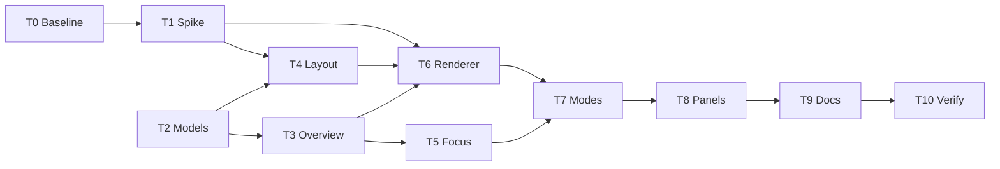

---

## 15. Acceptance criteria

All timings are measured on the `LargeSnapshot(apps: 400)` fixture (about 1,300 nodes) in current Chrome on a typical developer laptop, with WebGL on, unless stated otherwise.

| # | Criterion |
|---|-----------|
| AC1 | `libman.json` contains Cytoscape.js and no other graph library. No file under `wwwroot/lib/vis-network` remains |
| AC2 | Second visit to `/graph` in the same session: from navigation to `OnRenderComplete` in **under 2 s**. First visit (cold layout): **under 5 s**, or the fallback layout is shown with the info note |
| AC3 | Panning and zooming continuously holds **30 FPS or more** (DevTools FPS meter) |
| AC4 | Toggling any Overview filter (type group, scope, Only connected, Hide external) repaints in **under 150 ms** (`performance.now()` around `applyFilter`) |
| AC5 | Picking a resource in Search renders Focus mode in **under 500 ms**, and the canvas shows only the centre, its 1-hop neighbours, their parents, and aggregate nodes |
| AC6 | In Focus mode for `contoso-web`, the "Talks to" list shows each dependency grouped by category, with setting keys and no setting values |
| AC7 | Opening `graph?focus=<resource-id>` renders Focus mode without first rendering the Overview |
| AC8 | No edge has a text label in either mode. No per-node info icon is drawn |
| AC9 | Hovering or selecting a node fades **both** non-neighbour nodes and non-neighbour edges |
| AC10 | The serialized `GraphViewPayload` contains no resource IDs, tag keys or values, setting keys, or `references` (automated test) |
| AC11 | The Overview payload for the fixture is **at least 3x smaller** than the current full `GraphDocument` stream (measured in T0 and T10) |
| AC12 | With `GraphView:UseWebGl = false`, or when WebGL is unavailable, the graph renders and AC4 and AC5 still hold |
| AC13 | No CSP violations appear in the browser console on the Graph page |
| AC14 | Existing saved graph filters load without error, and their `NodeTypes`, scope, and toggles are honoured. The one exception: a filter saved before this release (no `FilterVersion`) loads with `OnlyConnected = true`. After the user turns it off and the filter is saved, it stays off across reloads |
| AC15 | All existing tests pass, and the new tests in [section 11.2](#112-automated-tests) pass |
| AC16 | Opening a copied link `graph?focus=<id>&expand=<id>` in a new window (same user) shows the same nodes and the same breadcrumb as the original view |
| AC17 | After Focus and then Expand, browser Back first removes the expansion and then returns to the Overview, with no full page reload and no change to the filters |
| AC18 | Every node type shows its Fluent UI glyph (white on the type colour, dark on grey for `External`). The repository contains no Azure architecture icons and no third-party logos. `wwwroot/lib/fluent-icons/LICENSE` exists |
| AC19 | Invalid, duplicate, or unknown `expand` values never cause an error. They are dropped, the user is told how many, and the URL is cleaned |

---

## 16. Open questions

### 16.1 Resolved

| # | Question | Answer | Where it is reflected |
|---|----------|--------|-----------------------|
| Q1 | Shareable Focus state in the URL? | **Yes** | [6.9](#69-url-contract), [7.8](#78-url-changes-back-forward-shared-link), AC16, AC17, AC19 |
| Q2 | Persist the Overview layout across restarts? | **No** | Non-goals, A2 |
| Q3 | Material Symbols or official Azure icons? | **Fluent UI System Icons (MIT).** The Azure icon terms are not an open-source license and do not allow redistribution in a public MIT repo | [5.5](#55-node-icons-fluent-ui-system-icons), AC18 |
| Q4 | Turn on Only connected once for existing users? | **Yes** (best judgement: the old default was off, so most saved values were never a deliberate choice, and orphan resources are the main clutter. The change is visible as a chip and can be undone permanently with one click) | [6.6](#66-changes-to-existing-types), [7.9](#79-saved-filter-migration-only-connected), AC14 |
| Q5 | Browser end-to-end tests? | **No** | Non-goals, [11](#11-testing) |
| Q6 | Group-by-resource-group mode? | **Not needed yet** | Non-goals |

### 16.2 Still open

None. Before the public release, fill in the placeholders `[year] [fullname]` in the repository `LICENSE.txt` (unrelated to this feature, noted while reviewing licensing).

---

## 17. Spike S1 results

Run on 2026-10-13 with throwaway code outside the repository. Machine: 32 cores, Intel UHD 770 (ANGLE D3D11), Chrome 154, .NET 10.0.12. Input: `Fixture.LargeSnapshot`. "Full" means every non-scope node with all non-`CONTAINS` edges (as with **Show child resources**). "Collapsed" means children merged into parents with dependency edges only (the default Overview).

**Verdict: GO for both.** Cytoscape.js 3.34.3 with WebGL, and MSAGL 1.1.6 MDS with the settings changes below.

### 17.1 Cytoscape.js 3.34.3 (S1a)

We loaded `dist/cytoscape.esm.min.mjs` (434,102 bytes, SHA-256 `C299A4D5DE7AF08DFA7813F8EEC4E2A2EF4F700F490F4505B408A0CE57E8E816`) as a local ES module, using the exact `Program.cs` CSP header. Positions came from MSAGL, with the `preset` layout and the [section 5.4](#54-visual-rules-cytoscape-style) style subset: circles, straight edges, triangle arrows, low-confidence opacity, and `min-zoomed-font-size`.

| Graph | Renderer | Create | First frame | Pan FPS | Zoom FPS | Drag via mouse events | Hover sweep | Hub highlight (batched classes) |
|-------|----------|--------|-------------|---------|----------|------------------------|-------------|---------------------------------|
| Full, 1,271 nodes, 2,212 edges | WebGL | 941 ms | 1,333 ms | 60 | 60 | 61 | 60 | 310 ms |
| Full | Canvas | 473 ms | 759 ms | 45 (9 long tasks, worst 90 ms) | 37 | 58 | 59 | 283 ms |
| Collapsed, 491 nodes, 1,356 edges | WebGL | 332 ms | 450 ms | 60 | 60 | n/a | n/a | 123 ms |
| Collapsed | Canvas | 194 ms | 291 ms | 56 | 53 | n/a | n/a | 181 ms |

- **CSP:** no `securitypolicyviolation` events and no console errors. The module contains no `eval` or `new Function`.
- **WebGL:** `renderer: { name: 'canvas', webgl: true }` adds a `webgl2` layer canvas without error. The library logs `webgl rendering enabled` to the console. This is expected noise, so mention it in M11.
- **Measuring FPS:** count animation frames while driving `cy.panBy` and `cy.zoom`, or synthetic `MouseEvent`s, inside the page. Playwright's CDP mouse input showed about 1 FPS for every Cytoscape case, including the idle canvas renderer. That is an artifact of the input path, not of the renderer. The T0 vis-network figure of 23 FPS used the CDP method, so compare against it with care. T10 uses the DevTools FPS meter (M3).
- **For T6:** hub highlight takes 120 to 310 ms when every element gets a class. Toggle `faded` only on elements whose state changes, or put the class on the container plus a `keep` class on the neighbourhood. `HoverHighlightMaxElements` (4,000) stays as the safety valve.

### 17.2 MSAGL 1.1.6 MDS on .NET 10 (S1b)

The package restores and runs on `net10.0` (it targets `netstandard2.0`). Output is finite, deterministic (identical on repeat runs, within 1e-3), and has no overlapping nodes (no pair closer than 2r) in every run.

| Settings | 400 full (1,271) | 400 collapsed (491) | 1200 full (3,811) | 1200 collapsed (1,471) |
|----------|------------------|---------------------|-------------------|------------------------|
| Defaults | 8.8 s (cold 11.2 s) | 2.0 s | 21.0 s | 15.5 s |
| `EdgeRoutingMode.None` | 6.2 s | 0.92 s | 1.0 s | 8.0 s |
| `EdgeRoutingMode.None` + `IterationsWithMajorization = 0` | 0.41 s | 0.11 s | 1.2 s | 0.23 s |
| `EdgeRoutingMode.None` + `RemoveOverlaps = false` | 5.8 s, 1,288 overlaps | 0.92 s, 328 overlaps | 0.3 s | 7.9 s |

Findings:

- The defaults route edges (`SugiyamaSplines`) that we never draw. With `EdgeRoutingMode.None` the node positions are **identical** (maximum delta 0) and the run is about 40% faster.
- Stress majorization is the main cost. MSAGL skips it on its own above `CallIterationsWithMajorizationThreshold` (default 3,000 nodes), which is why 3,811 nodes is faster than 1,471.
- Keep `RemoveOverlaps = true`. It is cheap, and without it hundreds of nodes overlap.
- Quality: with majorization, clusters are even and edges are short ([screenshot](mockups/graph-spike-s1-mds-majorization.png)). Pivot-only MDS is readable, with no overlaps, but it has longer edges and looser clusters ([screenshot](mockups/graph-spike-s1-mds-pivot-only.png)). Both show the SendGrid hub at the centre of its consumers.

**For T4:** in `ComputeMsagl`, set `EdgeRoutingSettings.EdgeRoutingMode = None` and `CallIterationsWithMajorizationThreshold = 1000`. This keeps majorization for typical collapsed Overviews (under about 1 s at 491 nodes) and drops to pivot-only above 1,000 nodes, so every measured case finishes in 1.2 s or less. That is well within AC2's 5 s cold budget and the 10 s `LayoutTimeoutSeconds`. Section 6.3's usage note otherwise holds. Risk R2 is retired. The Cytoscape `cose` fallback is not needed.
