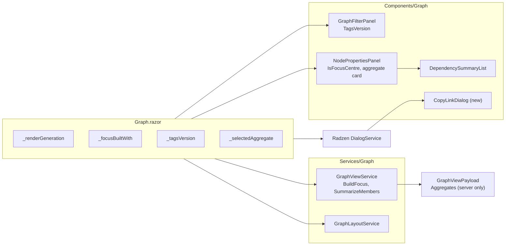
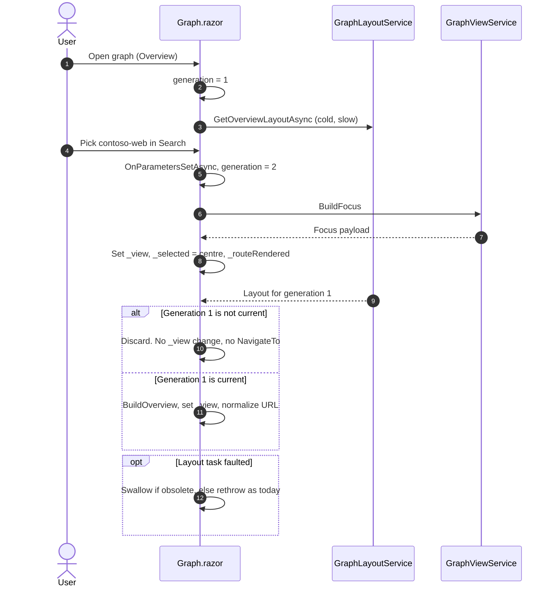
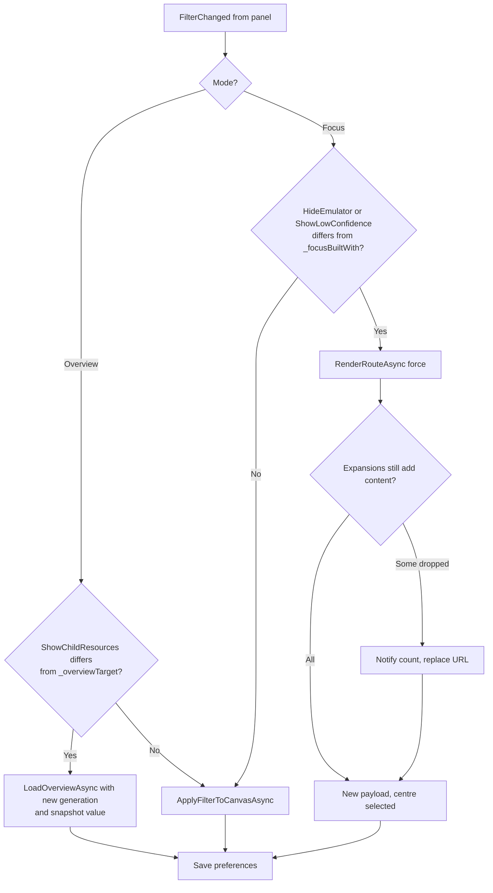
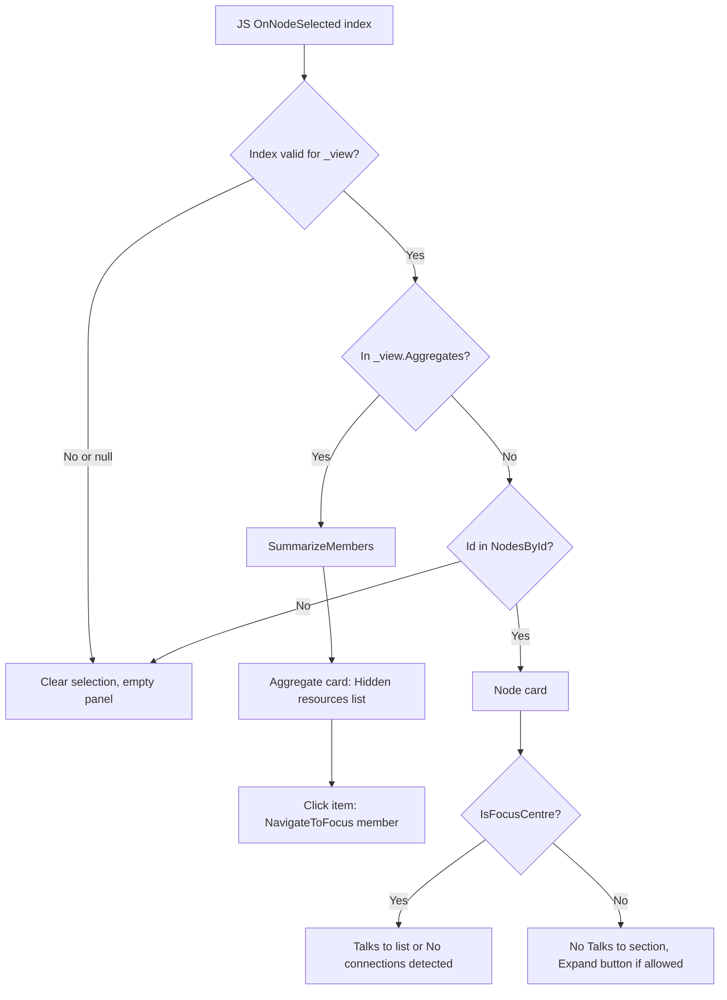
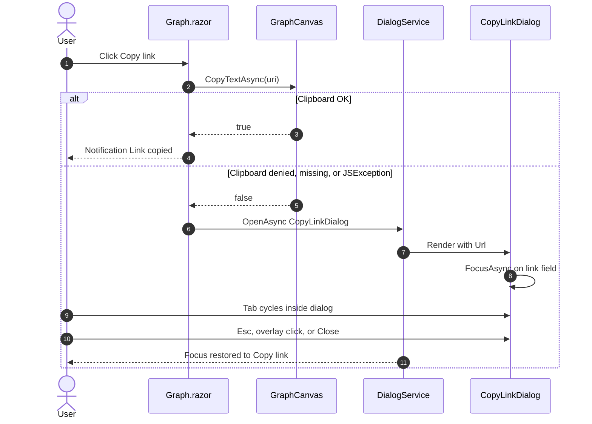
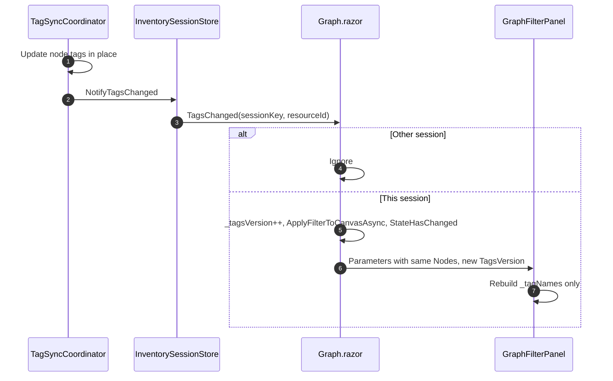
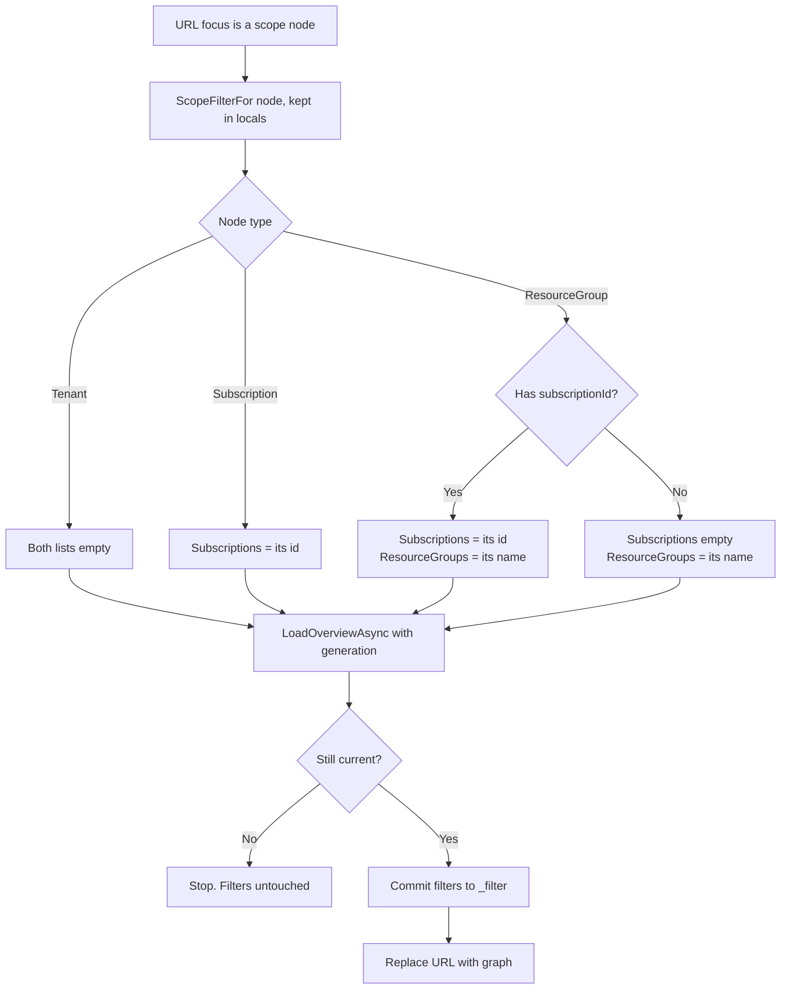
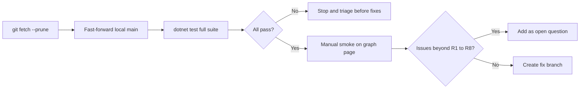
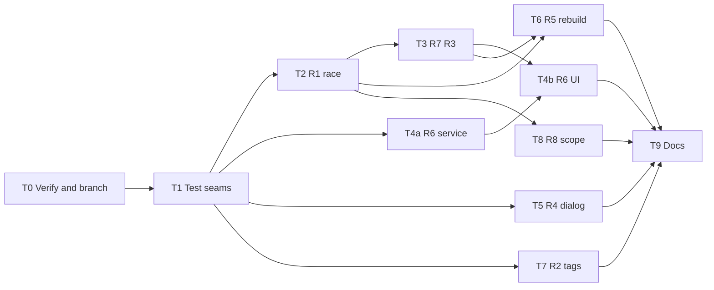

# Knowledge Graph Review Fixes Plan: Post-merge Check and PR #1 Copilot Review Follow-ups

> **Status:** Implemented (T1 to T8 code, tests, and docs; committed as one commit instead of one per task). Before closing T9, these remain: manual checks M2 to M9 against a signed-in test tenant, and the replies on the PR #1 review threads (see T9).
> **Scope:** Post-merge verification of PR #1, plus the eight Copilot review findings on the Graph page (`Graph.razor`, its panels, `GraphViewService`, tests, docs)
> **Related docs:** [Knowledge-Graph-Performance-UX-Plan.md](Knowledge-Graph-Performance-UX-Plan.md) (the feature that PR #1 delivered), [screen-descriptions.md](screen-descriptions.md), [SecurityReview.md](SecurityReview.md)

All examples use made-up names (`contoso-web`, `contoso-sql`, `rg-shop`). This repository is public, so real organization identifiers, hosts, keys, or setting values must never be added to this document, to tests, or to fixtures. Resource IDs below use placeholders such as `<sub-id>`.

---

## Table of Contents

1. [Summary](#1-summary)
2. [Goals and non-goals](#2-goals-and-non-goals)
3. [Decisions](#3-decisions)
4. [Current state](#4-current-state)
5. [Proposed design](#5-proposed-design)
6. [Contracts](#6-contracts)
7. [Process flows](#7-process-flows)
8. [File-by-file changes](#8-file-by-file-changes)
9. [Error handling and edge cases](#9-error-handling-and-edge-cases)
10. [Security and privacy](#10-security-and-privacy)
11. [Test plan](#11-test-plan)
12. [Risks and mitigations](#12-risks-and-mitigations)
13. [Implementation tasks](#13-implementation-tasks)
14. [Acceptance criteria](#14-acceptance-criteria)
15. [Open questions](#15-open-questions)

---

## 1. Summary

PR #1 (`feature/knowledge-graph-performance-ux`) was merged into `main` as merge commit `246fb12`. **No merge conflict exists.** The merge commit's tree is identical to the branch tip `f6f8f6b`, so every line of the branch is on `main` unchanged. The test suite passes on that tree (387 passed, 0 failed, 1 skipped by design). See [section 4.1](#41-merge-status-feature-1).

The GitHub Copilot review left **eight findings** (R1 to R8) on the merged PR. All eight were checked against the code and are real. They fall into four groups:

| Group | Findings | Effect for the user |
|-------|----------|---------------------|
| Navigation race | R1 | A slow Overview layout can overwrite a newer Focus view and remove `focus` from the URL |
| Wrong or missing panel content | R3, R6, R7 | "Talks to" shown under the wrong resource. Clicking `+60 more apps` shows an empty panel. Opening a Focus link shows an empty panel |
| Stale filter results | R2, R5, R8 | Tag autocomplete misses new tags. Focus-mode switches cannot bring nodes back. A resource-group link shows same-named groups from other subscriptions |
| Accessibility | R4 | The "Copy graph link" fallback is announced as a modal but does not hold keyboard focus |

The fixes ship as **one follow-up PR** off `main`, with one commit per task in [section 13](#13-implementation-tasks). Each commit is mapped to its review thread.

---

## 2. Goals and non-goals

### 2.1 Goals

| # | Goal | Measured by |
|---|------|-------------|
| G1 | Confirm that `main` works after the PR #1 merge | Build and the full test suite pass on `origin/main`, plus the manual smoke checklist in [11.3](#113-manual-verification) |
| G2 | Fix all eight review findings | AC1 to AC8 in [section 14](#14-acceptance-criteria) |
| G3 | Each fix has a regression test | New tests in [11.2](#112-automated-tests) fail on today's `main` and pass after the fix |
| G4 | Keep PR #1 behaviour that the review did not question | All 387 existing tests still pass. The browser payload still has no resource IDs ([GraphViewServiceTests.cs](../BlazorAzureInventory.Tests/GraphViewServiceTests.cs) `Payload_contains_no_ids_tags_or_references`) |

### 2.2 Non-goals

- Re-doing or re-resolving the merge. There is nothing to resolve ([4.1](#41-merge-status-feature-1)).
- New features beyond what each finding needs. For example, there is no "Talks to" list for nodes other than the Focus centre, and no new filter options.
- Changing the JavaScript renderer ([graph-view.js](../BlazorAzureInventory/wwwroot/js/graph-view.js)). Every fix is server-side or Razor-side. See D6.
- Highlighting the auto-selected Focus centre in the canvas (R7 only asks for the panel). See D7.
- Saving scope-focus filter changes to user preferences. `ApplyScopeFocus` does not save today, and that does not change.
- Fixing a JS selection callback that refers to an old payload index after a new payload is installed (pre-existing, not raised in the review). It is listed under risks.
- Browser end-to-end tests. As in the parent plan, coverage comes from xUnit, bUnit, and the manual checklist.

---

## 3. Decisions

### 3.1 Decisions agreed with the requester

| # | Decision | Rejected alternative | Why |
|---|----------|----------------------|-----|
| D1 | Feature 1 is **verification only**: record that there is no conflict, and run build, tests, and a smoke check on `main` | Write a conflict-resolution playbook | User: "drop it" and "I just want to check if my branch is still working and there are no issues after merge" |
| D2 | If a conflict ever appears before the follow-up PR merges, **the PR #1 branch's version takes precedence** | Take `main`'s version | User: "I want my branch changes to take precedence". It already does: the merged tree equals the branch tip |
| D3 | Deliver all fixes as **one PR** off `main`, with one commit per task | Several small PRs | User choice (`one-pr`) |

### 3.2 Decisions made on the requester's behalf (change if wrong)

| # | Decision | Rejected alternative | Why |
|---|----------|----------------------|-----|
| D4 | **R1:** Use a per-page **request generation counter**. Each route render or Overview reload takes a number. After every `await`, it publishes `_view` or rewrites the URL only if its number is still the latest | (a) A `SemaphoreSlim` to serialize renders. (b) A `CancellationTokenSource` only | (a) Focus would then wait for a cold Overview layout. That breaks `GraphPage_focus_query_builds_focus_payload_without_waiting_for_overview_layout` in [GraphPageTests.cs](../BlazorAzureInventory.Tests/GraphPageTests.cs) and AC7 of the parent plan. (b) The layout task can finish in the same instant as the cancel, so a check after the `await` is still needed. The counter alone is enough and simpler |
| D5 | **R2:** Add a `TagsVersion` integer parameter to `GraphFilterPanel`. Rebuild tag suggestions when `Nodes` *or* `TagsVersion` changes. Rebuild node-search options only when the `Nodes` reference changes | (a) Rebuild tag names on every `OnParametersSet`. (b) Hand the panel a new `Nodes` list on each tag change | (a) Runs a regex over every tag of every node on every parent render, including each node click. (b) `GraphDocument.Nodes` is shared session state, and copying it would also rebuild the search options for no reason |
| D6 | **R5:** When `HideEmulator` or `ShowLowConfidence` changes in Focus mode, **rebuild the Focus payload on the server**. Other filter changes stay client-side. The JS stays unchanged | Also apply the emulator filter in the browser in Focus mode | `BuildFocus` already drops these nodes and edges and derives parents, aggregates, and `+N` counts from what is left. A browser-only filter would hide nodes but leave those values wrong |
| D7 | **R7:** When a Focus payload is installed, set `_selected` to the focus centre on the server only. Do not change JS selection | Add a JS `select(index)` export to highlight it | The review only asks for the panel. In Focus mode the whole canvas is already the centre's neighbourhood, so a highlight adds little. Keeps the JS untouched (D6) |
| D8 | **R3:** Show "Talks to" **only** for the Focus centre. Compare IDs **without regard to case** | Compute "Talks to" for whichever node is selected | Matches the review and is the smallest change. The question was left unanswered, so the recommended default applies. The ID check must ignore case because `GraphFocusRoute.Focus` keeps the URL's casing ([GraphFocusRoute.cs](../BlazorAzureInventory/Services/Graph/GraphFocusRoute.cs)) while [GraphIndex.NodesById](../BlazorAzureInventory/Models/Graph/GraphModels.cs#L65) ignores case |
| D9 | **R6:** Selecting an aggregate node lists **all** hidden resources, sorted by label, using the existing `DependencySummaryList`. Each item is clickable and focuses that resource | (a) Show only the first 200. (b) Show only the count | Matches the parent plan, [Knowledge-Graph-Performance-UX-Plan.md line 822](Knowledge-Graph-Performance-UX-Plan.md): "Selecting the aggregate lists the hidden items in the panel". The question was left unanswered, so the recommended default applies |
| D10 | **R6:** Keep aggregate membership **on the server only**, as a `[JsonIgnore]` property on `GraphViewPayload`, keyed by payload node index | Send the member list to the browser | The payload contract keeps resource IDs on the server. See the comment on [GraphViewPayload](../BlazorAzureInventory/Models/Graph/GraphViewModels.cs#L7) and [section 10](#10-security-and-privacy) |
| D11 | **R4:** Replace the hand-made overlay with a Radzen `DialogService` dialog (`CopyLinkDialog`). Open it with `AutoFocusFirstElement = false` and focus the link field from the component | (a) A native `<dialog>` with `showModal()` and new JS. (b) A hand-written focus trap | The review asks for "the existing dialog infrastructure". `DialogService` is already used across the app, for example in [Inventory.razor](../BlazorAzureInventory/Components/Pages/Inventory.razor#L323). Radzen.Blazor 12.0.5 already traps Tab inside the dialog, closes on Esc, and puts focus back on the element that opened it (see [4.4](#44-radzen-dialog-behaviour-verified-in-the-package)) |
| D12 | **R8:** A resource-group scope focus sets **both** `Subscriptions = [subscriptionId]` and `ResourceGroups = [name]`. If the node has no `subscriptionId`, fall back to today's name-only filter | Match resource groups by full ARM ID | The JS filter combines both lists with AND ([graph-view.js](../BlazorAzureInventory/wwwroot/js/graph-view.js#L159)), so setting both is enough. Matching by ID would change the payload contract (`rgs` holds lower-case names) and the filter-panel facets |
| D13 | **R5:** After a Focus rebuild, expansions that no longer add content are dropped, the user is told how many, and the URL is replaced. This is the existing code path | Keep invalid expansions in the URL | Reuses the tested behaviour of `GraphPage_unknown_expansion_is_removed_from_url` |

---

## 4. Current state

### 4.1 Merge status (feature 1)

Verified on 2026-10-15 with `git fetch origin --prune`:

| Fact | Evidence |
|------|----------|
| PR #1 is merged | `origin/main` = `246fb12 Merge pull request #1 from <owner>/feature/knowledge-graph-performance-ux`. Its parents are `a2c5e3a` (previous `main`) and `f6f8f6b` (branch tip) |
| The merge changed nothing on the branch | `git rev-parse HEAD^{tree}` and `git rev-parse origin/main^{tree}` both return `2e84fbf...`. `git diff --stat HEAD origin/main` is empty |
| A colleague's commits were already in the branch | `a2c5e3a`, `ff1cbc1`, and `36c79bf` are in the first-parent history of `f6f8f6b` |
| The remote branch is gone | `git fetch --prune` reports `[deleted] origin/feature/knowledge-graph-performance-ux` |
| The local `main` is stale | `git branch -vv` shows `main ... [origin/main: behind 3]` |
| Tests pass on the merged tree | `dotnet test BlazorAzureInventory.Tests\BlazorAzureInventory.Tests.csproj`: **Passed 387, Failed 0, Skipped 1**. The skip is the perf test gated by `RUN_PERF_TESTS` ([GraphLayoutServiceTests.cs line 277](../BlazorAzureInventory.Tests/GraphLayoutServiceTests.cs#L277)) |

**Conclusion:** your branch's changes already take precedence (D2). The only remaining feature-1 work is the manual smoke check ([11.3](#113-manual-verification)) and updating the local repository (task T0).

### 4.2 Review findings, checked against the code

Review threads are on PR #1 in this repository. The ID is the `discussion_r…` anchor.

| # | Thread | Location | Root cause, confirmed in code |
|---|--------|----------|-------------------------------|
| R1 | `r4288751908` | [Graph.razor `LoadOverviewAsync`](../BlazorAzureInventory/Components/Pages/Graph.razor#L504), [`RenderRouteAsync`](../BlazorAzureInventory/Components/Pages/Graph.razor#L402) | `LoadOverviewAsync` awaits `GetOverviewLayoutAsync(..., CancellationToken.None)` and then assigns `_view` without checking. The callers then call `NavigateToRoute(null, replace: true)`. At line 424 this happens whenever the *current* `Focus` or `Expand` query value is set, and at lines 433 and 442 it happens unconditionally. Nothing guards against a newer request: no counter, lock, or token. The only guard is the equality check at line 406 |
| R2 | `r4288751949` | [GraphFilterPanel.razor `OnParametersSet`](../BlazorAzureInventory/Components/Graph/GraphFilterPanel.razor#L132) | An early return when `Nodes` is the same reference skips rebuilding `_tagNames`. [TagSyncCoordinator.Apply](../BlazorAzureInventory/Services/Tags/TagSyncCoordinator.cs) changes `node.Data[TagKeys.Tags]` in place, and [Graph.razor `OnTagsChanged`](../BlazorAzureInventory/Components/Pages/Graph.razor#L327) only calls `ApplyFilterToCanvasAsync` and `StateHasChanged` |
| R3 | `r4288751991` | [NodePropertiesPanel.razor](../BlazorAzureInventory/Components/Graph/NodePropertiesPanel.razor#L111) | `@if (Dependencies is { Count: > 0 })` renders for *any* selected node. `_dependencies` is always the centre's summary ([Graph.razor line 470](../BlazorAzureInventory/Components/Pages/Graph.razor#L470)). The `node.Id != FocusId` and `Node.Id == FocusId` checks at lines 93 and 115 compare with case, but `FocusId` comes from the URL |
| R4 | `r4288752008` | [Graph.razor lines 77 to 89](../BlazorAzureInventory/Components/Pages/Graph.razor#L77) | The markup has `role="dialog" aria-modal="true"` but nothing moves focus, keeps it inside, or restores it. The styles are in [app.css lines 83 to 86](../BlazorAzureInventory/wwwroot/app.css#L83) |
| R5 | `r4288752037` | [Graph.razor `ApplyFilterAsync`](../BlazorAzureInventory/Components/Pages/Graph.razor#L199) | In Focus mode every filter change goes to `ApplyFilterToCanvasAsync`. [BuildFocus](../BlazorAzureInventory/Services/Graph/GraphViewService.cs#L75) drops emulator nodes and low-confidence edges ([CollectFocusHop](../BlazorAzureInventory/Services/Graph/GraphViewService.cs#L289)), so they cannot come back. JS skips all node filters in Focus mode ([graph-view.js line 159](../BlazorAzureInventory/wwwroot/js/graph-view.js#L159)) |
| R6 | `r4288752077` | [Graph.razor `OnNodeSelected`](../BlazorAzureInventory/Components/Pages/Graph.razor#L294), [GraphViewService.cs line 336](../BlazorAzureInventory/Services/Graph/GraphViewService.cs#L336) | Aggregate nodes get synthetic IDs `aggregate:<center-id>:<category>` that are not in `NodesById`, so `_selected` becomes `null`. Hidden members are discarded after `sorted.Take(maxNeighbours)` |
| R7 | `r4288752124` | [Graph.razor lines 468 to 470](../BlazorAzureInventory/Components/Pages/Graph.razor#L468) | `Load()` clears `_selected` ([line 189](../BlazorAzureInventory/Components/Pages/Graph.razor#L189)). JS `render` sets `selectedNode = null` and does not call back ([graph-view.js line 101](../BlazorAzureInventory/wwwroot/js/graph-view.js#L101)) |
| R8 | `r4288752168` | [Graph.razor `ApplyScopeFocus`](../BlazorAzureInventory/Components/Pages/Graph.razor#L486) | For a resource group it sets `Subscriptions = []` and `ResourceGroups = [name]`. JS matches resource groups by lower-case name only ([graph-view.js line 164](../BlazorAzureInventory/wwwroot/js/graph-view.js#L164)). Resource-group nodes do carry `subscriptionId` ([InventoryGraphBuilder.cs line 139](../BlazorAzureInventory/Services/Graph/InventoryGraphBuilder.cs#L139)) |

### 4.3 Components involved

| Component | Role today | Link |
|-----------|-----------|------|
| `Graph.razor` | Page. Parses `focus` and `expand`, builds payloads, owns selection, filters, copy link | [Graph.razor](../BlazorAzureInventory/Components/Pages/Graph.razor) |
| `GraphCanvas.razor` | JS interop wrapper (`render`, `applyFilter`, `center`, `copyText`) | [GraphCanvas.razor](../BlazorAzureInventory/Components/Graph/GraphCanvas.razor) |
| `GraphFilterPanel.razor` | Search, scope, types, tags, Advanced switches | [GraphFilterPanel.razor](../BlazorAzureInventory/Components/Graph/GraphFilterPanel.razor) |
| `NodePropertiesPanel.razor` | Selected node or edge details, Focus and Expand buttons, "Talks to" | [NodePropertiesPanel.razor](../BlazorAzureInventory/Components/Graph/NodePropertiesPanel.razor) |
| `DependencySummaryList.razor` | Grouped, clickable list with a `Title` parameter (default "Talks to") | [DependencySummaryList.razor](../BlazorAzureInventory/Components/Graph/DependencySummaryList.razor) |
| `GraphViewService` | `BuildOverview`, `BuildFocus`, `MatchTag`, `SummarizeDependencies` | [GraphViewService.cs](../BlazorAzureInventory/Services/Graph/GraphViewService.cs) |
| `GraphLayoutService` | Cached Overview layout per session (`Lazy<Task<GraphLayout>>` on a worker thread) | [GraphLayoutService.cs](../BlazorAzureInventory/Services/Graph/GraphLayoutService.cs#L44) |
| `GraphViewCache` | Holds the cached `Collapsed` and `Expanded` layouts. It is `internal` and its setters are writable, which gives tests a seam ([InternalsVisibleTo](../BlazorAzureInventory/BlazorAzureInventory.csproj)) | [GraphLayoutService.cs line 286](../BlazorAzureInventory/Services/Graph/GraphLayoutService.cs#L286) |
| `GraphQueryService.GetFacets` | Subscription facet key is `subscriptionId`, resource-group facet key is the lower-case name | [GraphQueryService.cs](../BlazorAzureInventory/Services/Graph/GraphQueryService.cs#L30) |

### 4.4 Radzen dialog behaviour (verified in the package)

The app references `Radzen.Blazor` 12.0.5 ([csproj](../BlazorAzureInventory/BlazorAzureInventory.csproj)), and `<RadzenComponents />` is in [MainLayout.razor](../BlazorAzureInventory/Components/Layout/MainLayout.razor). The package's `staticwebassets/Radzen.Blazor.js` was read directly:

| Behaviour | Where in `Radzen.Blazor.js` |
|-----------|-----------------------------|
| Remembers `document.activeElement` as the element that opened the dialog | `openDialog` (`Radzen.dialogInvokerElement`) |
| Keeps Tab inside the dialog | `openDialog` adds a `keydown` listener `Radzen.focusTrap` on the dialog root |
| Focuses the first focusable element after a 500 ms timer when `autoFocusFirstElement` is set. The default is `true` (`DialogOptions.AutoFocusFirstElement` XML doc) | `openDialog`, `focusFirstFocusableElement` |
| Closes on Esc when `closeDialogOnEsc` is set | `openDialog` and `closePopupOrDialog` |
| Puts focus back on the opener when the last dialog closes | `closeDialog` and `restoreDialogInvokerFocus` |

That the dialog element has `role="dialog"` and `aria-modal="true"` was **(assumed)** when this plan was written. **Confirmed in T5:** the `CopyLinkDialog_focuses_link_field` test finds `role="dialog"` with `aria-modal="true"` around the link field in the rendered `RadzenDialog` markup.

---

## 5. Proposed design

### 5.1 Structure



### 5.2 R1: Request generation

- Add `private int _renderGeneration;` to `Graph.razor`.
- `RenderRouteAsync` increments it **after** the "unchanged route" early return at [line 406](../BlazorAzureInventory/Components/Pages/Graph.razor#L406). That way a no-op `OnParametersSetAsync` does not cancel an Overview load that is still running.
- `LoadOverviewAsync` takes the generation **and a snapshot of `showChildResources`**. Today it reads the mutable `_filter.ShowChildResources` both before and after the `await` ([Graph.razor lines 507 and 508](../BlazorAzureInventory/Components/Pages/Graph.razor#L507)). With the snapshot, the layout and the projection always use the same value. It returns `false` and assigns nothing when its generation is no longer current after the `await`.
- Every caller returns at once on `false`. That skips `_routeRendered = true`, every `NavigateToRoute(..., replace: true)` (lines 424, 433, 442, 475), and the scope-filter commit (5.9).
- **Child-resource toggles:** add `private bool? _overviewTarget;`. It holds the `showChildResources` value of the newest Overview load, whether in flight or published, and is cleared when Focus is published. Change the `ApplyFilterAsync` condition from "differs from the published `_overviewShowsChildren` and `_view is not null`" ([line 201](../BlazorAzureInventory/Components/Pages/Graph.razor#L201)) to `_route is null && _session is not null && _filter.ShowChildResources != _overviewTarget`. Each such change starts a new generation. So turning the switch on and then off quickly ends with the "off" load as current, and a toggle during the first load is no longer ignored.
- `Dispose()` increments the counter, so late continuations on a disposed page do nothing.
- If the layout task faults and the request is no longer current, swallow the fault. If the request is current, keep today's behaviour and let the exception propagate.

### 5.3 R2: Tag suggestions

- `GraphFilterPanel` gets `[Parameter] public int TagsVersion`, plus private `_cachedTagsVersion`.
- In `OnParametersSet`, rebuild `_nodeOptions` only when `Nodes` is a new reference, as today. Rebuild `_tagNames` when `Nodes` is new **or** `TagsVersion != _cachedTagsVersion`.
- `Graph.razor` keeps `private int _tagsVersion;`, increments it in `OnTagsChanged` before `StateHasChanged()`, and passes `TagsVersion="@_tagsVersion"`.
- Add `internal object TagNamesInstance => _tagNames;` for tests, like the existing `NodeOptionsInstance`.

### 5.4 R3: "Talks to" only for the Focus centre

- Add `private bool IsFocusCentre` to `NodePropertiesPanel`. It is true when `IsFocusMode`, `Node` and `FocusId` are both set, and the IDs match without regard to case.
- Render `DependencySummaryList` only when `IsFocusCentre && Dependencies is { Count: > 0 }`. Show "No connections detected." only when `IsFocusCentre` and the list is empty.
- The Expand button condition `node.Id != FocusId` ([line 93](../BlazorAzureInventory/Components/Graph/NodePropertiesPanel.razor#L93)) becomes `!IsFocusCentre`. This is the same casing bug.
- Fix [screen-descriptions.md line 372](screen-descriptions.md), which says "the 'Talks to' list for the selected node", to say "for the Focus centre".

### 5.5 R4: Copy link dialog

- New `Components/Graph/CopyLinkDialog.razor` with a `Url` parameter. It contains the explanation text, a read-only `<input>` (`aria-label="Graph link"`), and a **Close** button that calls `DialogService.Close()`. In `OnAfterRenderAsync(firstRender)` it calls `ElementReference.FocusAsync()` on the input.
- `Graph.razor` injects `DialogService`. When the copy fails, it opens the dialog through `DialogService.OpenAsync<CopyLinkDialog>` with the title "Copy graph link" and the options in [6.5](#65-copy-link-dialog).
- Remove `_copyUrl`, the inline overlay markup (lines 77 to 89), and the `.graph-copy-*` rules in [app.css](../BlazorAzureInventory/wwwroot/app.css#L83). Keep or move only `input { width: 100% }`.

### 5.6 R5: Rebuild Focus when server-side filters change

- Add `private (bool HideEmulator, bool ShowLowConfidence)? _focusBuiltWith;`. Set it wherever a Focus payload is assigned, and clear it when Overview is assigned.
- `ApplyFilterAsync` gets a new branch for Focus mode (`_route is not null`) when `_focusBuiltWith` differs from the current filter values: call `RenderRouteAsync(force: true)`. All other changes keep calling `ApplyFilterToCanvasAsync()`. Saving preferences is unchanged.
- A forced render goes through `Load()`, which clears the selection. R7 then selects the centre again.

### 5.7 R6: Aggregate membership and selection

- `CollectFocusHop` keeps, for each aggregate it creates, the hidden candidates `sorted.Skip(visible.Count)`. For each member it stores the member ID **and the representative edge** that made it a candidate (`candidate.Edges[0]`, the same choice `CollectFocusHop` already uses for the aggregate edge). This edge may be a dependency edge (`CONNECTS_TO`, `REFERENCES_SECRET`, `PULLS_IMAGE_FROM`) or a structural one (`HAS_SLOT` or a child edge). Recording it at collection time avoids searching for it later and gives a fixed order. `FocusHop` carries these lists keyed by aggregate ID.
- `BuildFocus` maps them to payload indexes **only for aggregates that were actually added** (the node cap may drop some). It then **reconciles each list against the final node set**: an expansion hop can add a node that an earlier hop hid. Members already in the payload are removed, and the aggregate label is rebuilt from the remaining count (`+{count} more {category}`). If no members remain, drop the aggregate node and its aggregate edge. The result is exposed as `GraphViewPayload.Aggregates` (`[JsonIgnore]`).
- New `GraphViewService.SummarizeMembers(...)` returns one `DependencyGroup` with a `DependencyItem` for each member that is still in the index. `EdgeType`, `SettingKeys`, and `Confidence` come from the stored representative edge. A structural edge gives empty `SettingKeys` and a `null` `Confidence`.
- `Graph.razor` `OnNodeSelected` **first sets `_selectedAggregate = null`**, then checks `_view.Aggregates`. If the index is an aggregate, it sets `_selectedAggregate` and clears `_selected`. Otherwise it goes on as today. `OnEdgeSelected`, `Load`, and `LoadOverviewAsync` also clear `_selectedAggregate`. Both values are passed to the panel.
- `NodePropertiesPanel` gets a new branch, checked before the empty state: a card that shows the aggregate label and the text "Not shown in this Focus view.", plus `DependencySummaryList` with `Title="Hidden resources"` and `OnSelect="@OnFocus"`. Clicking an item focuses that resource. The card has no Focus, Expand, or Open details buttons.

### 5.8 R7: Select the centre

- In `RenderRouteAsync`, next to `_view = view;`, set `_selected = focusNode;` and clear `_selectedEdge`, `_selectedEdges`, and `_selectedAggregate`.

### 5.9 R8: Scope focus on a resource group

- `ApplyScopeFocus` reads `subscriptionId` and `resourceGroup` from the node. It sets `Subscriptions = [subscriptionId]` when that value is present, or `[]` when it is not, and sets `ResourceGroups = [resourceGroup]`. The subscription and tenant branches do not change (see Q1).
- **Commit the filters only if the request is still current.** Today `ApplyScopeFocus` changes `_filter` *before* the Overview `await` ([Graph.razor line 439](../BlazorAzureInventory/Components/Pages/Graph.razor#L439)). If a newer Focus request wins in the meantime, the abandoned scope filter would stay. Change it into a pure function, `ScopeFilterFor(GraphNode) -> (List<string>? Subscriptions, List<string>? ResourceGroups)`, where `null` means "leave unchanged". Call it before the `await` and assign `_filter` only after `LoadOverviewAsync` returns `true`. The assignment runs before the next render, so `OnRenderedAsync` → `ApplyFilterToCanvasAsync` ([Graph.razor line 339](../BlazorAzureInventory/Components/Pages/Graph.razor#L339)) sends it to the canvas with the new payload.

---

## 6. Contracts

No configuration keys, CLI parameters, routes, or payload JSON fields are added or changed.

### 6.1 `GraphViewModels.cs` additions

```csharp
/// <summary>One hidden neighbour and the edge that made it a candidate. Server only.</summary>
public sealed record AggregateMember(string NodeId, GraphEdge Edge);

/// <summary>Hidden neighbours behind one "+N more" node, reconciled against the final payload. Server only.</summary>
public sealed record AggregateMembership(
    string CenterId,                         // focus centre or expanded node the aggregate hangs off
    string Category,                         // NodeCategories value, e.g. "Apps"
    IReadOnlyList<AggregateMember> Members); // ordered by label then ID (same order as BuildFocus); never in the payload

public sealed record GraphViewPayload(...)  // unchanged positional members
{
    // existing NodeIds, EdgeSources
    [JsonIgnore] public IReadOnlyDictionary<int, AggregateMembership> Aggregates { get; init; }
        = new Dictionary<int, AggregateMembership>();   // payload node index -> membership; empty in Overview
}
```

### 6.2 `GraphViewService` additions

```csharp
/// <summary>Lists the members of an aggregate as one group; setting keys only, never values.</summary>
public IReadOnlyList<DependencyGroup> SummarizeMembers(GraphIndex index, AggregateMembership membership);
```

Sample (sanitized): the centre is `sendgrid`, and 2 of 62 apps are hidden.

| Input `membership` | Output |
|--------------------|--------|
| `CenterId = "<sub-id>/.../sendgrid"`, `Category = "Apps"`, `Members = [ (NodeId: "<sub-id>/.../contoso-web-61", Edge: CONNECTS_TO, reference key SendGrid:ApiKeyName, confidence High), (NodeId: "<sub-id>/.../contoso-web-62", ...) ]` | `[ DependencyGroup("Apps", [ DependencyItem(NodeId: "<…>/contoso-web-61", Label: "contoso-web-61", Type: "WebApp", EdgeType: "CONNECTS_TO", SettingKeys: "SendGrid:ApiKeyName", Confidence: "High"), DependencyItem(... "contoso-web-62" ...) ]) ]` |

Members that are missing from `index.NodesById` are skipped. An empty `Members` list returns `[]`. A structural representative edge (for example `HOSTS_DATABASE`) gives `SettingKeys = ""` and `Confidence = null`.

### 6.3 Component parameters

| Component | Parameter | Type | Default | Change |
|-----------|-----------|------|---------|--------|
| `GraphFilterPanel` | `TagsVersion` | `int` | `0` | New |
| `NodePropertiesPanel` | `AggregateLabel` | `string?` | `null` | New. Heading of the aggregate card |
| `NodePropertiesPanel` | `AggregateMembers` | `IReadOnlyList<DependencyGroup>?` | `null` | New. Its presence selects the aggregate card |
| `CopyLinkDialog` | `Url` | `string` | `""` (`EditorRequired`) | New component |

### 6.4 `Graph.razor` private members

| Member | Type | Purpose |
|--------|------|---------|
| `_renderGeneration` | `int` | R1. The latest request number |
| `LoadOverviewAsync(InventorySession session, bool showChildResources, int generation)` | `Task<bool>` | R1. Changed signature. `false` means the result was discarded |
| `_overviewTarget` | `bool?` | R1. `showChildResources` of the newest Overview load (in flight or published). `null` in Focus |
| `ScopeFilterFor(GraphNode node)` | `(List<string>? Subscriptions, List<string>? ResourceGroups)` (static) | R8. Replaces the side-effecting `ApplyScopeFocus`. `null` means leave unchanged |
| `_focusBuiltWith` | `(bool HideEmulator, bool ShowLowConfidence)?` | R5. The filter values used to build the current Focus payload |
| `_tagsVersion` | `int` | R2. Incremented when tags change |
| `_selectedAggregate` | `(string Label, IReadOnlyList<DependencyGroup> Members)?` | R6 |
| `_copyUrl` | `string?` | R4. **Removed** |

### 6.5 Copy link dialog

```csharp
await DialogService.OpenAsync<CopyLinkDialog>("Copy graph link",
    new Dictionary<string, object?> { [nameof(CopyLinkDialog.Url)] = uri },
    new DialogOptions { Width = "32rem", AutoFocusFirstElement = false, CloseDialogOnEsc = true, CloseDialogOnOverlayClick = true });
```

`AutoFocusFirstElement = false` matters. Otherwise Radzen's 500 ms timer moves focus from the link field to the title-bar close button.

### 6.6 Git and test commands (feature 1 and validation)

| Purpose | Command |
|---------|---------|
| Update refs | `git fetch origin --prune` |
| Update the local `main` | `git switch main` then `git merge --ff-only origin/main` |
| Remove the merged local branch | `git branch -d feature/knowledge-graph-performance-ux` |
| Create the follow-up branch | `git switch -c fix/graph-review-followups` |
| Check that the tree equals a reference | `git rev-parse "HEAD^{tree}"` and compare with `git rev-parse "f6f8f6b^{tree}"`. They are equal until the first fix commit |
| Run focused tests | `dotnet test BlazorAzureInventory.Tests\BlazorAzureInventory.Tests.csproj --filter "FullyQualifiedName~GraphPageTests\|FullyQualifiedName~ComponentTests\|FullyQualifiedName~GraphViewServiceTests"` (xUnit 2 on VSTest, see the [test csproj](../BlazorAzureInventory.Tests/BlazorAzureInventory.Tests.csproj)) |
| Run the full suite | `dotnet test BlazorAzureInventory.Tests\BlazorAzureInventory.Tests.csproj` |
| Bring in new `main` commits before merging the PR | `git fetch origin` then `git merge origin/main`. Use merge, not rebase: during a rebase, "ours" and "theirs" swap meaning, which makes D2 easy to get backwards |

---

## 7. Process flows

### 7.1 Route render with the generation check (R1, R7)



### 7.2 Filter change (R5)



### 7.3 Node selection (R3, R6, R7)



### 7.4 Copy link (R4)



### 7.5 Tag change (R2)



### 7.6 Scope focus link (R8)



### 7.7 Post-merge verification (feature 1)



---

## 8. File-by-file changes

| File | New/Modified | Change |
|------|--------------|--------|
| [Components/Pages/Graph.razor](../BlazorAzureInventory/Components/Pages/Graph.razor) | Modified | R1: `_renderGeneration` and `_overviewTarget`. `LoadOverviewAsync(session, showChildResources, generation)` returns `Task<bool>`. Callers stop on `false`. `Dispose` increments the counter. R2: `_tagsVersion`. R4: inject `DialogService`, remove `_copyUrl` and the overlay markup, open `CopyLinkDialog`. R5: `_focusBuiltWith` and the new branch in `ApplyFilterAsync`. R6: `_selectedAggregate`, aggregate branch in `OnNodeSelected`, new panel parameters. R7: select the centre. R8: `ApplyScopeFocus` becomes the pure `ScopeFilterFor`, committed only while the request is current, and sets both filters for resource groups |
| [Components/Graph/GraphFilterPanel.razor](../BlazorAzureInventory/Components/Graph/GraphFilterPanel.razor) | Modified | R2: `TagsVersion` parameter, split caching, `TagNamesInstance` test hook |
| [Components/Graph/NodePropertiesPanel.razor](../BlazorAzureInventory/Components/Graph/NodePropertiesPanel.razor) | Modified | R3: `IsFocusCentre` (ignores case) gates "Talks to", "No connections", and Expand. R6: aggregate card, `AggregateLabel` and `AggregateMembers` parameters |
| `Components/Graph/CopyLinkDialog.razor` | New | R4: read-only link field focused on first render, Close button |
| [Services/Graph/GraphViewService.cs](../BlazorAzureInventory/Services/Graph/GraphViewService.cs) | Modified | R6: `FocusHop` carries aggregate members with their representative edges. `BuildFocus` reconciles them against the final nodes, rebuilds labels, and fills `Aggregates`. New `SummarizeMembers` |
| [Models/Graph/GraphViewModels.cs](../BlazorAzureInventory/Models/Graph/GraphViewModels.cs) | Modified | R6: `AggregateMember` and `AggregateMembership` records, and `GraphViewPayload.Aggregates` (`[JsonIgnore]`) |
| [wwwroot/app.css](../BlazorAzureInventory/wwwroot/app.css) | Modified | R4: remove `.graph-copy-backdrop` and `.graph-copy-dialog` rules (lines 83 to 86). Add a width rule for the dialog input if needed |
| [BlazorAzureInventory.Tests/GraphPageTests.cs](../BlazorAzureInventory.Tests/GraphPageTests.cs) | Modified | T1 seams: optional `graph`, `options`, and `savedFilter`. `TestGraphPageHost.Session` and `User`. `RenderDialogHost()`. New page tests ([11.2](#112-automated-tests)). Update the copy-link test for the dialog |
| [BlazorAzureInventory.Tests/ComponentTests.cs](../BlazorAzureInventory.Tests/ComponentTests.cs) | Modified | Panel and dialog tests |
| [BlazorAzureInventory.Tests/GraphViewServiceTests.cs](../BlazorAzureInventory.Tests/GraphViewServiceTests.cs) | Modified | Aggregate membership, payload privacy, `SummarizeMembers` |
| [Docs/screen-descriptions.md](screen-descriptions.md) | Modified | Line 372: "Talks to" is for the Focus centre. Describe the aggregate card, the copy dialog, and the Focus rebuild when the switches change |
| [Docs/Knowledge-Graph-Review-Fixes-Plan.md](Knowledge-Graph-Review-Fixes-Plan.md) | New | This plan. Set Status to "Implemented" in T9 |

[graph-view.js](../BlazorAzureInventory/wwwroot/js/graph-view.js), [GraphCanvas.razor](../BlazorAzureInventory/Components/Graph/GraphCanvas.razor), and [GraphLayoutService.cs](../BlazorAzureInventory/Services/Graph/GraphLayoutService.cs) are **not** changed.

---

## 9. Error handling and edge cases

| Case | Behaviour |
|------|-----------|
| An Overview layout finishes after a newer Focus render (R1) | Discarded. No `_view` change, no URL change |
| Two Overview loads in flight (Back, then Forward) | Only the latest generation publishes. Both await the same cached `Lazy` task, so the layout is computed once ([GraphLayoutService.cs line 44](../BlazorAzureInventory/Services/Graph/GraphLayoutService.cs#L44)) |
| The layout task faults for an obsolete request | Swallowed. The current request is unaffected |
| The page is disposed while a layout is in flight | `Dispose` bumps the generation, so the continuation does nothing and never calls `NavigateTo` |
| `OnParametersSetAsync` runs with the same route while a load is in flight | Returns early **before** incrementing, so the in-flight load still publishes |
| Focus URL with different casing (`?focus=APP-A`) | The centre is matched without regard to case in the panel. "Talks to" and the Expand button behave correctly |
| An aggregate's centre is an expanded node, not the focus | `AggregateMembership.CenterId` is that expanded node. `SummarizeMembers` uses it for the edge lookup |
| An aggregate dropped by `FocusMaxNodes` | Not in `Aggregates`. It cannot be selected because it is not drawn |
| An aggregate member was removed from the index (graph rebuilt) | `RebuildAsync` re-renders the route with `force`, and `SummarizeMembers` also skips missing IDs |
| Hide emulator turned on while the Focus centre is an emulator | The centre stays. `AddCandidate` never drops the centre ([GraphViewService.cs line 298](../BlazorAzureInventory/Services/Graph/GraphViewService.cs#L298)) |
| Hide emulator turned on while an expanded node is an emulator | The expansion is dropped, the user is notified, and the URL is replaced (D13) |
| Clipboard fails while a Radzen dialog is already open | Not reachable: **Copy link** sits behind the modal |
| A tag change for another session or user | Ignored (`sessionKey` check, unchanged) |
| A resource-group node without `subscriptionId` | Name-only filter, as today (D12) |
| Show child resources turned on and then off quickly, while the "on" layout is still cold | The "off" change differs from `_overviewTarget` (true), so it starts a newer generation. The "on" result is discarded |
| Show child resources toggled during the very first Overview load | No longer ignored, because the condition no longer needs `_view is not null`. The newest load wins |
| Scope link opened, then a Search pick before its layout finishes | The scope request is obsolete, so its filters are never committed (5.9) |
| A node hidden behind an aggregate is added by a later expansion | Removed from the membership. The label count drops, and the aggregate disappears if nothing is left (5.7) |
| An aggregate of structural children (for example databases of a SQL server) | Members list with their structural edge type, empty setting keys, and no confidence |
| Aggregate selected, then a normal node, an empty-canvas tap, or an edge | `_selectedAggregate` is cleared first on every path, so the aggregate card never stays on screen |

---

## 10. Security and privacy

| Topic | Rule |
|-------|------|
| Resource IDs in the browser | `AggregateMembership` sits behind `[JsonIgnore]` and never reaches the payload JSON. Extend `Payload_contains_no_ids_tags_or_references` (or add a Focus variant) to cover a payload with an aggregate |
| Tenant-controlled text | The aggregate list reuses `DependencySummaryList`, which renders labels and setting keys as encoded text (the existing `DependencySummaryList_renders_hostile_labels_as_text` test). `CopyLinkDialog` binds `Url` to `value`. No `MarkupString` |
| Setting values | `SummarizeMembers` returns setting **keys** only, through the same helper as `SummarizeDependencies` |
| Clipboard | Unchanged: write-only, started by a user click ([graph-view.js `copyText`](../BlazorAzureInventory/wwwroot/js/graph-view.js#L232)) |
| URL contents | Unchanged. `focus` and `expand` hold resource IDs, as before. The dialog shows the user's own current URL |
| CSP | No new scripts. Radzen's script is already loaded |
| Logging | No new log lines carry IDs or labels |

---

## 11. Test plan

### 11.1 Test seams

- **Deterministic R1 race:** first compute a real layout **on a separate session** that has its own cache: `var real = await host.Layouts.GetOverviewLayoutAsync(new InventorySession { Graph = graph, Index = index }, false, default);`. Do not use the page's session for this: the cache lives on `InventorySession`, not on the service ([GraphLayoutService.cs line 44](../BlazorAzureInventory/Services/Graph/GraphLayoutService.cs#L44)). Then, before rendering, set `host.Session.ViewCache = new GraphViewCache(graph) { Collapsed = new(() => tcs.Task) }`. `GetOverviewLayoutAsync` reuses that `Lazy` because `Usable` only replaces faulted or cancelled tasks ([GraphLayoutService.cs line 83](../BlazorAzureInventory/Services/Graph/GraphLayoutService.cs#L83)). The test controls completion with `tcs.SetResult(real)`. For a child-resource race, install `Expanded` the same way.
- **Host additions (T1):** `TestGraphPageHost` exposes only `Store` and `Layouts` today ([GraphPageTests.cs line 273](../BlazorAzureInventory.Tests/GraphPageTests.cs#L273)). Add `Session` (the `InventorySession` it stored), `User` (the `ClaimsPrincipal`, needed by `Store.NotifyTagsChanged(user, id)`, see [InventorySessionStore.cs line 62](../BlazorAzureInventory/Services/Graph/InventorySessionStore.cs#L62)), and an optional `GraphFilterState? savedFilter` saved to the `NullUserDataStore` preferences so tests can start with chosen switch values.
- **Fixture graphs:** `ConfigurePage` builds one fixed 5-node graph today ([GraphPageTests.cs line 212](../BlazorAzureInventory.Tests/GraphPageTests.cs#L212)). Add optional `GraphDocument? graph` and `GraphViewOptions? options` parameters so tests can add emulator nodes, low-confidence edges, resource groups in two subscriptions, and a hub with more than `FocusMaxNeighbours` neighbours.
- **Dialog host:** Radzen dialogs render in the `RadzenDialog` host, not in the page, and the test router does not render `MainLayout` ([GraphPageTests.cs `RenderPage`](../BlazorAzureInventory.Tests/GraphPageTests.cs#L197)). In T1, add a `RenderDialogHost()` helper that renders `<RadzenDialog />` in the same bUnit context, which shares the scoped `DialogService` **(confirmed in T1: `RadzenDialog` is the host component in Radzen.Blazor 12.0.5)**.
- **Dialog test sequence:** `CopyLinkAsync` awaits `DialogService.OpenAsync`, which completes only when the dialog closes, so **do not await the click first**. Start `var click = copyButton.ClickAsync(new());`, use `dialogHost.WaitForAssertion(...)` on the dialog content, click **Close** in the host, and only then `await click`.

### 11.2 Automated tests

Each new test must fail on the current `main` (where applicable) and pass after its task.

| File | Test | Asserts | Finding |
|------|------|---------|---------|
| GraphPageTests | `GraphPage_stale_overview_layout_does_not_replace_newer_focus` | Overview awaits the TCS, the test navigates to `?focus=app-a`, then completes the TCS. The canvas view stays in Focus mode | R1 |
| GraphPageTests | `GraphPage_stale_overview_does_not_rewrite_focus_url` | Same setup. `Nav.Uri` still contains `focus=app-a` after the TCS completes | R1 |
| GraphPageTests | `GraphPage_child_resources_on_then_off_ends_collapsed` | `Expanded` held by a TCS. Toggle on, then off, then complete the TCS. The final view is the collapsed Overview | R1 |
| GraphPageTests | `GraphPage_stale_scope_focus_does_not_change_filters` | `?focus=<rg-node-id>` with the layout held by a TCS, then navigate to `?focus=app-a`, then complete the TCS. `Subscriptions` and `ResourceGroups` are unchanged and the URL keeps `focus=app-a` | R1, R8 |
| GraphPageTests | `GraphPage_focus_selects_centre_and_shows_talks_to` | After `?focus=app-a`, the panel shows "App A" and "Talks to (1)" with no click | R7 |
| GraphPageTests | `GraphPage_focus_rebuilds_when_low_confidence_toggled` | A low-confidence neighbour is missing, then present after the switch is turned on (`Assert.NotSame` on the view) | R5 |
| GraphPageTests | `GraphPage_focus_rebuilds_when_hide_emulator_toggled` | `HideEmulator` defaults to `true` ([GraphModels.cs line 123](../BlazorAzureInventory/Models/Graph/GraphModels.cs#L123)), so the emulator neighbour starts **missing**. It is present after turning the switch off and missing again after turning it on | R5 |
| GraphPageTests | `GraphPage_focus_other_filter_changes_stay_client_side` | Toggling Hide external in Focus mode keeps the same view instance | R5 |
| GraphPageTests | `GraphPage_selecting_aggregate_lists_hidden_resources` | Selecting the aggregate index shows "Hidden resources (N)" with member labels. Clicking one navigates to `focus=<member>` | R6 |
| GraphPageTests | `GraphPage_selecting_node_after_aggregate_clears_aggregate_card` | Aggregate, then a normal node: the panel shows the node, not the aggregate card. The same holds for an empty-canvas tap (`null`) | R6 |
| GraphPageTests | `GraphPage_resource_group_scope_focus_sets_subscription_and_group` | `?focus=<rg-node-id>` gives a filter with both lists set, and the URL is replaced | R8 |
| GraphPageTests | `GraphPage_copy_link_opens_dialog_when_clipboard_is_unavailable` (replaces `GraphPage_copy_link_shows_manual_copy_when_clipboard_is_unavailable`) | The dialog host contains "Copy graph link" and the input value equals the URL. The page has no `.graph-copy-backdrop` | R4 |
| GraphPageTests | `GraphPage_tag_change_refreshes_filter_suggestions` | Change a node tag in place, then raise `Store.NotifyTagsChanged`. `TagNamesInstance` contains the new key | R2 |
| ComponentTests | `FilterPanel_refreshes_tag_names_when_tags_version_changes` | Re-render with the same `Nodes` and `TagsVersion = 1`. The new key is present and the removed key is gone. `NodeOptionsInstance` is the same object | R2 |
| ComponentTests | `FilterPanel_does_not_rebuild_options_when_nodes_unchanged` (existing) | Still passes unchanged | R2 |
| ComponentTests | `NodePropertiesPanel_hides_talks_to_for_non_centre_node` | `IsFocusMode`, `FocusId = "a"`, `Node = b`, and `Dependencies` set: no "Talks to" and no "No connections detected." | R3 |
| ComponentTests | `NodePropertiesPanel_matches_focus_centre_ignoring_case` | `FocusId = "A"` and `Node.Id = "a"`: "Talks to" shown, Expand hidden | R3 |
| ComponentTests | `NodePropertiesPanel_aggregate_card_lists_members_and_focuses_on_click` | Card heading, list items, and `OnFocus` called with the member ID. No Expand or Open details buttons | R6 |
| ComponentTests | `CopyLinkDialog_focuses_link_field` | `JSInterop.VerifyFocusAsyncInvoke()` targets the input. Close calls `DialogService.Close` | R4 |
| GraphViewServiceTests | `Focus_aggregate_retains_hidden_member_ids` | With `FocusMaxNeighbours = 60` and 120 apps: one `Aggregates` entry at the aggregate index with 60 members in label order, each with its representative edge | R6 |
| GraphViewServiceTests | `Focus_aggregate_excludes_members_made_visible_by_expansion` | A member hidden from the centre but added by an expanded hop is not in the membership, and the label count is one lower. If it was the only member, the aggregate node and its edge are gone | R6 |
| GraphViewServiceTests | `Focus_structural_aggregate_members_have_structural_edge` | A SQL server with more databases than the cap: members carry `HOSTS_DATABASE`, and `SummarizeMembers` gives empty setting keys | R6 |
| GraphViewServiceTests | `Focus_payload_json_contains_no_aggregate_member_ids` | Serialize with `GraphViewJson.Options`. No member ID appears in the JSON | R6 |
| GraphViewServiceTests | `SummarizeMembers_lists_members_with_setting_keys_only` | Keys present, a fake secret value absent, missing IDs skipped | R6 |

### 11.3 Manual verification

Run with `dotnet run` (or the Aspire AppHost) against a test tenant you have already scanned. Use DevTools for focus checks. The app has no sample-data mode, so these checks depend on what that tenant contains:

| Check | Tenant needs |
|-------|-------------|
| M3 | A resource with an emulator connection (for example a local storage emulator setting) and one low-confidence edge |
| M4 | A hub with more than `GraphView:FocusMaxNeighbours` (default 60) consumers in one category. Alternatively, lower it for the run with the environment variable `GraphView__FocusMaxNeighbours=5` (the section is in [appsettings.json](../BlazorAzureInventory/appsettings.json)). Do not commit the change |
| M9 | The same resource-group name in two subscriptions |

**The automated tests in 11.2 are the merge gate.** Do the manual checks the tenant allows. Mark the rest "N/A (topology not available)" in the PR description. Lack of a topology does not block a task.

| # | Step | Expected |
|---|------|----------|
| M1 | On the merged `main` *before* any fix, open Graph, then Overview, Search, Focus, Expand, Back, Back | Works as in PR #1 (feature-1 smoke check) |
| M2 | With a cold layout (first visit after scan), pick a Search result immediately | Focus view stays. URL keeps `focus=` |
| M3 | In Focus mode, toggle Hide emulator and Show low-confidence edges on and off | Nodes and edges disappear and come back |
| M4 | Focus a hub with more than 60 consumers and click `+N more apps` | The panel lists the hidden apps. Clicking one focuses it |
| M5 | Open a `?focus=` link | The panel shows the centre and "Talks to" without a click |
| M6 | Select a neighbour database | No "Talks to" section under the database |
| M7 | Block clipboard permission and click Copy link | The dialog opens with the link field focused. Tab stays inside. Esc closes and focus returns to Copy link. The accessibility tree shows `dialog` with modal semantics |
| M8 | Add a tag in the resource dialog, then open the Tags autocomplete | The new key is suggested without a rebuild |
| M9 | Open `?focus=<rg-node-id>` for a resource-group name that exists in two subscriptions | Only that subscription's group is shown |

---

## 12. Risks and mitigations

| Risk | Likelihood | Mitigation |
|------|-----------|------------|
| The generation is incremented at the wrong point, which cancels legitimate loads (for example a no-op parameter set) | Medium | Increment after the early-return check (5.2). The tests `GraphPage_show_child_resources_toggle_rebuilds_overview_once` and `GraphPage_navigating_to_graph_without_query_renders_overview` must still pass |
| JS sends `OnNodeSelected(index)` for the *old* payload just after a new payload is installed. Separately, `GraphCanvas` marks `_renderedView` before the async JS `render` finishes, so two quick renders can complete out of order ([GraphCanvas.razor line 65](../BlazorAzureInventory/Components/Graph/GraphCanvas.razor#L65)). Both are pre-existing, and R5 rebuilds make them a little more likely | Low | Out of scope (no JS changes, D6 and D7). The index is bounds-checked, so the worst case is a wrong selection, or a wrong aggregate list, until the next click. Record it in the PR description as a follow-up: add a payload epoch to `render` and the selection callbacks, and serialize canvas renders |
| Radzen's 500 ms autofocus timer steals focus from the link field | Medium if misconfigured | `AutoFocusFirstElement = false` (6.5). Covered by M7 |
| The aggregate list is very long (hundreds of items) and the panel grows | Medium | The properties pane scrolls **(assumed: `.graph-pane` or the splitter pane overflows)**. Check with M4. If it does not scroll, add `max-height` and `overflow:auto` on the list in `app.css` |
| `RenderRouteAsync(force: true)` on a filter toggle drops the user's neighbour selection | Low | By design (D13 and R7 select the centre). Mention it in the release notes |
| Membership dictionaries add server memory per circuit | Low | Bounded by the hub size (one `string` reference per hidden member) and replaced on every render |
| A colleague pushes to `main` while the PR is open and causes conflicts | Low | `git merge origin/main`. Keep the branch's version for conflicting hunks (D2), keep the colleague's non-overlapping hunks, then run the full suite again |

---

## 13. Implementation tasks

**T0 is a prerequisite with no commit**: record its results in the PR description. T1 to T9 land in **one PR** (D3) as separate commits, in this order. Each commit builds and passes the full suite on its own. In the PR description, map each commit to its review thread ID ([4.2](#42-review-findings-checked-against-the-code)). Manual checks follow the rules in [11.3](#113-manual-verification): mark N/A where the test tenant lacks the topology.

- [x] **T0: Post-merge check and branch (no commit).** Run the [6.6](#66-git-and-test-commands-feature-1-and-validation) sync commands, run the full suite, do manual M1, then create `fix/graph-review-followups`. *Done when:* the local `main` equals `origin/main`, the suite shows 0 failures, M1 passes, the new branch exists, and the results are pasted into the PR description draft.
  *Progress (2026-10-15):* `main` fast-forwarded to `origin/main` (`246fb12`), suite 387 passed / 0 failed / 1 skipped, `fix/graph-review-followups` created, results in the PR draft (`private/graph-review-followups-PR.md`, git-ignored). Suite re-run: 387 passed / 0 failed / 1 skipped. M1 passed (signed-in run against a scanned tenant). **Done.**
- [x] **T1: Test seams.** In `GraphPageTests`: optional `graph`, `options`, and `savedFilter` parameters on `ConfigurePage`/`RenderPage`. `TestGraphPageHost` gains `Session` and `User`. Add a `RenderDialogHost()` helper, and confirm the Radzen host component name ([11.1](#111-test-seams)). Test-only. *Done when:* every existing test passes unchanged, no production file changed, and a throw-away assertion shows `RenderDialogHost()` renders. *Result:* `RadzenDialog` is confirmed as the host in Radzen.Blazor 12.0.5; a throw-away test opened a `DialogService` dialog and saw it in the host. `savedFilter` uses a test-only `TestUserDataStore`, because `NullUserDataStore` always returns new preferences. Suite: 387 passed, 1 skipped, 0 failed.
- [x] **T2: R1 navigation race.** Generation counter. `LoadOverviewAsync(session, showChildResources, generation)` returns `Task<bool>`. `_overviewTarget` replaces the published-state check in `ApplyFilterAsync`. Guarded URL normalization. `Dispose` bump. `ScopeFilterFor` with commit-after-current (same filter values as today; R8's new values come in T8). Tests: the four R1 page tests in [11.2](#112-automated-tests). *Done when:* the four tests fail on `main` and pass on the branch, and `GraphPage_show_child_resources_toggle_rebuilds_overview_once` still passes. *Result:* all four fail against `main`'s `Graph.razor` and pass with the fix. On `main` the on-then-off toggle already ends with collapsed *nodes*, because the old code read the mutable filter after the `await`, but it places them with the stale expanded layout. So `GraphPage_child_resources_on_then_off_ends_collapsed` also asserts that the final positions are the collapsed layout's. Suite: 391 passed, 1 skipped, 0 failed (includes `GraphPage_show_child_resources_toggle_rebuilds_overview_once`).
- [x] **T3: R7 and R3 selection and "Talks to".** Select the centre on Focus. Add `IsFocusCentre` (ignores case) for "Talks to", "No connections", and Expand. Tests: `GraphPage_focus_selects_centre_and_shows_talks_to`, `NodePropertiesPanel_hides_talks_to_for_non_centre_node`, and `NodePropertiesPanel_matches_focus_centre_ignoring_case`. *Done when:* these tests pass, and so does the existing `NodePropertiesPanel_focus_and_expand_raise_callbacks`. *Result:* all three new tests and `NodePropertiesPanel_focus_and_expand_raise_callbacks` pass. Focused suite (`GraphPageTests`, `ComponentTests`, `GraphViewServiceTests`): 57 passed, 0 failed.
- [x] **T4a: R6 membership in the service.** `AggregateMember`, `AggregateMembership`, `GraphViewPayload.Aggregates`, collection in `CollectFocusHop`, reconciliation and label rebuild in `BuildFocus`, and `SummarizeMembers`. Tests: the five R6 tests in `GraphViewServiceTests`. No UI change. *Done when:* those tests pass, and so do the existing `Focus_hub_is_aggregated_above_neighbour_cap` and `Payload_contains_no_ids_tags_or_references`. *Result:* all five pass (the expansion test is a theory covering both "label drops by one" and "aggregate removed"), as do both existing tests. Reconciliation also adds the representative edge of each member that a later hop draws, so a member revealed by an expansion keeps its connection to the aggregate's centre instead of losing it with the aggregate edge. Focused suite: 63 passed, 0 failed.
- [x] **T4b: R6 aggregate selection in the UI.** `_selectedAggregate` (cleared first on every selection path), the `OnNodeSelected` branch, the `NodePropertiesPanel` aggregate card and parameters. Tests: the two R6 page tests and `NodePropertiesPanel_aggregate_card_lists_members_and_focuses_on_click`. *Done when:* those tests pass. *Result:* all three pass. The clearing test covers a normal node, an empty-canvas tap, and an edge after an aggregate. Focused suite: 66 passed, 0 failed.
- [x] **T5: R4 copy link dialog.** `CopyLinkDialog`, `DialogService` wiring, removal of the overlay and its CSS, and the updated page test (using the sequence in 11.1) and component test. Check the dialog's ARIA attributes in the browser (M7). *Done when:* the tests pass and M7 is ticked. *Result:* `GraphPage_copy_link_opens_dialog_when_clipboard_is_unavailable` (replaces the overlay test) and `CopyLinkDialog_focuses_link_field` pass. Focused suite: 67 passed, 0 failed. M7: the ARIA part is verified on the rendered Radzen markup (`role="dialog"`, `aria-modal="true"`), and `FocusAsync` targets the link field. The interactive part (Tab stays inside, Esc closes, focus returns to **Copy link**) is Radzen's own JS ([4.4](#44-radzen-dialog-behaviour-verified-in-the-package)) and **still needs a manual browser run**: the page requires Entra sign-in and a scanned tenant, which were not available when T5 was implemented. The `.graph-copy-*` overlay rules are replaced by a single `.graph-copy-link` width rule.
- [x] **T6: R5 Focus rebuild on server-side filters.** `_focusBuiltWith` and the `ApplyFilterAsync` branch, plus the three R5 page tests. *Done when:* the tests pass and M3 is ticked or marked N/A. *Result:* the three R5 tests pass (the low-confidence test also checks that the centre is selected again after the rebuild). Focused suite: 70 passed, 0 failed. M3: N/A (no signed-in, scanned test tenant was available in this environment).
- [x] **T7: R2 tag suggestions.** `TagsVersion` parameter, `_tagsVersion` in the page, `TagNamesInstance` hook, and the two R2 tests. *Done when:* the new tests pass, the existing caching test passes, and M8 is ticked. *Result:* `GraphPage_tag_change_refreshes_filter_suggestions` and `FilterPanel_refreshes_tag_names_when_tags_version_changes` pass, as does `FilterPanel_does_not_rebuild_options_when_nodes_unchanged`. `TagNamesInstance` is typed `IReadOnlyList<string>` (not `object`) so tests can check its contents. Focused suite: 72 passed, 0 failed. M8: N/A (no signed-in, scanned test tenant was available in this environment). The page test covers the same path: an in-place tag write plus `NotifyTagsChanged`.
- [x] **T8: R8 resource-group scope focus.** `ScopeFilterFor` returns both lists for resource groups, plus `GraphPage_resource_group_scope_focus_sets_subscription_and_group`. *Done when:* the test passes and M9 is ticked or marked N/A. *Result:* the test passes. It also checks that the URL change replaces the history entry. `GraphPage_stale_scope_focus_does_not_change_filters` still passes. Focused suite: 73 passed, 0 failed. M9: N/A (no test tenant with the same resource-group name in two subscriptions was available in this environment).
- [ ] **T9: Docs and wrap-up.** Update `screen-descriptions.md` (line 372, aggregate card, copy dialog, Focus switches), set this plan's Status to Implemented, run M1 to M9, record the follow-up from [12](#12-risks-and-mitigations) (payload epoch), and reply on each PR #1 review thread with the commit that fixes it. *Done when:* the docs are updated, every checklist row is ticked or N/A, and all 8 threads have a reply. *Progress:* **docs done.** `screen-descriptions.md` now says "Talks to" is for the Focus centre (old line 372), describes the centre auto-selection, the aggregate card, the copy-link dialog, the Focus rebuild for the two Advanced switches, and the resource-group scope link, and adds mockup states. Status set above. The payload-epoch follow-up is recorded in the PR description draft, which also holds draft replies for all 8 threads, mapped to the tasks. Full suite: 410 passed, 0 failed, 1 skipped. **Still open:** (1) M2 to M9 need a signed-in session against a scanned test tenant, and each one's automated coverage is listed in the PR draft. M7 is only partly verified: the ARIA attributes and field focus are confirmed, but Tab trap, Esc, and focus return still need a browser. (2) T1 to T9 were committed together as one commit, because their `Graph.razor` edits interleave. The replies should cite that commit instead of a per-task hash. (3) The replies themselves still need to be posted on PR #1.



T4a, T5, and T7 depend only on T1. They can be committed earlier without changing the order of the rest.

---

## 14. Acceptance criteria

| # | Criterion |
|---|-----------|
| AC0 | On `origin/main` before any fix, the full suite passes (0 failures) and manual check M1 passes. Recorded in the PR description |
| AC1 | An Overview layout that finishes after a newer Focus render changes neither the view nor the URL (R1) |
| AC2 | After a tag write, the Tags autocomplete offers the new key and drops removed keys without a graph rebuild. Node-search options are not rebuilt (R2) |
| AC3 | "Talks to" and "No connections detected." appear only when the Focus centre is selected, whatever the casing of the URL (R3) |
| AC4 | The copy fallback opens a Radzen dialog. The link field has focus, Tab cannot leave the dialog, and Esc or Close puts focus back on **Copy link** (R4) |
| AC5 | In Focus mode, turning Hide emulator off or Show low-confidence edges on brings the hidden nodes and edges back. The reverse removes them. Other filter changes do not rebuild the payload (R5) |
| AC6 | Selecting a `+N more` node lists all N hidden resources. Clicking one focuses it. The serialized payload contains none of their IDs (R6) |
| AC7 | Opening a Focus link or picking a Search result shows the centre's details and "Talks to" with no click (R7) |
| AC8 | A resource-group Focus link filters to that subscription **and** that group name (R8) |
| AC9 | All 387 existing tests still pass, except the copy-link test, which is replaced by its dialog variant. All new tests in [11.2](#112-automated-tests) pass. `graph-view.js` is unchanged |

---

## 15. Open questions

| # | Question | Recommended default | Why it matters |
|---|----------|---------------------|----------------|
| Q1 | A **subscription** scope focus sets `Subscriptions` but leaves a previous `ResourceGroups` selection in place ([Graph.razor line 490](../BlazorAzureInventory/Components/Pages/Graph.razor#L490)). Should it also clear `ResourceGroups`? | **Not in this PR.** T8 changes only the resource-group branch. If you confirm, add it to T8 with a test (`ScopeFilterFor` returns `ResourceGroups = []` for subscriptions) | Without it, a subscription link can show an empty graph if a resource-group filter from another subscription is still active. The review did not raise it, and you asked for review fixes only |
| Q2 | Should the auto-selected Focus centre (R7) also be highlighted in the canvas? | No (D7) | It would need a new JS export and break the "no JS change" rule |
| Q3 | Should "Talks to" later be shown for any selected node (the old wording at screen-descriptions.md line 372)? | No for this PR (D8). It could be a follow-up feature | It decides whether the doc fix in T9 removes the wording or turns it into a backlog item |
