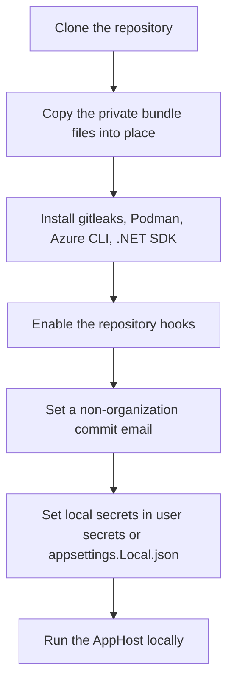
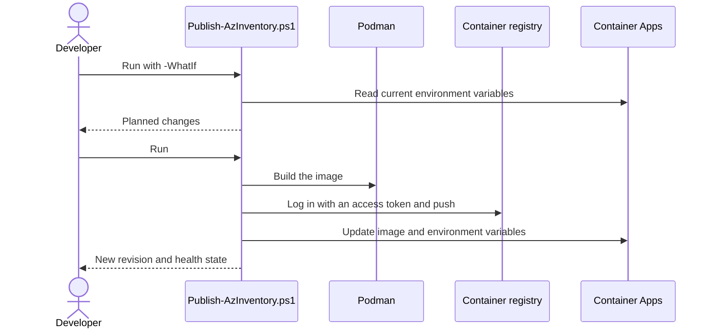

# Deployment Guide

This guide covers deploying Blazor Azure Inventory to an **existing** Azure Container Apps environment with the manual, script-based flow. For a fresh environment created by Aspire, see the README (`aspire deploy`).

## Organization-specific settings

The repository holds only generic defaults. Each deploying organization keeps its own values in a git-ignored overlay file:

| File | Tracked | Purpose |
|---|---|---|
| `BlazorAzureInventorySolution.AppHost/appsettings.Org.sample.json` | Yes | Template with placeholders |
| `BlazorAzureInventorySolution.AppHost/appsettings.Org.json` | No | Real values: allowed tenants, bootstrap admins, subscription, resource group, registry, app names |

The AppHost loads `appsettings.Org.json` in run mode (before `appsettings.Local.json`, so local overrides still win) and in publish mode. `deploy/Publish-AzInventory.ps1` reads its `Deployment` section.

If you deploy for an organization, get its **private bundle** from your team (a shared, access-controlled folder). It usually contains:

| File | Place it at |
|---|---|
| `appsettings.Org.json` | `BlazorAzureInventorySolution.AppHost/` |
| `.gitleaks.private.toml` | Repository root |
| Organization runbook | `private/` |

All three locations are git-ignored. Never commit them, attach them to issues or pull requests, or paste their contents into public places.

## One-time developer setup



```powershell
winget install Gitleaks.Gitleaks
git config core.hooksPath .githooks
git config user.email "<personal-or-github-noreply-address>"
```

The pre-commit hook runs gitleaks on staged changes, and the pre-push hook runs it on the commits about to be pushed. Both use `.gitleaks.private.toml` when present (which adds the organization's identifier rule) and `.gitleaks.toml` otherwise. There is no GitHub CI, so these hooks are the only leak check: keep them enabled.

## Publishing

`deploy/Publish-AzInventory.ps1` builds the images, pushes them to Azure Container Registry through Podman, and updates the existing container apps.

```powershell
az login
./deploy/Publish-AzInventory.ps1 -Component Web -WhatIf
./deploy/Publish-AzInventory.ps1 -Component Web
```

| Parameter | Default | Meaning |
|---|---|---|
| `-SettingsPath` | `BlazorAzureInventorySolution.AppHost/appsettings.Org.json` | Overlay file |
| `-Component` | `Web` | `Web`, `Mcp`, or `All` |
| `-Tag` | Current UTC time, `yyyyMMddHHmmss` | Image tag |
| `-AzureMcpTag` | Dockerfile default | Base image tag for the Azure MCP Server |
| `-SkipEnvSync` | Off | Update the image only |
| `-WhatIf` | Off | Show the planned environment variable changes and commands without running them |



The script refuses to run while a required `Deployment` value is missing or still a `<placeholder>`. For the web app it syncs only `Security__AllowedTenantIds__*`, `UserManagement__BootstrapAdmins`, and `UserManagement__SupportContact`. It does not change identities, federated credentials, volumes, ingress, or scale settings.

Publishing straight to the registry with `dotnet publish -t:PublishContainer` can fail with `CONTAINER1016` at manifest write, which is why the script publishes to Podman first.

## Persistent storage (one time per environment)

Saved scans, `users.json`, the audit log, and Data Protection keys live on an Azure Files share mounted at `/data`. Aspire cannot declare volumes on project resources, so set this up once per environment:

1. Create a dedicated Standard general-purpose v2 storage account in the environment's resource group and region, and a file share (for example `azinventory-data`, 1 GiB quota, soft delete on).
2. Add the share to the Container Apps environment as ReadWrite Azure Files storage. If the environment is VNet-integrated, allow outbound TCP 445 from its subnet.
3. Add a volume `data` to the web app's template (storage type `AzureFile`) with mount options `uid=1654,gid=1654,dir_mode=0700,file_mode=0600`, and mount it at `/data`.
4. Set `Persistence__RootPath=/data` and `Persistence__RequirePersistentVolume=true`.

Image updates keep the volume. See `Docs/persistence-and-user-management-plan.md` section 4.2 for details.
