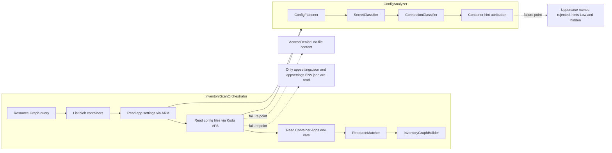
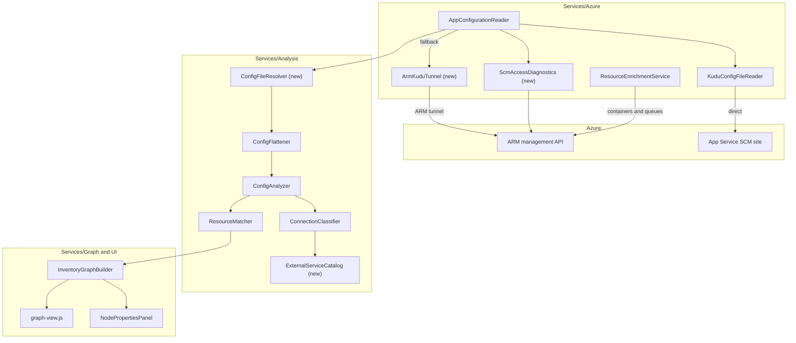
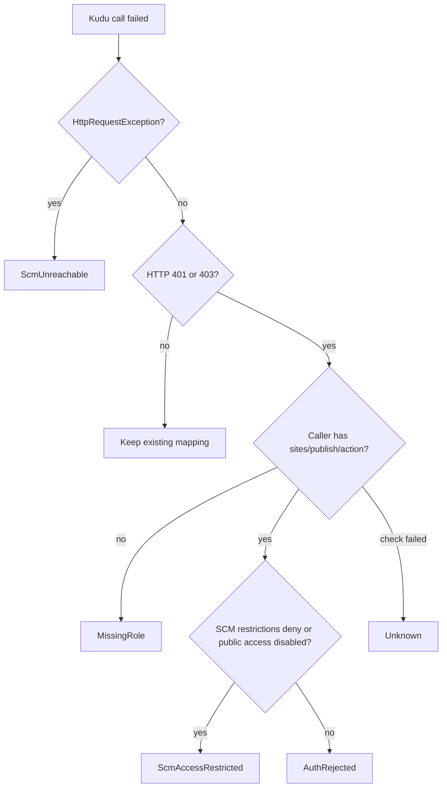
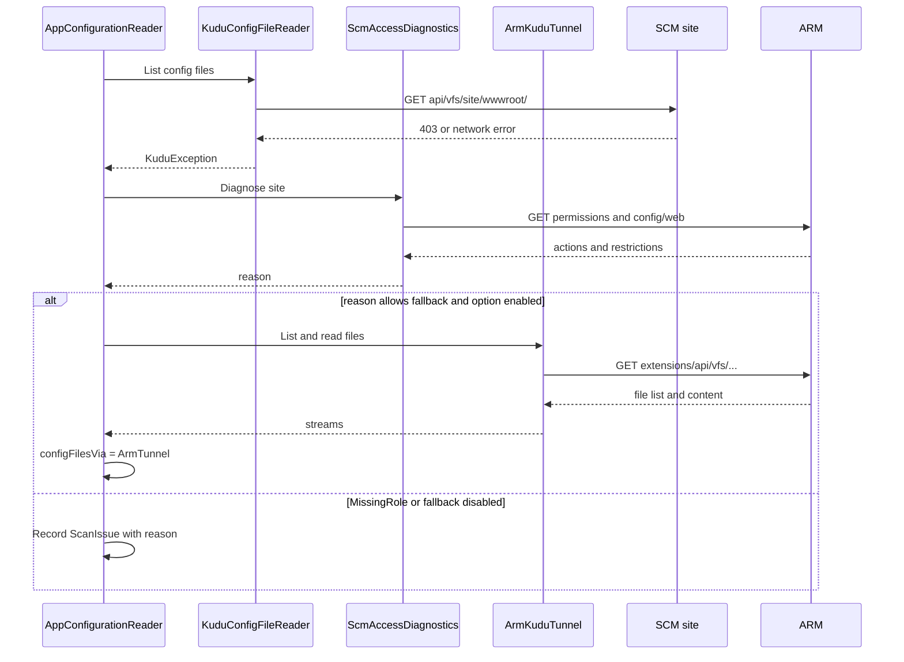
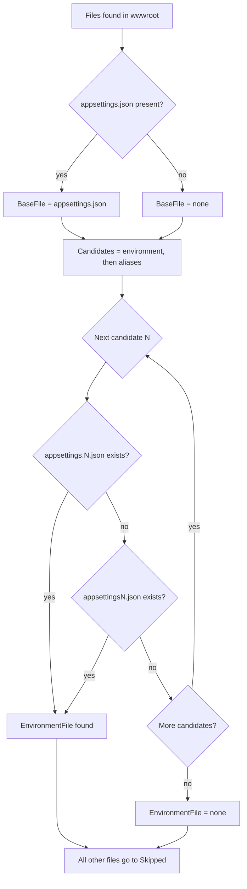
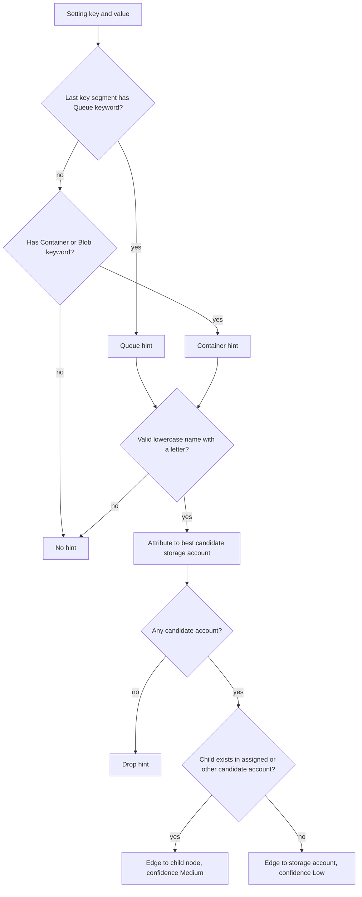
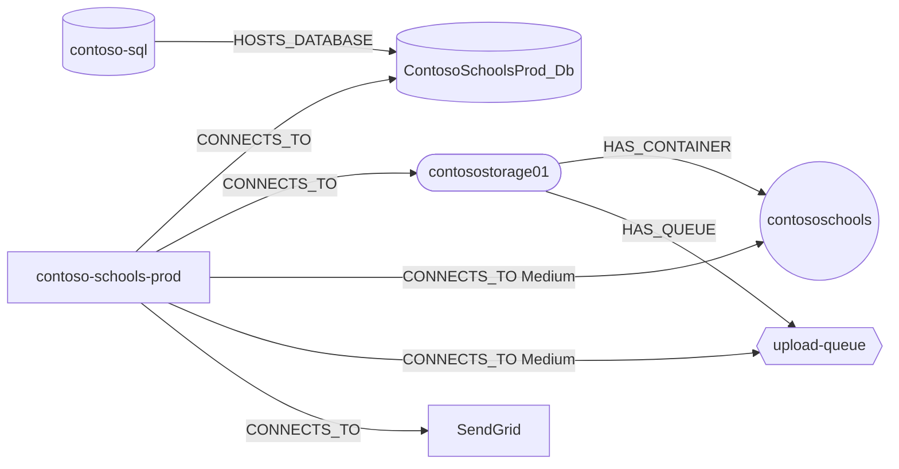
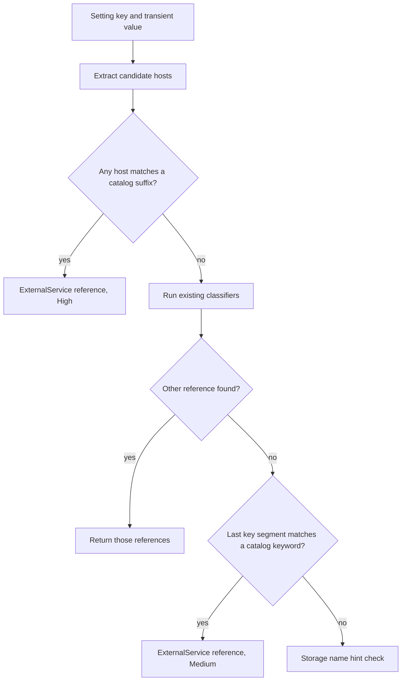
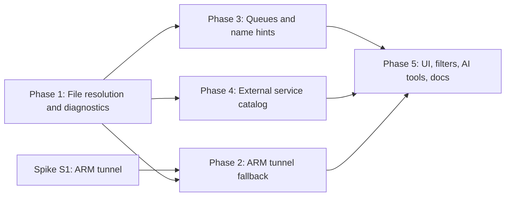

# Knowledge Graph Connections Plan: Config Files, Storage Containers and Queues, External Services

> **Status:** Implemented. Spike S1 passed: the ARM `extensions/api/vfs` route lists and reads `wwwroot` files on a test app.
> **Scope:** Scanner (config reading and classification), resource discovery, resource matching, graph builder, graph UI, tests
> **Related docs:** [implementation-plan.md](implementation-plan.md), [SecurityReview.md](SecurityReview.md), [persistence-and-user-management-plan.md](persistence-and-user-management-plan.md)

All examples use made-up names (`contoso-schools-prod`, `contosostorage01`, `ContosoSchoolsProd_Db`). This repository is public, so real organization identifiers, hosts, keys, or setting values must never be added to this document, to tests, or to fixtures.

---

## 1. Summary

The Knowledge Graph is missing three kinds of connections that exist in real web app configuration files:

| # | Reported problem | Example (sanitized) |
|---|------------------|---------------------|
| 1 | Web apps are not linked to the SQL databases in their production settings file | `contoso-schools-prod` uses `ContosoSchoolsProd_Db` through `appsettingsProduction.json`, but the graph shows no edge |
| 2 | Storage accounts are linked to their blob containers, but web apps are not linked to the storage account, its containers, or its queues | `ApplicationSettings:AzureStorageConnectionString`, `AzureBlobContainer`, `AzureQueueName`, `OutreachContainer`, and similar settings |
| 3 | External SaaS dependencies are invisible | `SmtpServer = smtp.sendgrid.net` should produce a large **SendGrid** node |

This plan describes four features:

- **Feature A: Reliable config-file reading.** Diagnose and work around Kudu access failures, and resolve environment file names such as `appsettingsProduction.json`.
- **Feature B: SQL database edges from config files.** Verify and harden SQL connection-string handling once the files are read.
- **Feature C: Storage containers and queues.** Discover queues as nodes, normalize container and queue name hints, and promote confirmed hints so they are visible by default.
- **Feature D: External service catalog.** Detect SendGrid (and later other SaaS services set up in configuration) and render a large shared node for each.

---

## 2. Decisions

These were agreed before the plan was written.

| Topic | Decision |
|-------|----------|
| Production file name | The environment is `Production`. The file `appsettingsProduction.json` (no dot) must be read. Resolution also supports `appsettings.Production.json` and short aliases such as `Prod`. |
| Observed `configFilesStatus` | `AccessDenied` for the affected app. Feature A must explain *why* and provide a fallback. |
| Storage queues | Become first-class nodes discovered from ARM, the same way blob containers are. |
| Container and queue name matching | Values are **not** lowercased. Mixed-case values such as `"OutreachContainer": "Outreach"` are folders (blob prefixes) inside the real container named by `AzureBlobContainer`, so they are ignored. Only keys whose **last segment** contains `Container`, `Blob`, or `Queue` count as hints. Keys such as `EventsRoster` are **not** matched by default (the keywords can be changed in configuration). |
| Hint visibility | A hint that matches a real discovered container or queue is promoted from `Low` to `Medium` confidence, so it shows by default. Unconfirmed hints stay `Low` and are hidden by default. |
| External services | A generic, configurable external-service catalog. SendGrid is the first built-in entry. Office 365 SMTP, Twilio, Mailgun, and others can be added through configuration. |
| Plain-text secret finding | Out of scope. |

---

## 3. Current pipeline



Key code locations:

| Concern | File | Notes |
|---------|------|-------|
| App Service read and environment detection | `Services/Azure/AppConfigurationReader.cs` (`ReadAppServiceAsync`, `ReadConfigFilesAsync`) | The environment comes from `ASPNETCORE_ENVIRONMENT`, `DOTNET_ENVIRONMENT`, or `AZURE_FUNCTIONS_ENVIRONMENT` and defaults to `Production` |
| Kudu VFS | `Services/Azure/KuduConfigFileReader.cs` | Uses an ARM-audience bearer token. 401, 403, and network errors all map to `AccessDenied` |
| File patterns | `Models/Options/Options.cs` (`EffectiveConfigFilePatterns`), `appsettings.json` (`Inventory:ConfigFilePatterns`) | Default is `appsettings.json` and `appsettings.*.json` |
| Classification | `Services/Analysis/ConnectionClassifier.cs` | Handles Key Vault refs, Redis, connection strings (SQL, storage, Cosmos DB, Service Bus), storage and Key Vault URIs, identity-based keys, and container hints |
| Hint attribution | `Services/Analysis/ConfigAnalyzer.cs` | Attaches every hint to the **first** resolved storage account of the app |
| Matching | `Services/Analysis/ResourceMatcher.cs` | An unresolved container falls back to the storage account |
| Container discovery | `Services/Azure/ResourceEnrichmentService.cs` | ARM `blobServices/containers` list, capped by `MaxBlobContainersPerAccount` |
| Graph | `Services/Graph/InventoryGraphBuilder.cs`, `Models/Graph/GraphModels.cs` | Edge types `CONNECTS_TO`, `HAS_CONTAINER`, and others |
| Rendering | `wwwroot/js/graph-view.js` (`NODE_STYLES`, `applyFilter`) | Low-confidence edges are hidden unless `showLowConfidence` is set |

---

## 4. Root-cause analysis

### 4.1 Issue 1 and Issue 2 share a primary cause

The affected app reports `configFilesStatus = AccessDenied`. In `ReadConfigFilesAsync`, the directory listing is the first Kudu call. When it fails, **no file is read at all**, including `appsettings.json`. That means:

- The SQL connection string in the production file is never classified, so there is no app-to-database edge.
- The storage connection string is never classified, so there is no app-to-storage-account edge and no container hints.

`AccessDenied` is currently reported for three different conditions, and the scan issue text always suggests a missing role:

| Condition | Current mapping | What it really means |
|-----------|-----------------|----------------------|
| HTTP 401 or 403 because the user lacks `Microsoft.Web/sites/publish/action` | `AccessDenied` + Website Contributor hint | Missing role (correct) |
| HTTP 403 from SCM access restrictions (IP rules or `scmIpSecurityRestrictionsDefaultAction = Deny`) | `AccessDenied` + Website Contributor hint | **Network restriction.** The role hint is misleading, and `AzureRoleRequirements.Detect` wrongly reports a missing role |
| `HttpRequestException` (DNS or connect failure, private-endpoint-only SCM) | `AccessDenied`, "SCM site unreachable" | **Network path missing** from the scanner to the SCM host |

### 4.2 Secondary cause for Issue 1: file name resolution

Even with access, `appsettingsProduction.json` would be skipped:

1. The default listing pattern `appsettings.*.json` requires a dot after `appsettings`, so the file is not even listed.
2. `ReadConfigFilesAsync` only reads the exact name `appsettings.{environment}.json`.

### 4.3 Secondary causes for Issue 2

| Cause | Location | Effect on the sample |
|-------|----------|----------------------|
| The hint regex only accepts lowercase names | `BlobContainerNameRegex` in `ConnectionClassifier` | `Outreach`, `Events`, `Grants`, and similar values are rejected. This is correct: they are folders inside the `AzureBlobContainer` container, not containers |
| Queues are not modeled | No queue discovery, no `ConnectionTargetKind` for queues | `AzureQueueName` is ignored |
| Queue keywords are not recognized | `TryContainerHint` checks only `Container` | `AzureQueueName` never becomes a hint |
| Hints are always `Low` | `TryContainerHint` | Even confirmed container edges are hidden by default |
| Hints attach to the first storage account | `ConfigAnalyzer.Analyze` | Wrong account when an app uses more than one |
| Listing stops at the cap | `ListBlobContainersAsync` | A referenced container past the cap is never confirmed |

### 4.4 Cause for Issue 3

Bare SMTP host values such as `smtp.sendgrid.net` are not URIs, connection strings, or Azure hosts, so the classifier returns nothing for them. There is no concept of a known external SaaS service.

### 4.5 Root cause to fix map

| Symptom | Fix |
|---------|-----|
| No file content (`AccessDenied`) | A1 diagnostics, A2 ARM-tunneled Kudu fallback, A5 UI guidance |
| `appsettingsProduction.json` skipped | A3 environment file resolver, A4 default patterns |
| No app-to-database edge | A, then B verification |
| No app-to-storage, container, or queue edges | A, then C |
| No SendGrid node | D |

---

## 5. Target architecture



---

## 6. Feature A: Reliable config-file reading

### A1. Access diagnostics

**Goal:** Every `AccessDenied` on config files gets a precise reason and the right remediation, and missing-role detection stops counting network restrictions.

**New model** (`Models/Configuration/ConfigurationModels.cs`):

```csharp
public enum ConfigAccessReason
{
    None,
    MissingRole,          // caller lacks Microsoft.Web/sites/publish/action
    ScmAccessRestricted,  // SCM IP rules or default action Deny
    ScmUnreachable,       // DNS or connect failure (private endpoint only, VNet)
    AuthRejected,         // 401/403 with the permission present (for example Conditional Access)
    Unknown
}
```

Add it to `AppConfigAnalysis` as an init-only property, so the positional record and saved snapshots stay compatible:

```csharp
public ConfigAccessReason ConfigFilesReason { get; init; } = ConfigAccessReason.None;
public IReadOnlyList<string> ConfigFilesRead { get; init; } = [];
public IReadOnlyList<string> ConfigFilesSkipped { get; init; } = [];
```

**New service** `Services/Azure/ScmAccessDiagnostics.cs`. It runs only after a Kudu failure (never on the happy path) and makes two ARM calls with the user's token:

| Check | ARM call | Required permission |
|-------|----------|---------------------|
| Does the caller have publish rights? | `GET {siteId}/providers/Microsoft.Authorization/permissions?api-version=2022-04-01`, then evaluate `actions` and `notActions` for `Microsoft.Web/sites/publish/action` (wildcards supported) | Any read access |
| Is SCM restricted? | `GET {siteId}/config/web`, then read `scmIpSecurityRestrictions`, `scmIpSecurityRestrictionsDefaultAction`, `scmIpSecurityRestrictionsUseMain`, `ipSecurityRestrictions*`, and `publicNetworkAccess` | `Microsoft.Web/sites/config/read` (Reader) |

**Decision logic:**



**Scan issue messages.** Only `MissingRole` includes `AzureRoleRequirements.ConfigFiles.Hint` (which contains the permission string). The other reasons use their own text, so `AzureRoleRequirements.Detect` stops reporting a missing role for network problems:

| Reason | Issue message (no hosts or values beyond the app name) |
|--------|--------------------------------------------------------|
| `MissingRole` | `403: SCM access denied. Requires the Website Contributor role (Microsoft.Web/sites/publish/action).` |
| `ScmAccessRestricted` | `SCM site blocks this scanner by access restrictions. Allow the scanner's outbound IP or VNet on the SCM site, or enable the ARM tunnel fallback.` |
| `ScmUnreachable` | `SCM site unreachable from the scanner (private endpoint or DNS). Link the scanner VNet to the private DNS zone, or enable the ARM tunnel fallback.` |
| `AuthRejected` | `SCM rejected the token although the role is present (for example Conditional Access).` |

Rules for the diagnostics:

- Never log or store the 403 response body.
- Never call diagnostics more than once per app per scan.
- Treat any diagnostics failure as `Unknown`. The scan must not fail because of diagnostics.

### A2. ARM-tunneled Kudu fallback (spike first)

App Service can proxy SCM requests through ARM using the `extensions` route:

```text
GET {armEndpoint}{siteId}/extensions/api/vfs/site/wwwroot/?api-version=2023-12-01
GET {armEndpoint}{siteId}/extensions/api/vfs/site/wwwroot/{file}?api-version=2023-12-01
```

For slots, use `{slotId}/extensions/...`.

**Spike S1 (go or no-go) must confirm:**

1. The VFS listing and file GET work through `extensions` for both Windows and Linux apps.
2. Which RBAC action is checked. Expected: `Microsoft.Web/sites/extensions/*` or `publish/action`. Update `AzureRoleRequirements.ConfigFiles` if it differs.
3. Whether it works when SCM has IP restrictions, and when SCM is reachable only through a private endpoint.
4. Response size limits and content type.

**If S1 succeeds**, add `Services/Azure/ArmKuduTunnel.cs` with the same contract as `KuduConfigFileReader`:

- The host is always the cloud's ARM endpoint from `ArmClientFactory`. It is never derived from tenant data.
- File names still pass the `ConfigFilePatterns` allow list and `Uri.EscapeDataString`.
- The same 15 s timeout, `MaxConfigFileBytes` streaming cap, and no-redirect rule apply.
- A new option `Inventory:UseArmKuduFallback` (default `true`) controls the fallback.
- The fallback runs only for `ScmAccessRestricted`, `ScmUnreachable`, and `AuthRejected`. It never runs for `MissingRole`.
- Record which path succeeded in a new extra property `configFilesVia = Direct | ArmTunnel`.

**If S1 fails**, ship A1, A3, A4, and A5 only. The UI guidance then tells admins how to give the scanner a network path. The scanner already runs in a VNet-integrated Container Apps environment, so linking that VNet to the `privatelink.azurewebsites.net` private DNS zone is the documented option.



### A3. Environment file resolver

New static class `Services/Analysis/ConfigFileResolver.cs`:

```csharp
public sealed record ConfigFileSelection(string? BaseFile, string? EnvironmentFile, IReadOnlyList<string> Skipped);

public static class ConfigFileResolver
{
    public static ConfigFileSelection Resolve(
        IReadOnlyList<string> found,
        string environment,
        IReadOnlyDictionary<string, string[]> aliases);
}
```

**Resolution rules** (all comparisons are case-insensitive):

1. `BaseFile` is `appsettings.json` if present.
2. Build the candidate environment names: `environment` first, then its aliases in configured order. Aliases are two-way. For example, if the environment is `Prod`, the candidates are `Prod` and then `Production`.
3. For each candidate name `N`, check in this order, and the first hit wins:
   - `appsettings.N.json`
   - `appsettingsN.json`
4. Every other found file goes into `Skipped` and is shown in the UI. It is not read.
5. Precedence stays the same: the base file is `ConfigSource.AppSettingsJson` and the environment file is `ConfigSource.AppSettingsEnvironmentJson`, so the environment file overrides the base.



**Default aliases** (new option `Inventory:EnvironmentAliases`):

```json
"EnvironmentAliases": {
  "Production": [ "Prod", "Prd" ],
  "Development": [ "Dev" ],
  "Staging": [ "Stage", "Stg" ],
  "Test": [ "Tst", "QA" ]
}
```

Dictionaries are not affected by the binder's array-append behavior, but the defaults still belong in an `EffectiveEnvironmentAliases` property, following the existing `Effective*` pattern.

**Changes in `ReadConfigFilesAsync`:**

- Replace the inline `toRead` filter with `ConfigFileResolver.Resolve`.
- Fill `ConfigFilesRead` and `ConfigFilesSkipped`.
- Return `NotFound` only when neither a base file nor an environment file exists.

### A4. Default patterns

| Location | Old | New |
|----------|-----|-----|
| `InventoryOptions.EffectiveConfigFilePatterns` | `appsettings.json`, `appsettings.*.json` | `appsettings*.json` |
| `BlazorAzureInventory/appsettings.json` → `Inventory:ConfigFilePatterns` | same as above | `[ "appsettings*.json" ]` |
| AppHost settings, if they override the patterns | check and align | `[ "appsettings*.json" ]` |

`appsettings*.json` matches `appsettings.json`, `appsettings.Production.json`, and `appsettingsProduction.json`. The glob still matches only the file-name segment, so traversal is not possible.

### A5. UI changes for config-file status

`NodePropertiesPanel.razor`, web app, function app, and slot nodes:

| Field | Source |
|-------|--------|
| Config files status | `configFilesStatus` (existing) |
| Reason | `configFilesReason` (new). Show only when the status is not `Read` |
| Read via | `configFilesVia` (new): `Direct` or `ArmTunnel` |
| Files read | `configFilesRead` (new list) |
| Files skipped | `configFilesSkipped` (new list), with the tooltip "Not the current environment" |
| Remediation | Static text per reason (see A1). No links are built from tenant data |

`InventoryGraphBuilder.CreateResourceNode` writes these fields into `GraphNode.Data` next to `settingsStatus` and `configFilesStatus`.

The Roles page (`AzureRoleRequirements.Detect`) needs no code change. It becomes accurate automatically, because only `MissingRole` issues contain the permission string.

---

## 7. Feature B: SQL database edges from config files

After Feature A, the existing classifier already handles the common case:

```json
"ConnectionStrings": {
  "DefaultConnection": "Server=tcp:contoso-sql.database.windows.net,1433;Initial Catalog=ContosoSchoolsProd_Db;Authentication=Active Directory Default;"
}
```

This becomes `ConnectionTargetKind.SqlDatabase` with host `contoso-sql.database.windows.net` and database `ContosoSchoolsProd_Db`. `ResourceMatcher` then looks up `contoso-sql.database.windows.net/ContosoSchoolsProd_Db` (case-insensitive) and the graph gets a `CONNECTS_TO` edge to the database node.

### B1. Hardening tasks

| Case | Current behavior | Change |
|------|------------------|--------|
| EF6 entity connection string: `metadata=res://...;provider=System.Data.SqlClient;provider connection string="data source=...;initial catalog=..."` | `DbConnectionStringBuilder` parses the outer string, and `data source` sits inside a quoted value | If the key `provider connection string` exists, classify its inner value recursively |
| `Data Source=contoso-sql.database.windows.net;Database=...` | Supported | Add a regression test |
| Server in an unscanned subscription | An `External` node with reason `NotVisible`, hidden when "Hide external" is on | No code change. A5's properties panel and the external node's tooltip say "Server not in scanned subscriptions" |
| Database name differs only by case | Lookup is case-insensitive | Add a regression test |
| Connection string inside a nested section such as `ApplicationSettings:Db:Main` | Already flattened and classified | Add a regression test |

### B2. Acceptance

For a web app whose production file has a SQL connection string to a server and database in scope, the graph shows `WebApp -> CONNECTS_TO -> SqlDatabase` with `EdgeReference.FileName = appsettingsProduction.json` and `Source = AppSettingsEnvironmentJson`.

---

## 8. Feature C: Storage containers and queues

### C1. Model changes

| Type | Addition |
|------|----------|
| `AzureResourceKind` | `StorageQueue` (after `BlobContainer`) |
| `ConnectionTargetKind` | `StorageQueue` |
| `EdgeTypes` | `HasQueue = "HAS_QUEUE"`. Add it to `EdgeTypes.Structural` |
| `NodeTypeStyles.All` | `("StorageQueue", "#AB47BC")` |
| `InventoryOptions` | `MaxQueuesPerAccount` (default 200, range 1 to 5000), and `StorageNameHints` (see C3) |
| `ConnectionReference` | No new field. For `StorageQueue`, the queue name goes in `ContainerName`, documented in an XML comment as "child entity name (container or queue)" |

Queue resource ID format, matching the container format:

```text
{storageAccountId}/queueservices/default/queues/{queueName}   (lower-cased)
```

### C2. Queue discovery

Add `ListQueuesAsync` to `ResourceEnrichmentService`:

```csharp
public async Task<(IReadOnlyList<AzureResourceInfo> Queues, bool Truncated)> ListQueuesAsync(
    AzureResourceInfo account, int maxQueues, CancellationToken ct)
{
    var client = await armFactory.GetAsync(account.TenantId);
    var storage = client.GetStorageAccountResource(new ResourceIdentifier(account.Id));
    var queues = new List<AzureResourceInfo>();
    await foreach (var queue in storage.GetQueueService().GetStorageQueues().GetAllAsync(cancellationToken: ct))
    {
        if (queues.Count >= maxQueues) return (queues, true);
        queues.Add(new AzureResourceInfo(
            $"{account.Id}/queueservices/default/queues/{queue.Data.Name}".ToLowerInvariant(),
            queue.Data.Name, AzureResourceKind.StorageQueue, "microsoft.storage/storageaccounts/queueservices/queues",
            account.TenantId, account.SubscriptionId, account.ResourceGroup, account.Location,
            account.Id, null, new Dictionary<string, string>(StringComparer.OrdinalIgnoreCase)));
    }
    return (queues, false);
}
```

**Orchestrator** (`InventoryScanOrchestrator`):

- Add a stage `"Listing storage queues"` right after `"Listing blob containers"` in `ScanProgress.Stages`.
- Replace index-based stage references (`ScanProgress.Stages[3]` and others in `AzureRoleRequirements` and the orchestrator) with named constants, so inserting a stage does not shift meanings. Persisted `ScanIssue.Stage` values are strings, so existing snapshots are unaffected.
- Run queue listing inside the same `Parallel.ForEachAsync` over storage accounts, with separate try/catch blocks so a queue failure does not hide containers.
- Write `queueCount` and `queuesTruncated` to the account's extra properties.
- Skip accounts whose `kind` does not support queues (for example `BlockBlobStorage` and `FileStorage`), using the existing `kind` property from Resource Graph.

**Roles:** Add `AzureRoleRequirements.StorageQueues = new(Stages.ListQueues, "List storage queues", Reader, "Microsoft.Storage/storageAccounts/queueServices/queues/read")` and include it in `All`.

### C3. Classifier changes

**Options** (`Inventory:StorageNameHints`):

```json
"StorageNameHints": {
  "ContainerKeywords": [ "Container", "Blob" ],
  "QueueKeywords": [ "Queue" ]
}
```

Both arrays default to empty in the options class and are resolved through `Effective*` properties, because the binder appends to pre-populated arrays.

**Replace `TryContainerHint` with `TryStorageNameHint`:**

```csharp
private bool TryStorageNameHint(string key, string value, out ConnectionReference reference)
{
    reference = null!;
    var segment = LastSegment(key);                    // text after the last ':'
    var kind = ContainsAny(segment, hints.QueueKeywords) ? ConnectionTargetKind.StorageQueue
             : ContainsAny(segment, hints.ContainerKeywords) ? ConnectionTargetKind.BlobContainer
             : (ConnectionTargetKind?)null;
    if (kind is null) return false;

    var name = value.Trim().ToLowerInvariant();
    if (!ChildNameRegex().IsMatch(name) || !name.Any(char.IsAsciiLetterLower)) return false;

    reference = new ConnectionReference(kind.Value, null, null, null, name, null, false, Confidence.Low, null);
    return true;
}
```

Rules:

- **Only the last key segment is checked.** `ApplicationSettings:AzureBlobContainer` matches, but `BlobStorage:Timeout` does not, because its last segment is `Timeout`.
- **Queue keywords win** over container keywords when a segment contains both.
- **Names are not lowercased.** Container and queue names are always lowercase in Azure, so mixed-case values (for example `Outreach`) are treated as blob folders and ignored. Container and queue names share the same rules: 3 to 63 characters, lowercase letters, digits, and single hyphens, starting and ending with a letter or digit. The existing `BlobContainerNameRegex` is renamed to `ChildNameRegex`.
- **At least one letter is required**, which rejects values like `300` or `1024`.
- The hint runs only when no other reference was found for the value (current behavior).
- `$web` and `$root` remain valid only through storage URIs, not hints.

**Queue URIs** in `TryStorageUri`: when `svc == "queue"`, take the first path segment, validate it with `ChildNameRegex`, and return `StorageQueue` with `Confidence.High`.

### C4. Hint attribution across multiple storage accounts

**`ConfigAnalyzer.Analyze`** changes from "first storage account" to "best candidate":

1. Collect the candidate accounts: every non-overridden, non-`Low` reference of kind `StorageAccount`, `BlobContainer`, or `StorageQueue` with an account name, together with its setting key.
2. For each hint, choose the candidate whose key shares the **longest common section prefix** with the hint key. For example, `ApplicationSettings:AzureBlobContainer` prefers `ApplicationSettings:AzureStorageConnectionString` over `Logging:Storage:AccountName`. Break ties by the candidate's order.
3. If there are no candidates, drop the hint (current behavior).

**`ResourceMatcher.Match(AppConfigAnalysis, ResourceIndex)`** gets a hint confirmation pass:

1. Index queues as `index.StorageQueues["{account}/{queue}"]`.
2. For each `Low` reference of kind `BlobContainer` or `StorageQueue`:
   - Try the assigned account first, then every other candidate account of the same app.
   - **If a child resource matches:** set `AccountOrServerName` to the matching account, set `ResolvedResourceId` to the child ID, and **promote the confidence to `Medium`**.
   - **If nothing matches:** resolve to the assigned storage account and keep `Low`.



### C5. Truncated listings

When an account's listing was truncated (`containersTruncated` or `queuesTruncated` is `true`), a referenced child may exist but not be in the index. Add a **targeted confirmation** step to the "Analyzing connections" stage:

- For each unconfirmed hint whose account is truncated, call `GET .../blobServices/default/containers/{name}` or `GET .../queueServices/default/queues/{name}`.
- Add any found child to `resources` and rerun the match for that app.
- Limit this to 50 lookups per account, and skip it on `404`.

### C6. Graph builder

- Generalize `ApplyContainerCap` to `ApplyChildCap(kind, edgeType, segment, cap)` and call it for both `BlobContainer` (`HAS_CONTAINER`, `containers`) and `StorageQueue` (`HAS_QUEUE`, `queues`). Referenced children are always kept, and the aggregate node ID becomes `.../queues/__more` for queues.
- Add a `case AzureResourceKind.StorageQueue` structural edge: `AddEdge(edges, r.ParentId, EdgeTypes.HasQueue, r.Id)`.
- `CreateResourceNode`: queues are not taggable (`data[TagKeys.Taggable] = false`), the same as containers.
- `ResourceMatcher.ExternalNodeId`: map `StorageQueue` to slug `storage`, using the queue name as the child.
- `EdgeReference` gets no change. The setting key, file name, environment, and confidence already explain the edge.

### C7. UI and other consumers

| Component | Change |
|-----------|--------|
| `graph-view.js` `NODE_STYLES` | `StorageQueue: { shape: 'square', color: '#AB47BC', size: 'small' }` |
| `graph-view.js` `STRUCTURAL` | Add `'HAS_QUEUE'` |
| `GraphFilterPanel.razor` | No code change. Types come from `NodeTypeStyles.All` |
| `Graph.razor` `RestoreFilter` | **Bug to fix:** saved `NodeTypes` is an allow list, so new types (`StorageQueue`, `ExternalService`) would be hidden for every user with saved preferences. Add `KnownNodeTypes` to `GraphFilterState`, saved with the filter. On restore, add every type that is in `NodeTypeStyles.All`, not in `saved.KnownNodeTypes`, and not in `HiddenByDefault` |
| `InventoryView.cs` | Treat `HAS_QUEUE` like `HAS_CONTAINER` when grouping children |
| `GraphNodeResolver.cs`, `InventoryGraphTools.cs` (AI tools) | Add `EdgeTypes.HasQueue` to `ChildEdges` |
| `ConnectionTagGenerator.cs` | Add `HasQueue` to `ChildEdges`. Treat `StorageQueue` like `BlobContainer` (tags roll up to the account) |
| `ResourceInspector.cs` | `StorageQueue` message: "Storage queues do not support Azure tags (they use queue metadata instead)." |
| `TagValidator.cs` | Add `microsoft.storage/storageaccounts/queueservices/queues` as not taggable |
| `NodePropertiesPanel.razor` | Show `queueCount` and `queuesTruncated` on storage accounts |

### C8. Worked example (sanitized)

Input (production file, `ApplicationSettings` section, secret values replaced):

```json
"ApplicationSettings": {
  "AzureStorageConnectionString": "DefaultEndpointsProtocol=https;AccountName=contosostorage01;AccountKey=<redacted>",
  "AzureBlobContainer": "contososchools",
  "AzureQueueName": "upload-queue",
  "OutreachContainer": "Outreach",
  "EventsContainer": "Events",
  "EventsRoster": "EventsRoster",
  "SmtpServer": "smtp.sendgrid.net",
  "SmtpPassword": "<redacted>"
}
```

| Key (last segment) | Classification | Result |
|--------------------|----------------|--------|
| `AzureStorageConnectionString` | Storage connection string, `High` | `CONNECTS_TO` the `contosostorage01` account. `IsSecretLike = true`, and the value is never stored |
| `AzureBlobContainer` | Container hint, `contososchools` | Confirmed, so `Medium` edge to the container |
| `AzureQueueName` | Queue hint, `upload-queue` | Confirmed, so `Medium` edge to the queue |
| `OutreachContainer` | Mixed case, so a folder inside `contososchools` | **Not matched.** No container named `outreach` exists |
| `EventsContainer` | Mixed case, so a folder | **Not matched** |
| `EventsRoster` | No keyword | **Not matched** (by decision). Add `Roster` to `ContainerKeywords` to include it |
| `SmtpServer` | External service host, SendGrid, `High` | `CONNECTS_TO` the shared SendGrid node (Feature D) |
| `SmtpPassword` | Secret-like, no reference | Masked flag only |

Resulting graph:



---

## 9. Feature D: External service catalog (SendGrid first)

### D1. Configuration model

`Models/Options/Options.cs`:

```csharp
public sealed class ExternalServiceDefinition
{
    [Required, RegularExpression("^[a-z0-9-]{2,40}$")] public string Id { get; set; } = "";
    [Required, StringLength(60)] public string DisplayName { get; set; } = "";
    [StringLength(60)] public string Category { get; set; } = "";
    [RegularExpression("^#[0-9A-Fa-f]{6}$")] public string Color { get; set; } = "#607D8B";
    public string[] HostSuffixes { get; set; } = [];   // label-boundary match, for example "sendgrid.net"
    public string[] KeyKeywords { get; set; } = [];    // last key segment contains, for example "SendGrid"
}

// InventoryOptions
public ExternalServiceDefinition[] ExternalServices { get; set; } = [];
public IReadOnlyList<ExternalServiceDefinition> EffectiveExternalServices =>
    ExternalServices.Length > 0 ? ExternalServices : [ExternalServiceDefaults.SendGrid];
```

Built-in default:

```json
"ExternalServices": [
  {
    "Id": "sendgrid",
    "DisplayName": "SendGrid",
    "Category": "Email",
    "Color": "#1A82E2",
    "HostSuffixes": [ "sendgrid.net", "sendgrid.com" ],
    "KeyKeywords": [ "SendGrid" ]
  }
]
```

Examples of entries that can be added later through configuration, with no code changes:

| Id | HostSuffixes | KeyKeywords |
|----|--------------|-------------|
| `office365-smtp` | `smtp.office365.com` | |
| `twilio` | `twilio.com` | `Twilio` |
| `mailgun` | `mailgun.org`, `mailgun.net` | `Mailgun` |

**Startup validation** (`ValidateOnStart`):

- Every suffix contains a dot.
- No suffix ends with a configured Azure suffix (from `CloudEndpointSuffixes.AllAzure`).
- Ids are unique.
- `Color` passes the hex regex. This matters because the color is injected into the vis-network style.

### D2. Detection

New class `Services/Analysis/ExternalServiceCatalog.cs` (singleton, built from options) with one method:

```csharp
public ExternalServiceDefinition? MatchHost(string host);   // host == suffix or host ends with "." + suffix
```

`ConnectionClassifier.Classify` calls a new `TryExternalService(key, value)` **first, before the Key Vault and Redis checks**. A known SaaS host is never an Azure resource, so returning early is safe.

Candidate hosts, all taken from the transient value and never stored:

1. The whole value, if it matches `^[A-Za-z0-9.-]+(:\d{1,5})?$` (a bare host or `host:port`), for example `smtp.sendgrid.net`.
2. The host of every match of `UriRegex`, for example `https://api.sendgrid.com/v3`.
3. In a connection string, the values of the keys `Host`, `Server`, `SmtpServer`, `Smtp`, and `Endpoint`.

Result rules:

| Signal | Confidence | Reference |
|--------|------------|-----------|
| Host matches a `HostSuffixes` entry | `High` | `ConnectionReference(Kind: ExternalService, Host: matchedHost, AccountOrServerName: serviceId, ...)` |
| Only the last key segment contains a `KeyKeywords` entry, and no other reference was found | `Medium` | Same, with `Host = null` |

The value of keyword-matched keys (for example `SendGridApiKey`) is never inspected or stored. Only the key name is used.



### D3. Matching and graph

- `ConnectionTargetKind.ExternalService` and `AzureResourceKind.ExternalService` are new.
- `ResourceMatcher.Match` leaves `ExternalService` references unresolved (they are never ARM resources).
- `InventoryGraphBuilder.AddConfigEdges` sends `ExternalService` references to a new `EnsureExternalServiceNode` instead of `EnsureExternalNode`:

```csharp
private string EnsureExternalServiceNode(ConnectionReference r, Dictionary<string, GraphNode> nodes)
{
    var def = catalog.ById(r.AccountOrServerName!);
    var id = $"external:service:{def.Id}";
    if (!nodes.TryGetValue(id, out var node))
    {
        node = new GraphNode
        {
            Id = id, Type = nameof(AzureResourceKind.ExternalService), Label = def.DisplayName,
            Data = new()
            {
                ["serviceId"] = def.Id, ["category"] = def.Category, ["color"] = def.Color,
                ["matchedHosts"] = new List<string>(), [TagKeys.Taggable] = false
            }
        };
        nodes[id] = node;
    }
    if (r.Host is { } h && node.Data["matchedHosts"] is List<string> hosts && !hosts.Contains(h, StringComparer.OrdinalIgnoreCase))
        hosts.Add(h);
    return id;
}
```

- **There is one shared node per service**, so every app that uses SendGrid connects to the same node. This makes shared external dependencies easy to see.
- The edge type is `CONNECTS_TO`, so existing AI tools, connection listing, and change tracking work unchanged. The edge's `references` list shows which keys (for example `ApplicationSettings:SmtpServer`) caused it.
- `matchedHosts` is sorted before serialization, so builds stay deterministic.

### D4. Rendering ("big" node)

`graph-view.js`:

```js
ExternalService: { shape: 'box', color: '#607D8B', size: 'large' }
```

In `toVisNode`, for `type === 'ExternalService'`:

- Use `data.color` as the background color, but only when it matches `/^#[0-9A-Fa-f]{6}$/`. Otherwise use the default.
- Set the font size to 22 (bold), the margin to 16, and `borderWidth` to 3.
- Set `mass` to 4, so the shared hub stays near the center of its connected apps.
- Show the category (for example "Email") as a second label line. vis-network supports line breaks in node labels.

Other UI rules:

| Area | Rule |
|------|------|
| `NodeTypeStyles.All` | Add `("ExternalService", "#607D8B")`. It is visible by default |
| "Hide external" toggle | **Does not** hide `ExternalService`. That toggle stays scoped to unresolved Azure references (`External`). Users can hide services with the node-type checkbox |
| Subscription and resource group filters | `ExternalService` nodes have no `subscriptionId`, so they pass these filters (same as `External`). With "Only connected" on, they appear only when a visible app connects to them |
| `NodePropertiesPanel` | Show the display name, category, matched hosts, and the list of connected apps with setting keys. No portal link |
| `ResourceInspector` | "External service outside Azure. Detected from app configuration." |
| Tags | Not taggable. `ConnectionTagGenerator` treats it like `External` (it is excluded unless `IncludeExternal` is set) |
| AI tools | `InventoryGraphTools` lists external services in connection answers using the label and category |

---

## 10. Consolidated data-model changes

| File | Change |
|------|--------|
| `Models/Inventory/InventoryModels.cs` | `AzureResourceKind`: add `StorageQueue` and `ExternalService` (append them at the end to avoid reordering). `ScanProgress.Stages`: add `"Listing storage queues"` and named constants |
| `Models/Configuration/ConfigurationModels.cs` | `ConnectionTargetKind`: add `StorageQueue` and `ExternalService` (appended). Add the new `ConfigAccessReason` enum. `AppConfigAnalysis`: add `ConfigFilesReason`, `ConfigFilesRead`, and `ConfigFilesSkipped` (init properties) |
| `Models/Graph/GraphModels.cs` | `EdgeTypes.HasQueue`, `Structural`, `NodeTypeStyles.All` entries, `GraphFilterState.KnownNodeTypes` |
| `Models/Options/Options.cs` | `MaxQueuesPerAccount`, `EnvironmentAliases`, `StorageNameHints`, `ExternalServices`, `UseArmKuduFallback`, and their `Effective*` properties |
| `Models/Inventory/AzureRoleRequirements.cs` | `StorageQueues` requirement. Switch to named stage constants. Possibly adjust `ConfigFiles` after spike S1 |
| `Services/Persistence/PersistenceModels.cs` | `SnapshotEnvelope.CurrentSchemaVersion = 2` (see section 12) |

---

## 11. Configuration summary

`BlazorAzureInventory/appsettings.json` → `Inventory`:

```json
"Inventory": {
  "ReadConfigFiles": true,
  "ConfigFilePatterns": [ "appsettings*.json" ],
  "UseArmKuduFallback": true,
  "EnvironmentAliases": {
    "Production": [ "Prod", "Prd" ],
    "Development": [ "Dev" ],
    "Staging": [ "Stage", "Stg" ],
    "Test": [ "Tst", "QA" ]
  },
  "MaxBlobContainersPerAccount": 200,
  "MaxQueuesPerAccount": 200,
  "StorageNameHints": {
    "ContainerKeywords": [ "Container", "Blob" ],
    "QueueKeywords": [ "Queue" ]
  },
  "ExternalServices": [
    {
      "Id": "sendgrid",
      "DisplayName": "SendGrid",
      "Category": "Email",
      "Color": "#1A82E2",
      "HostSuffixes": [ "sendgrid.net", "sendgrid.com" ],
      "KeyKeywords": [ "SendGrid" ]
    }
  ]
}
```

Organization-specific additions (for example extra keywords such as `Roster`, or more services) go in the git-ignored `appsettings.Org.json` in the AppHost project, never in the public `appsettings.json`.

---

## 12. Persistence and compatibility

| Concern | Handling |
|---------|----------|
| Old snapshots loaded by the new app | All new properties have defaults, and new enum values are only *added*, so old snapshots deserialize unchanged. They do not have the new edges until the user rescans |
| New snapshots loaded by an old build (rollback) | Enums serialize as strings, so `StorageQueue` or `ExternalService` would fail to deserialize in an old build. Bump `SnapshotEnvelope.CurrentSchemaVersion` to `2`. Old builds already skip envelopes with a newer schema and log a warning |
| Snapshot diff (`SnapshotDiffService`) | The new nodes and edges show as "added" in the first diff after upgrading. Add a release note. No code change is needed |
| User preferences | `GraphFilterState.KnownNodeTypes` is optional. Missing means "assume every type known before this release", so restore adds `StorageQueue` and `ExternalService` automatically |
| Graph size | Queue nodes are capped per account like containers. External services add at most one node per catalog entry |

---

## 13. Security considerations

| Area | Requirement |
|------|-------------|
| Raw values | Unchanged principle: values exist only inside `AppConfigurationReader` and `ConfigAnalyzer.Analyze`. New detectors (`TryExternalService`, `TryStorageNameHint`) return identifiers only: service id, host, and child name |
| Secret-bearing keys | Keyword matching for external services uses the **key** only. The values of keys such as `SendGridApiKey` or `SmtpPassword` are never parsed by the new code |
| 403 bodies | Never logged, stored, or shown. Diagnostics use ARM metadata only |
| ARM tunnel | The host is fixed to the cloud ARM endpoint. Resource IDs come from Resource Graph and are validated with `ResourceIdentifier`. File names pass the allow list and are URL-encoded. The existing limits (size, time, no redirects) still apply |
| Catalog values in the UI | `Color` is validated server-side (options validation) and client-side (regex). Labels are rendered with `textContent` (existing rule in `graph-view.js`) |
| Public repository | Tests and docs use only `contoso` style names. The existing gitleaks hooks and `.gitleaks.private.toml` deny list cover org identifiers |
| Least privilege | No new roles beyond Reader for queues. The ARM tunnel role is confirmed in spike S1 and documented on the Roles page |

Add a short section to `Docs/SecurityReview.md` covering the ARM tunnel and the diagnostics calls once they are implemented.

---

## 14. Testing plan

All tests go in `BlazorAzureInventory.Tests` and follow the existing patterns: direct `Classify` assertions, fixture snapshots, and graph determinism checks.

### 14.1 Unit tests

| Test file | New cases |
|-----------|-----------|
| `ConfigFileResolverTests.cs` (new) | `appsettingsProduction.json` is resolved for `Production`. `appsettings.Production.json` wins over `appsettingsProduction.json` when both exist. Alias `Prod` resolves `appsettings.Prod.json` for `Production`, and the reverse. Unrelated files go to `Skipped`. A missing base file still returns the environment file. Matching is case-insensitive |
| `KuduConfigFileReaderTests.cs` (new or extended) | The glob `appsettings*.json` matches the three name forms and rejects `appsettings/../x.json` and `web.config` |
| `ScmAccessDiagnosticsTests.cs` (new) | Mocked permissions with and without `publish/action` (including the `*` and `Microsoft.Web/*` wildcards and `notActions`). Restrictions with default action `Deny`. `publicNetworkAccess = Disabled`. A diagnostics exception leads to `Unknown` |
| `RoleRequirementTests.cs` | `ScmAccessRestricted` and `ScmUnreachable` issues are **not** reported as a missing Website Contributor role |
| `ConnectionClassifierTests.cs` | `AzureBlobContainer = contososchools` gives a container hint. `OutreachContainer = Outreach` (a folder) gives no hint. `AzureQueueName = upload-queue` gives a queue hint. `EventsRoster` gives no hint. `BlobTimeout = 300` gives no hint (no letter, and no keyword in the last segment). A queue URI `https://acct.queue.core.windows.net/q1` gives `StorageQueue` with `High`. EF6 `provider connection string` gives `SqlDatabase`. `SmtpServer = smtp.sendgrid.net` gives `ExternalService` with `High`. `smtp.sendgrid.net:587` and `https://api.sendgrid.com/v3` give `High`. `SendGridApiKey = <anything>` gives `Medium` without reading the value. `notsendgrid.net` gives no match (label boundary) |
| `SecretAndFlattenerTests.cs` | Hint attribution chooses the account with the longest common section prefix. A hint with no storage account is dropped |
| `ResourceMatcherTests.cs` (new or in `GraphTests.cs`) | A confirmed hint gets `Medium` and resolves to the child ID. An unconfirmed hint gets `Low` and resolves to the account. A hint found in the second candidate account is re-attributed. A queue is matched through `index.StorageQueues` |
| `GraphTests.cs` | `HAS_QUEUE` edges. Queue cap with an aggregate node, with referenced queues kept. A single shared SendGrid node for two apps. `matchedHosts` is deterministic. No dangling edges. Same input gives the same IDs |
| `ComponentTests.cs` | The properties panel renders the reason, files read, and files skipped. The SendGrid node properties render without a portal link |
| `FeatureTests.cs` | `RestoreFilter` adds new node types for preferences saved before this release |
| `AISettingsDefaultsTests.cs` or an options test | The `ExternalServices` default is applied when the section is empty. Validation rejects a bad color, a suffix without a dot, an Azure suffix, and duplicate Ids |

### 14.2 Integration and manual verification

1. Scan a test subscription with an app that has `appsettingsProduction.json` and a SQL connection string. Expect a `WebApp -> SqlDatabase` edge with `FileName = appsettingsProduction.json`.
2. Remove Website Contributor from the test user. Expect `configFilesReason = MissingRole` and the Roles page listing Website Contributor.
3. Add an SCM IP restriction that excludes the scanner. Expect `ScmAccessRestricted`, no missing-role entry, and, if S1 passed, `configFilesVia = ArmTunnel` with the edges present.
4. Storage account with a lowercase `AzureBlobContainer` setting, mixed-case folder settings, and a queue. Expect `Medium` edges to the container and the queue, visible by default, and no edges for the folders.
5. Two apps using `smtp.sendgrid.net`. Expect one large SendGrid node with two incoming `CONNECTS_TO` edges.
6. Load a saved snapshot from before the upgrade. It loads without errors. Rescanning adds the new nodes, and the change view marks them as added.

---

## 15. Implementation phases



### Phase 1: File resolution and diagnostics (fixes Issue 1 once access is available)

- [ ] `ConfigFileResolver` and tests
- [ ] Default pattern `appsettings*.json` in options and in `appsettings.json`
- [ ] `ConfigAccessReason`, the new `AppConfigAnalysis` properties, and node data fields
- [ ] `ScmAccessDiagnostics`, plus scan-issue messages per reason
- [ ] EF6 `provider connection string` support
- [ ] Bump the snapshot schema version

### Phase 2: ARM tunnel fallback (depends on S1)

- [ ] `ArmKuduTunnel` with the same limits as `KuduConfigFileReader`
- [ ] The `UseArmKuduFallback` option, and `configFilesVia`
- [ ] Update `AzureRoleRequirements.ConfigFiles` if S1 shows a different action
- [ ] SecurityReview addendum

### Phase 3: Queues and storage name hints (fixes Issue 2)

- [ ] Enum, edge type, and style additions
- [ ] `ListQueuesAsync`, the orchestrator stage, named stage constants, and the `StorageQueues` role requirement
- [ ] `TryStorageNameHint` (last-segment keywords, lowercase names only, letter rule), and queue URIs
- [ ] Best-candidate attribution in `ConfigAnalyzer`
- [ ] Hint confirmation and promotion in `ResourceMatcher`, with a queue index
- [ ] Targeted confirmation for truncated accounts
- [ ] `ApplyChildCap` in the graph builder

### Phase 4: External service catalog (fixes Issue 3)

- [ ] Options, defaults, and validation
- [ ] `ExternalServiceCatalog` and `TryExternalService`
- [ ] `EnsureExternalServiceNode` and the shared node per service

### Phase 5: UI and consumers

- [ ] `graph-view.js` styles (`StorageQueue`, large `ExternalService`), `STRUCTURAL`, and the color guard
- [ ] `RestoreFilter` and `KnownNodeTypes` fix
- [ ] `NodePropertiesPanel`: config-file reason, files read and skipped, queue counts, and service details
- [ ] `InventoryView`, AI tools `ChildEdges`, `ConnectionTagGenerator`, `ResourceInspector`, and `TagValidator`
- [ ] Update `Docs/screen-descriptions.md` and `Docs/implementation-plan.md` (the config-files table and edge types)

---

## 16. Risks and open items

| Risk | Impact | Mitigation |
|------|--------|------------|
| The ARM tunnel does not work for private-endpoint SCM sites | Apps behind private SCM still show no file-based edges | Precise `ScmUnreachable` guidance. Document the private DNS zone link for the scanner VNet |
| Name hints create false positives | Spurious `Low` edges | Last-segment keywords, the letter rule, and `Low` stays hidden unless confirmed. Only confirmed hints become visible |
| Many container edges from one app clutter the graph | Visual noise | Edges carry `Medium` confidence. A later enhancement could collapse more than N child edges from one app into one "N containers" edge |
| Queue listing adds ARM calls | Longer scans, more throttling | Same parallelism and throttle handling as containers. Skip account kinds without queues |
| Apps that load custom-named files in code (for example `secrets.prod.json`) | Still not read | Out of scope. Admins can widen `ConfigFilePatterns`, but only the base and environment files are read by design |
| .NET Framework apps (`web.config`) | Not read | Out of scope for this plan. Candidate follow-up: parse the `<connectionStrings>` and `<appSettings>` sections of `web.config` using the same transient-value rules |
| Virtual applications (`site/wwwroot/<subapp>`) | Files in sub-apps are not read | Follow-up: read `siteConfig.virtualApplications` and resolve per physical path |

---

## 17. Acceptance criteria

1. An app whose environment is `Production` and whose `wwwroot` contains `appsettingsProduction.json` has that file read (status `Read`), listed under "Files read", and its SQL connection string produces a `CONNECTS_TO` edge to the correct `SqlDatabase` node.
2. When config files cannot be read, the node shows a specific reason (`MissingRole`, `ScmAccessRestricted`, `ScmUnreachable`, `AuthRejected`, or `Unknown`) and remediation text. The Roles page reports a missing role only for `MissingRole`.
3. A storage connection string in a config file produces a `CONNECTS_TO` edge from the app to the storage account.
4. `"AzureBlobContainer": "contososchools"` produces a visible `Medium` edge to the existing container node, while folder settings such as `"OutreachContainer": "Outreach"` produce no edge. `"AzureQueueName"` produces a visible `Medium` edge to a `StorageQueue` node, which is linked to its account by `HAS_QUEUE`.
5. Keys without a configured keyword (such as `EventsRoster`) produce no edge with the default configuration, and do produce one after the keyword is added in configuration.
6. Any setting whose value host is `smtp.sendgrid.net` (bare, `host:port`, URI, or connection-string host) connects the app to a single, large, SendGrid-blue `ExternalService` node shared by all apps.
7. No raw setting values, secrets, or 403 bodies appear in snapshots, logs, graph JSON, AI tool output, or the UI.
8. Users with saved graph filters see `StorageQueue` and `ExternalService` nodes without resetting their preferences.
9. All existing tests pass. The new tests in section 14 pass. The graph build is deterministic for the same input.
