# Persistence, User Management, and Product Improvements - Implementation Plan

## 1. Overview

This plan covers three improvements to Blazor Azure Inventory:

| # | Feature | Goal |
|---|---------|------|
| 1 | **Persistent file storage** | Save each user's inventory snapshot and preferences as JSON on the container's persistent volume. The app then does not rescan Azure each time a session expires, the app restarts, or the user opens a new browser. |
| 2 | **User management** | Replace the editable username allow-list with a managed user directory that has **Admin** and **User** roles. Admins add, disable, and remove users from the UI. |
| 3 | **Further recommendations** | Persist Data Protection keys and support multiple replicas, add per-user rate limits and quotas, and add product features: change tracking and downloadable Excel and CSV reports. |

### 1.1 Decisions

| Topic | Decision |
|-------|----------|
| Storage location | **The container's persistent storage**: a volume mounted at `/data` in `azinventory-dev`. The app reads and writes plain files. It has no Azure Storage SDK and no blob API. |
| Sharing scope | Saved data is **private to each user**, keyed by `tenantId` + `objectId`. Users never share saved data. |
| Refresh | Pages **load saved data by default**. A manual **Refresh from Azure** button runs a new scan. The UI shows how old the data is. No automatic or background scans. |
| What to persist | Inventory snapshot (the graph is rebuilt from it) and user preferences: selected subscriptions, graph filters, last page. **Not persisted:** AI chat history, AI API keys, and tag proposals. |
| Retention | Saved data for users who have been inactive for **90 days** is deleted automatically from the volume. |
| User store | `users.json` on the same volume, managed through the app UI |
| Roles | **Admin** and **User** |
| Initial Admins | Set per deployment in `UserManagement:BootstrapAdmins` (for example `admin1@contoso.com`, `admin2@contoso.com`) |
| Adding users | The admin types a UPN or email. The entry binds to the user's `tenantId` + `objectId` the first time that user signs in. |
| Key Vault | **Not used.** Data Protection keys are stored on the volume (section 7.1). |
| Reports | **No email and no scheduling.** Reports are downloadable Excel and CSV files only. |
| Cost data | **Out of scope.** Dropped. |

### 1.2 Important: What "Persistent Storage" Means in Azure Container Apps

The container file system in Azure Container Apps is **temporary**. Anything written to it is lost when the replica restarts, scales, or a new revision is deployed. Container Apps provides persistent storage by **mounting an Azure Files share as a volume** into the container.

Current state, checked against `azinventory-dev`:
- `properties.template.volumes`: **none**
- `volumeMounts`: **none**
- Environment storage definitions on the Container Apps environment (VNet-integrated): **none**

Organization-specific environment details live in the deployment's private runbook.

Phase 0 (section 4.2) therefore has to add an Azure Files share, register it as environment storage, and mount it at `/data`. After that, the app only sees a normal directory.

> **Why a storage account is still involved:** Azure Container Apps has no persistent disk of its own. Its "persistent storage" feature *is* an Azure Files share, and every Azure Files share lives in a storage account. The storage account is **platform plumbing behind the `/data` mount only**:
> - The app never calls the storage account. It has no Storage SDK, connection string, or blob or file API calls, and it only uses `System.IO` on `/data`.
> - The managed identity needs no storage RBAC role.
> - The account is referenced once, in the Container Apps environment's storage definition, which mounts it.
>
> The only hosting options with built-in persistent storage and no visible storage account are other platforms, such as App Service's `/home` share, which is also Azure Storage underneath. Moving off Container Apps is out of scope.

| Volume type in ACA | Survives restart and redeploy | Shared across replicas | Use here |
|--------------------|:-----------------------------:|:----------------------:|----------|
| Container file system | No | No | No |
| `EmptyDir` (replica-scoped) | No | No | No |
| **Azure Files (SMB)** | **Yes** | **Yes** | **Yes** |
| Azure Files (NFS) | Yes | Yes | Only if the environment is VNet-integrated and uses Premium files |

---

## 2. Current State: How Data Is Saved Today

**Nothing is saved.** All application data is kept in server memory and lost on restart, redeploy, or session expiry.

| Data | Where it lives today | Lifetime | Source file |
|------|----------------------|----------|-------------|
| `InventorySnapshot` (scan result) | `InventorySessionStore`, a private `MemoryCache` keyed by `inv:{tid}:{oid}` | 30 min sliding, 8 h absolute, max 500 sessions | `Services/Graph/InventorySessionStore.cs` |
| `GraphDocument` and `GraphIndex` | Same `InventorySession` | Same | `Services/Scan/InventoryScanOrchestrator.cs` |
| AI provider settings and keys | `InventorySession.AISettings`, encrypted with Data Protection | Same | `Services/AI/SessionAISettingsService.cs` |
| Tag proposals | `InventorySession.TagProposals` | Same | `Services/Tags/TagProposalStore.cs` |
| Selected subscriptions and graph filters | Component fields (`Inventory.razor`, `Graph.razor`) | One Blazor circuit | `Components/Pages/*.razor` |
| MSAL token cache | `AddInMemoryTokenCaches()` | Process lifetime | `Program.cs` |
| Data Protection keys | Default key ring on the temporary container file system | Container lifetime | `Program.cs` (`AddDataProtection()`) |
| Username allow-list | `appsettings.json` (written by `SecuritySettingsStore`) or the `Security__AllowedUsernames` env var in Azure | Until the next deploy | `Services/Auth/SecuritySettingsStore.cs`, `Components/Pages/Settings.razor` |
| Tags | Azure (ARM Tags API). This is the only write to Azure. | Permanent | `Services/Tags/ArmTagStore.cs` |

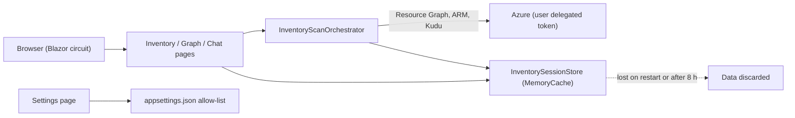

### 2.1 Consequences

- Each new session needs a full rescan: Resource Graph, blob containers, app settings, Kudu config files, and Container Apps. This is slow and can hit Azure throttling.
- A redeploy or restart deletes every user's work and signs everyone out, because the Data Protection keys are lost.
- The app is limited to one replica (see the comment in `AppHost.cs`).
- Any signed-in user can change the allow-list (**SEC-001, High**). The allow-list matches on mutable claims (**SEC-005**). Removing a user does not end their open sessions (**SEC-006**).

---

## 3. Target Architecture

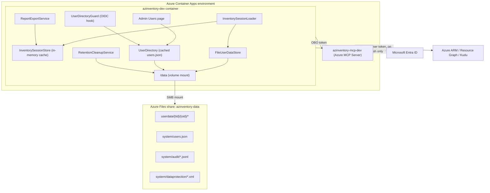

**Main principles**

1. **The volume is the source of truth for scan results. Memory is a cache.** `InventorySessionStore` stays as a fast cache. A cache miss loads the saved snapshot from `/data` before anything calls Azure.
2. **Only a user action calls Azure for a full scan.** Opening a page uses saved data. Clicking **Refresh from Azure** runs a scan.
3. **Per-user isolation comes from the identity token.** File paths are built only from the `tid` and `oid` claims, never from user input.
4. **App roles do not grant Azure access.** Azure RBAC on the user's delegated token still decides what a user can scan or tag. An Admin in the app cannot see another user's inventory.
5. **The app only does file I/O.** All persistence code works against a configurable root path (`Persistence:RootPath`). The same code works on a developer machine (a local folder) and in Azure (`/data`).

---

## 4. Feature 1: Persistent File Storage

### 4.1 Scope

| Item | Persisted | Notes |
|------|-----------|-------|
| `InventorySnapshot` | Yes | Gzip-compressed JSON |
| `GraphDocument` | **Rebuilt from the snapshot on load** | See below |
| `GraphIndex` | No | In-memory adjacency index, always rebuilt |
| User preferences | Yes | Small JSON file |
| Previous snapshot | Yes (one generation) | Needed for change tracking and the Changes sheet in reports (section 7.4) |
| Last-access marker | Yes | Drives the 90-day retention (section 4.10) |
| AI chat history, AI keys, tag proposals | No | Stay in memory, as today |

> **Why the graph is rebuilt and not deserialized:** `GraphNode.Data` and `GraphEdge.Data` are `Dictionary<string, object?>` and hold typed values such as `IReadOnlyDictionary<string,string>` (tags), `bool` (`taggable`), and `EdgeReference` lists. After a JSON round trip these come back as `JsonElement`, which breaks `TagKeys.GetTags()` and `TagKeys.IsTaggable()`. `InventoryGraphBuilder.Build` is deterministic and already used by `RebuildGraphAsync()`. Rebuilding gives the same graph without Azure calls and avoids schema drift when the builder changes.

### 4.2 Phase 0: Provisioning the Persistent Volume

The app does not depend on these Azure resources directly, but `/data` is only persistent once they exist.

| Step | Setting |
|------|---------|
| Storage account | A **dedicated** Standard general-purpose v2 account in `<resource-group>`, same region as the environment. It backs only this share, which keeps the account key's blast radius small. |
| File share | `azinventory-data`, SMB, Standard pay-as-you-go (Transaction optimized), **quota 1 GiB**. The quota is only an upper limit. Pay-as-you-go Standard shares are billed for the space actually used. |
| Environment storage | On `<aca-environment>`, add storage named `azinventory-data`: type Azure Files, access mode **ReadWrite**, pointing at the share. ACA stores the account key in the environment definition. |
| App volume | In the `azinventory-dev` template, add volume `data` (storage type `AzureFile`, storage name `azinventory-data`) with mount options `uid=1654,gid=1654,dir_mode=0700,file_mode=0600`. 1654 is the default non-root `app` user of .NET container images. |
| Container mount | `volumeMounts`: volume `data` at mount path `/data` |
| App setting | `Persistence__RootPath=/data` and `Persistence__RequirePersistentVolume=true` |
| Soft delete | Turn on share soft delete (14 days) as recovery for accidental deletion |
| Backup (optional) | Azure Backup for Azure Files, daily, if the users file and audit log need point-in-time recovery |
| Network | If the environment is not VNet-integrated, the storage account must accept public network traffic. Access is still controlled by the account key. Rotate the key by updating the environment storage definition, then restarting the revision. |

**Local development:**
- `Persistence:RootPath` defaults to `%LOCALAPPDATA%\BlazorAzureInventory\data` when the path is empty and the environment is Development.
- `RequirePersistentVolume` is `false` in Development.
- Nothing is written inside the repository.

**AppHost:** in publish mode, add the volume to the existing `PublishAsAzureContainerApp((_, app) => ...)` callback for `azinventory-dev`, so the AppHost matches the manual deployment. Deployment itself stays manual.

#### 4.2.1 Sizing

| Item | Estimate |
|------|----------|
| One snapshot, 2,000 resources (about 1.5 KB JSON each, gzip about 8:1) | ~0.4 MB |
| Per user: current + previous snapshot + preferences | ~1 MB |
| 8 current users / 50 users / 200 users | ~8 MB / ~50 MB / ~200 MB |
| Audit log, 365 days | < 5 MB |
| Data Protection keys and `users.json` | < 1 MB |

A **1 GiB quota** covers this with a large margin. The 90-day retention keeps usage bounded. Raise the quota only if the `persistence-volume` health check or Azure Monitor shows usage above 70%.

#### 4.2.2 How the Volume Gets Created in Each Deployment Path

| Deployment path | Is the storage account and share created automatically? | What to do |
|-----------------|:----------------------------------------------:|------------|
| **`aspire deploy` / `azd up` to a new environment** (AppHost uses `AddAzureContainerAppEnvironment("aca-env")`, as today) | **Yes** | Declare the volume in the AppHost (below). Aspire then generates a Standard_LRS storage account, a file share, the environment storage link (with the account key), and the `/data` mount. |
| **`aspire deploy` into an existing environment such as `<aca-environment>`** (environment marked `.AsExisting(...)`) | **No, deploy fails** | Aspire refuses to add volumes to an environment it does not own. It throws "Volumes require provisioning storage on the managed environment". Use the manual path. |
| **Current manual deployment** (Podman push + `az containerapp update --image`) | **No, one-time setup** | Run the one-time setup from 4.2 once. After that, every image update keeps the volume, because `--image` only changes the container image and leaves `template.volumes` as is. |
| **Local `aspire run` / F5** | Not needed | `Persistence:RootPath` defaults to a local folder (4.2) |
| **Any deployment without the volume** | Not applicable | The app still works. `PersistentVolumeCheck` switches to in-memory mode and shows the admin banner (4.12). |

**AppHost (as implemented):** Aspire 13.6.1 has no `WithVolume` for project resources (it only accepts `ContainerResource`), so `aspire deploy` does **not** create the storage for `azinventory-dev`. The AppHost sets `Persistence__RootPath=/data` and `Persistence__RequirePersistentVolume=true`, enables sticky sessions, and allows up to 3 replicas; the volume itself is set up once per environment with the manual path below.

- If a later Aspire version supports volumes on projects, add `web.WithVolume("azinventory-data", "/data")` in publish mode so a fresh `aspire deploy` provisions the account, share, and mount. Aspire creates the share with a 1024 GiB quota (only used space is billed); set `ShareQuota = 1` in `aca-env.ConfigureInfrastructure(...)` to cap it.
- The tighter mount options from 4.2 (`uid`, `gid`, `dir_mode`, `file_mode`) are not set by Aspire. Without them, the default SMB mount (mode 0777) is still writable by the app.

**One-time setup script for the manual path:** add an idempotent `deploy/setup-persistent-storage.ps1` to the repo. It creates the account, the share, the environment storage, and the app volume only if they are missing, so it is safe to re-run. A new environment then needs one script run, with no portal clicks.

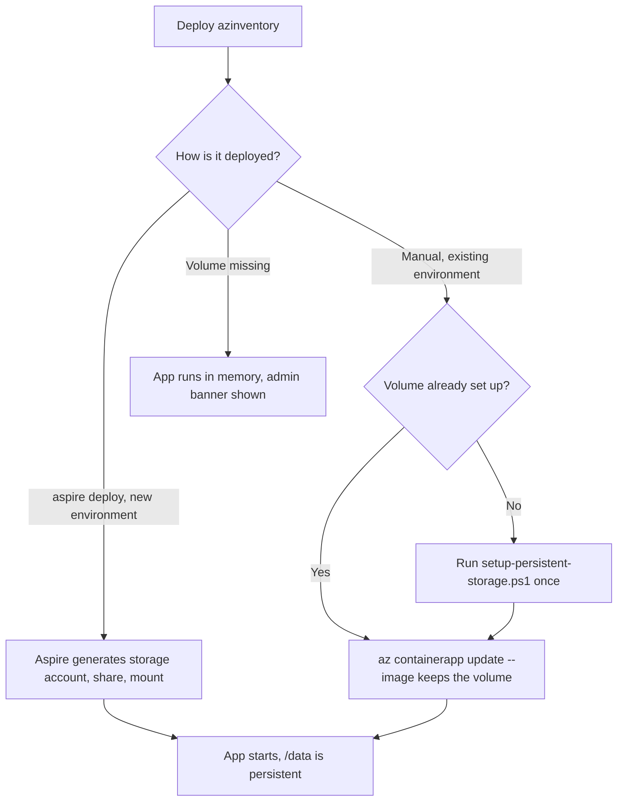

### 4.3 Directory Layout

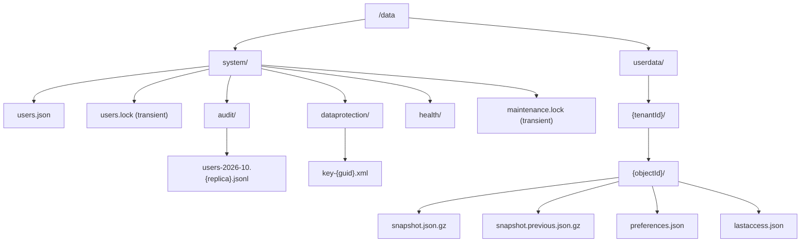

**Path rules (security)**
- `tenantId` and `objectId` come only from the `tid` and `oid` claims (`ClaimsPrincipal.GetTenantId()` and `GetObjectId()`).
- Both must parse as a `Guid`. Format them with `Guid.ToString("D")`, which is lower-case. Otherwise throw.
- `PersistencePaths` resolves every path with `Path.GetFullPath` and checks that it starts with the full root path plus a separator. This is defense in depth against traversal.
- No page, query string, or AI tool can supply a file path.
- Directories are created with `Directory.CreateDirectory`. The mount options (`dir_mode=0700`, `file_mode=0600`) limit access inside the container to the `app` user.

### 4.4 File Formats

#### 4.4.1 `snapshot.json.gz`

The envelope is gzip-compressed JSON.

```json
{
  "schemaVersion": 1,
  "appVersion": "1.5.0",
  "savedUtc": "2026-10-09T14:03:11Z",
  "owner": {
    "tenantId": "aaaaaaaa-aaaa-aaaa-aaaa-aaaaaaaaaaaa",
    "objectId": "bbbbbbbb-bbbb-bbbb-bbbb-bbbbbbbbbbbb"
  },
  "summary": {
    "scannedUtc": "2026-10-09T14:02:58Z",
    "resourceCount": 1834,
    "subscriptionCount": 12
  },
  "snapshot": {
    "scannedUtc": "2026-10-09T14:02:58Z",
    "tenants": [ { "tenantId": "...", "displayName": "...", "defaultDomain": "...", "requiresInteraction": false } ],
    "subscriptions": [ { "subscriptionId": "...", "displayName": "...", "tenantId": "...", "state": "Enabled", "tags": {} } ],
    "resourceGroups": [ ],
    "resources": [ ],
    "appConfigs": [ ],
    "issues": [ ]
  }
}
```

`summary` is written **before** `snapshot`. The Settings page and the "last scanned" badge stream-read only the start of the file with `Utf8JsonReader` and stop after `summary`. They never load the full snapshot.

#### 4.4.2 `preferences.json`

```json
{
  "schemaVersion": 1,
  "updatedUtc": "2026-10-09T14:05:00Z",
  "selectedSubscriptionIds": [ "0000...", "1111..." ],
  "graphFilter": {
    "nodeTypes": [ "WebApp", "SqlDatabase" ],
    "subscriptions": [],
    "resourceGroups": [],
    "onlyConnected": false,
    "hideExternal": false,
    "hideEmulator": true,
    "showLowConfidence": false,
    "tagName": null,
    "tagValue": null
  },
  "inventoryTab": "Web & Function Apps",
  "lastPage": "/graph"
}
```

`graphFilter` has the same shape as the existing `GraphFilterState` in `Models/Graph/GraphModels.cs`.

**Validation on load**
- Keep only the `selectedSubscriptionIds` that are in the user's current subscription list.
- `lastPage` must be one of `/inventory`, `/graph`, `/chat`, or `/appconfiguration`. Other values are dropped, which prevents an open redirect.
- `inventoryTab` must match a known tab title.
- Ignore unknown properties. If `schemaVersion` is higher than supported, use defaults.

#### 4.4.3 `lastaccess.json`

```json
{ "lastAccessUtc": "2026-10-09T14:05:00Z" }
```

Written when a snapshot is loaded or saved, **at most once per 24 hours** per user. This limits writes to the share.

### 4.5 Serialization and File-Write Rules

Create `Services/Persistence/PersistenceJsonContext.cs`, a System.Text.Json source-generated `JsonSerializerContext` for `SnapshotEnvelope`, `UserPreferences`, `LastAccess`, `UserDirectoryDocument`, and `AuditEvent`.

| Concern | Rule |
|---------|------|
| Naming | `JsonNamingPolicy.CamelCase`, `JsonStringEnumConverter`. `AzureResourceKind` and the other enums are stored as strings. |
| Computed properties | Add `[JsonIgnore]` to `InventorySnapshot.ScopeDescription` and `ScanIssue.ResourceName` |
| Case-insensitive dictionaries | Deserialized `IReadOnlyDictionary<string,string>` uses the default (case-sensitive) comparer. `SnapshotNormalizer.Normalize()` rebuilds `Tags` on every `AzureResourceInfo`, `SubscriptionInfo`, and `ResourceGroupInfo`, and the resource `Properties`, with `StringComparer.OrdinalIgnoreCase`. |
| Resource IDs | `AzureResourceInfo.Id` stays lower-case. The normalizer checks this. |
| Secret safety | The snapshot already has no raw setting values (`ConfigEntry` has no value property). Add a unit test that serializes a fixture snapshot built from secret-looking values and asserts that none of them appear in the output. |
| Streaming | Serialize with `JsonSerializer.SerializeAsync` into a `GZipStream` that wraps a `FileStream`. Deserialize the same way in reverse. Never build the whole JSON string in memory. |
| **Atomic writes** | `AtomicFile.WriteAsync(path, writer)`: write to `{name}.{Guid}.tmp` in the **same directory**, call `FileStream.Flush(flushToDisk: true)`, then `File.Move(tmp, path, overwrite: true)`. On SMB this is a rename-replace, so readers see either the old file or the new one, never a partial file. Temp files left by a crash are removed by the retention job (section 4.10). |
| Size limit | Reject a save whose compressed size is over `Persistence:MaxSnapshotMegabytes` (default 50). Log a warning and keep the in-memory session. |

### 4.6 New and Changed Components

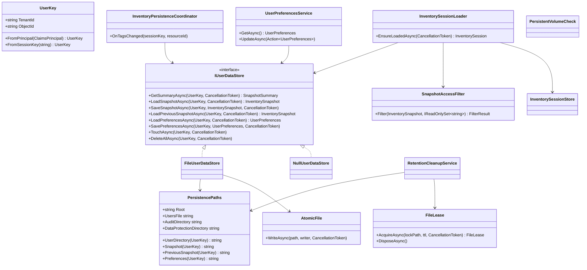

| Class | Folder | Lifetime | Responsibility |
|-------|--------|----------|----------------|
| `PersistenceOptions` | `Models/Options/Options.cs` | Options | Binds the `Persistence` section (4.11). Uses `ValidateDataAnnotations()` and `ValidateOnStart()`. |
| `UserKey` (readonly record struct) | `Services/Persistence` | Value | Validated `tid`/`oid` pair. Parses the existing `inv:{tid}:{oid}` session key. |
| `PersistencePaths` | `Services/Persistence` | Singleton | Builds all paths and enforces root containment |
| `AtomicFile` | `Services/Persistence` | Static | Temp-file plus rename write |
| `FileLease` | `Services/Persistence` | Value (`IAsyncDisposable`) | Cross-replica mutex. Creates `*.lock` with `FileMode.CreateNew` (atomic exclusive create, also on SMB) and writes the owner replica and expiry to it. A lock older than its TTL (default 30 s) is treated as stale and replaced. Retries with jitter. Deleted on dispose. |
| `IUserDataStore` / `FileUserDataStore` | `Services/Persistence` | Singleton | All per-user file I/O |
| `NullUserDataStore` | `Services/Persistence` | Singleton | Used when `Persistence:Enabled = false`. Keeps today's in-memory-only behavior. |
| `SnapshotNormalizer` | `Services/Persistence` | Static | Restores comparers and checks invariants |
| `SnapshotAccessFilter` | `Services/Persistence` | Singleton | Removes subscriptions the user can no longer access (4.9) |
| `InventorySessionLoader` | `Services/Persistence` | Scoped | Returns the cached session or loads from file and rebuilds the graph. A per-user `SemaphoreSlim` in a static `ConcurrentDictionary<UserKey, SemaphoreSlim>` prevents duplicate loads from several tabs. |
| `InventoryPersistenceCoordinator` | `Services/Persistence` | Singleton | Subscribes to `InventorySessionStore.TagsChanged`. Saves the updated snapshot after a 5 s debounce per user. |
| `UserPreferencesService` | `Services/Persistence` | Scoped | Loads preferences once per circuit. Saves them with a 2 s debounce. |
| `PersistentVolumeCheck` | `Services/Persistence` | Startup + health check | Section 4.12 |
| `RetentionCleanupService` | `Services/Persistence` | `BackgroundService` | 90-day deletion (section 4.10) |

**No new NuGet packages** are needed for Feature 1. Everything uses `System.IO`, `System.IO.Compression`, and `System.Text.Json`.

### 4.7 Load Flow

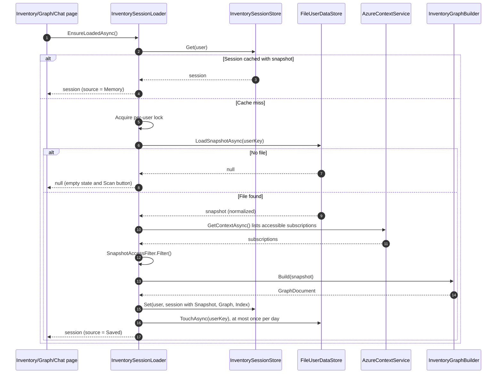

**Integration points:** replace direct `Store.Get(user)` calls in `OnInitializedAsync` with `await Loader.EnsureLoadedAsync()` in:
- `Components/Pages/Inventory.razor`
- `Components/Pages/Graph.razor`
- `Components/Pages/Chat.razor` (and the graph tools in `ChatService`, so the AI sees saved data)
- `Components/Pages/AppConfiguration.razor`
- `Services/Resources/ResourceInspector.cs` and `Services/Tags/TagSyncCoordinator.cs`, where these read the session

`Inventory.razor` already calls `AzureContextService.GetContextAsync()`. Cache the result per circuit in `AzureContextService` so the loader and the page share one ARM call.

### 4.8 Save Flow and Refresh

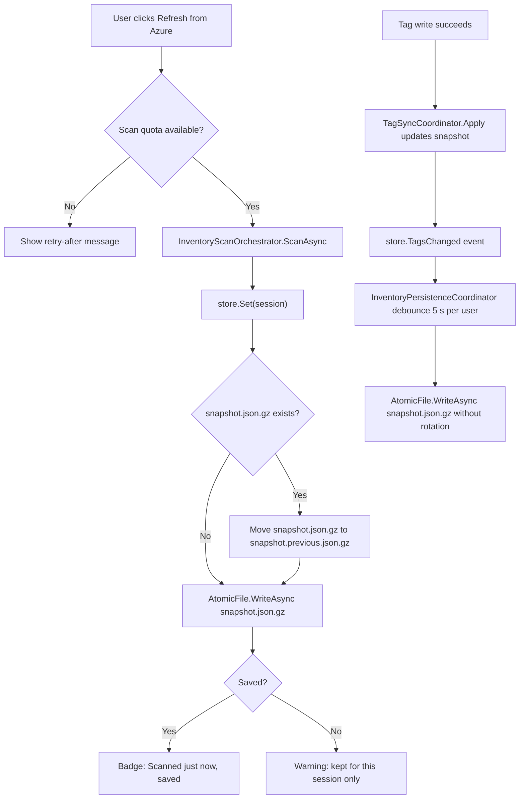

**Rules**
- The save runs **after** `store.Set` in `InventoryScanOrchestrator.ScanAsync`. It uses its own `CancellationToken` with a 60 s timeout, so closing the page does not abort the write.
- **Rotation only on a new scan**, not on tag saves. "Previous" then always means "the previous scan". Rotation uses `File.Move(current, previous, overwrite: true)`, which is a cheap rename on the share.
- A failed save **never** fails the scan. Log it as a warning without snapshot content and show a non-blocking notification.
- `RebuildGraphAsync()` does not save, because the graph is not persisted.
- A cancelled scan saves nothing, as today.

**UI changes on `Inventory.razor`**
- When a snapshot exists, label the scan button **Refresh from Azure**. Keep **Scan** for the first run.
- Add a badge next to the summary cards: `Last scanned 3 h ago - loaded from saved data` or `Scanned just now`. Use the `Warning` style when the data is older than `Persistence:StaleAfterHours` (default 24). This is informational only.
- Restore the subscription selection from preferences.
- Add the same "data as of" badge to `Graph.razor` and the chat panel header.

**UI changes on `Settings.razor`**
- Add a **Saved data** card that shows the last scanned time, the file size, the retention notice ("deleted after 90 days without use"), and a **Delete my saved data** button with confirmation. The button calls `IUserDataStore.DeleteAllAsync` and clears the in-memory session.

### 4.9 Access Re-validation on Load

Saved data was collected with the user's RBAC at scan time, and that access might have been removed since. Before showing a loaded snapshot:

1. Get the user's current subscription list with `AzureContextService.GetContextAsync()`. This is one ARM call, compared with dozens or hundreds for a scan.
2. `SnapshotAccessFilter` removes:
   - subscriptions that are not in the current list,
   - resource groups, resources, `AppConfigs` (matched by app resource ID), and issues in those subscriptions,
   - `External` resources that are only referenced by removed apps. The graph rebuild handles this automatically.
3. If anything was removed, show an info banner: *"N subscriptions from your saved scan are no longer accessible and were hidden. Refresh to update."*
4. **Fail closed:** if the subscription call fails (consent required, network), do not show saved data. Use the existing consent and error handling.

### 4.10 Retention: Delete After 90 Days of Inactivity

`RetentionCleanupService` is a `BackgroundService`. It runs once at startup (after a 5-minute delay) and then every 24 hours.

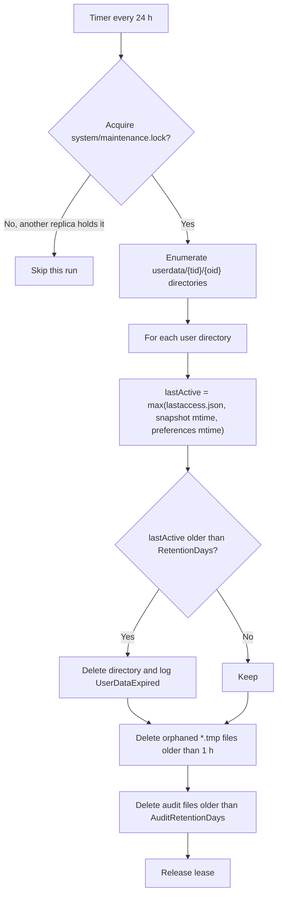

| Setting | Default |
|---------|---------|
| `Persistence:RetentionDays` | **90** |
| `Persistence:AuditRetentionDays` | 365 |
| `Persistence:CleanupIntervalHours` | 24 |

- Before deleting, re-validate that each directory name parses as a GUID pair. Skip anything unexpected and log it.
- When an Admin removes a user (section 5.7), that user's saved data is deleted right away. Disabling a user keeps the data, and the 90-day rule still applies.
- Data Protection keys and `users.json` are never touched by retention.

### 4.11 Configuration

`BlazorAzureInventory/appsettings.json`:

```json
"Persistence": {
  "Enabled": true,
  "RootPath": "",
  "RequirePersistentVolume": false,
  "MaxSnapshotMegabytes": 50,
  "StaleAfterHours": 24,
  "KeepPreviousSnapshot": true,
  "RetentionDays": 90,
  "AuditRetentionDays": 365,
  "CleanupIntervalHours": 24
}
```

Azure environment variables on `azinventory-dev`:

| Variable | Value |
|----------|-------|
| `Persistence__RootPath` | `/data` |
| `Persistence__RequirePersistentVolume` | `true` |

### 4.12 Volume Safety Check

If `/data` is not mounted, writes still succeed but go to the temporary container file system. They are then lost silently on restart. `PersistentVolumeCheck` prevents this:

- **Startup:** when `RequirePersistentVolume` is true, read `/proc/self/mountinfo` and check that `RootPath` (or a parent) is a mount point with file system type `cifs` or `nfs`/`nfs4`. Also write and delete a probe file in `system/health/`.
- **If the check fails:** log at `Critical` and switch the store to `NullUserDataStore`, which is in-memory only, like today. The app stays usable. Admins see a banner on every page: *"Persistent storage is not mounted. Saved data and user changes will not survive a restart."*
- **Health check:** `persistence-volume`, tagged `ready`, registered in `MapDefaultEndpoints`. It runs the same probe with a 5 s timeout.
- **User directory protection:** if the volume is missing, `UserDirectory` refuses admin writes, because changes would be lost. Sign-in uses the bootstrap Admins only (section 5.9). This fails closed.

### 4.13 File Change Summary (Feature 1)

| Action | File |
|--------|------|
| New | `Services/Persistence/UserKey.cs`, `PersistencePaths.cs`, `AtomicFile.cs`, `FileLease.cs` |
| New | `Services/Persistence/IUserDataStore.cs`, `FileUserDataStore.cs`, `NullUserDataStore.cs` |
| New | `Services/Persistence/PersistenceJsonContext.cs`, `SnapshotEnvelope.cs`, `SnapshotNormalizer.cs` |
| New | `Services/Persistence/SnapshotAccessFilter.cs` |
| New | `Services/Persistence/InventorySessionLoader.cs`, `InventoryPersistenceCoordinator.cs` |
| New | `Services/Persistence/UserPreferencesService.cs`, `Models/Persistence/UserPreferences.cs` |
| New | `Services/Persistence/RetentionCleanupService.cs`, `PersistentVolumeCheck.cs` |
| Edit | `Models/Options/Options.cs`: add `PersistenceOptions` |
| Edit | `Models/Inventory/InventoryModels.cs`: `[JsonIgnore]` on computed properties |
| Edit | `Services/Scan/InventoryScanOrchestrator.cs`: rotate and save after `store.Set` |
| Edit | `Services/Azure/AzureContextService.cs`: cache the context per circuit |
| Edit | `Components/Pages/Inventory.razor`, `Graph.razor`, `Chat.razor`, `AppConfiguration.razor`: loader, badge, preferences |
| Edit | `Components/Pages/Settings.razor`: Saved data card |
| Edit | `Components/Layout/MainLayout.razor`: admin-only volume warning banner |
| Edit | `Program.cs`: register services, options, hosted service, health check |
| Edit | `BlazorAzureInventorySolution.AppHost/AppHost.cs`: volume and env vars in publish mode |

---

## 5. Feature 2: User Management

### 5.1 Goals

- Admins manage users from a UI page. Nobody edits config or env vars to add a user.
- Two roles: **Admin** and **User**.
- After first sign-in, users are identified by an **immutable** `tenantId` + `objectId`. This fixes **SEC-005**.
- Only Admins can change who may sign in. This fixes **SEC-001**.
- Removing or disabling a user takes effect within minutes, including open Blazor circuits. This fixes **SEC-006**.
- Every change is audit-logged with the actor's identity. This fixes **SEC-008** for user management.
- Lockout is impossible: there is always at least one Admin, and bootstrap Admins come from configuration.

### 5.2 Role and Permission Matrix

| Capability | User | Admin |
|------------|:----:|:-----:|
| Sign in | Yes | Yes |
| Scan, view inventory, graph, app configuration | Yes | Yes |
| AI chat (own provider settings) | Yes | Yes |
| Write tags (Azure RBAC still required) | Yes | Yes |
| Download own Excel and CSV reports | Yes | Yes |
| Manage own saved data and preferences | Yes | Yes |
| View the **Admin > Users** page | No | Yes |
| Add, disable, enable, remove users, and change roles | No | Yes |
| View the user management audit log | No | Yes |
| Export the user list to Excel | No | Yes |
| See other users' inventories | No | **No** |

`Security:AllowedTenantIds` stays as deployment configuration. It is the outer gate (`TenantGuard`). The user directory is the inner gate.

### 5.3 User Record Lifecycle

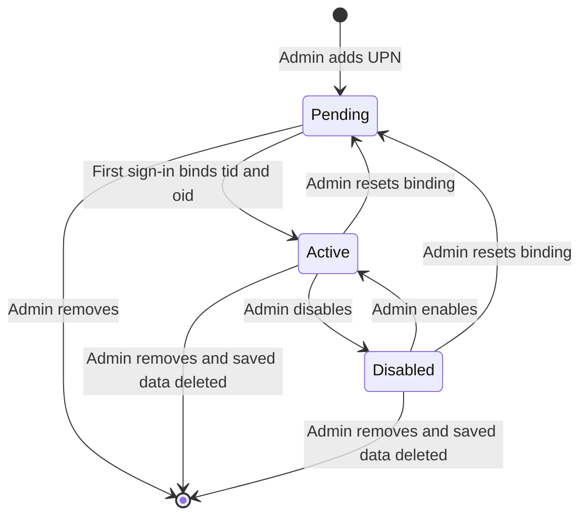

### 5.4 `/data/system/users.json` Schema

```json
{
  "schemaVersion": 1,
  "version": 42,
  "users": [
    {
      "id": "6f1b3c1e-7a8e-4c55-9b0b-5b1f4c2e9a01",
      "username": "admin1@contoso.com",
      "displayName": "Alex Morgan",
      "role": "Admin",
      "status": "Active",
      "tenantId": "aaaaaaaa-aaaa-aaaa-aaaa-aaaaaaaaaaaa",
      "objectId": "bbbbbbbb-bbbb-bbbb-bbbb-bbbbbbbbbbbb",
      "isBootstrap": true,
      "addedBy": "system:bootstrap",
      "addedUtc": "2026-10-09T10:00:00Z",
      "boundUtc": "2026-10-09T10:05:12Z",
      "modifiedBy": null,
      "modifiedUtc": null,
      "lastSignInUtc": "2026-10-09T14:00:00Z"
    },
    {
      "id": "0b9c...",
      "username": "user1@contoso.com",
      "displayName": null,
      "role": "User",
      "status": "Pending",
      "tenantId": null,
      "objectId": null,
      "isBootstrap": false,
      "addedBy": "admin1@contoso.com (aaaaaaaa-...:bbbbbbbb-...)",
      "addedUtc": "2026-10-09T10:10:00Z",
      "boundUtc": null,
      "modifiedBy": null,
      "modifiedUtc": null,
      "lastSignInUtc": null
    }
  ]
}
```

| Field | Rules |
|-------|-------|
| `version` | Increases by 1 on every write. Used to detect changes and as an optimistic concurrency check. |
| `id` | Server-generated GUID. Used by UI actions. |
| `username` | Normalized: trimmed and lower-case. Max 256 characters, no control characters (reuse `DirectoryUserLookup.Normalize`). Must look like `local@domain`. Unique. |
| `role` | `Admin` or `User` (string enum) |
| `status` | `Pending`, `Active`, or `Disabled` |
| `tenantId` / `objectId` | Null until bound. Set by the sign-in flow only. The UI never sets them. Unique as a pair. |
| `isBootstrap` | True for entries from `UserManagement:BootstrapAdmins`. These cannot be removed, disabled, or demoted in the UI. |
| `lastSignInUtc` | Updated at most once per hour per user, to limit writes |

### 5.5 Write Protocol for `users.json`

The file can be written by several replicas (after section 7.2) and by several Admins at once, so every write follows this sequence:

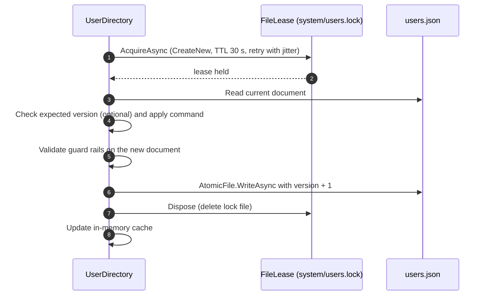

- **Reads** do not need the lease. Atomic rename means readers always see a complete file.
- **Change detection:** `UserDirectory` checks the file's `LastWriteTimeUtc` every `DirectoryRefreshSeconds` (default 60) and reloads it when the time changes. Do not use `FileSystemWatcher`, because it is unreliable on SMB mounts in containers.
- **Last-known-good:** if a read fails or the JSON is invalid, keep the previous cached document and log an error. Never replace a good cache with an empty one.

### 5.6 Components

| Class | Folder | Lifetime | Responsibility |
|-------|--------|----------|----------------|
| `UserManagementOptions` | `Models/Options/Options.cs` | Options | Binds the `UserManagement` section (5.12) |
| `AppRoles`, `AppPolicies` | `Services/Auth/AppRoles.cs` | Static | Constants `Admin`, `User`, and policy names |
| `IUserDirectoryStore` / `FileUserDirectoryStore` | `Services/Users` | Singleton | Reads and writes `users.json` using `FileLease` and `AtomicFile` |
| `UserDirectory` | `Services/Users` | Singleton | In-memory cache with change polling. Provides `Resolve`, `SignInAsync`, and the admin commands. Applies the guard rails (5.9). |
| `UserDirectoryGuard` | `Services/Auth` | Extension | Replaces `UsernameGuard` in the OIDC `OnTokenValidated` chain |
| `RoleClaimsTransformation` | `Services/Auth` | Singleton (`IClaimsTransformation`) | Adds the `ClaimTypes.Role` claim from the cached directory on each authenticated HTTP request |
| `CookieRevalidation` | `Services/Auth` | Extension | Cookie `OnValidatePrincipal` rejects principals that are not Active |
| `DirectoryRevalidatingAuthStateProvider` | `Services/Auth` | Scoped | `RevalidatingServerAuthenticationStateProvider` that re-checks status and role every `RevalidationMinutes` |
| `UserAdminService` | `Services/Users` | Scoped | Entry point for the UI. Re-checks that the **current actor** is an Active Admin in the directory (not only by claim) before each command. |
| `AuditLog` | `Services/Users` | Singleton | Appends JSON lines to `system/audit/users-{yyyy-MM}.{replica}.jsonl`, one file per replica so appends never contend. Also writes structured `ILogger` events. |
| `DirectoryBootstrapper` | `Services/Users` | Hosted service (startup) | Seeding and migration (5.10) |

**Removed:** `SecuritySettingsStore.cs`, the `UsernameGuard.AddUsernameGuard()` registration, the **Authentication access** card in `Settings.razor`, and the `Security:UsernameAllowListEnabled` and `Security:AllowedUsernames` options after migration. Move the `GetUsername` logic into `UserDirectoryGuard`, but **remove the `email` claim fallback** (SEC-005).

### 5.7 Sign-in and Authorization Flow

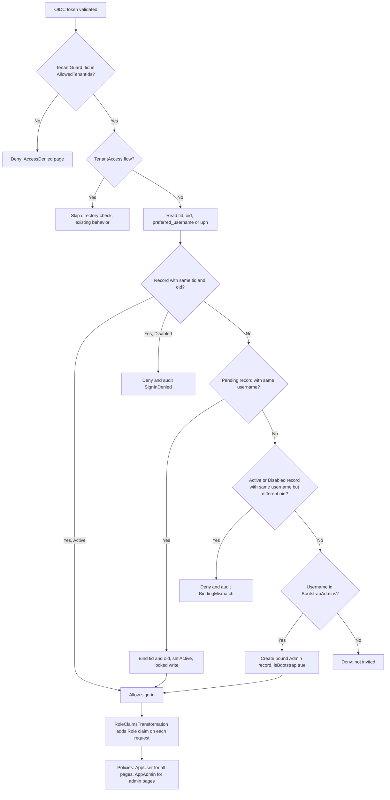

**Details**
- **Username claim order:** `preferred_username`, then `upn`. Never `email`.
- **Directory unavailable** (volume missing or file unreadable with no cache): only bootstrap Admins can sign in, matched by username. Everyone else sees *"Sign-in is temporarily unavailable"*. This fails closed.
- **Binding mismatch:** this happens when an account was deleted and recreated with the same UPN, or when someone else holds a reused UPN. The Admin must choose **Reset binding**.
- **Authorization policies** (in `Program.cs`):
  - `AppPolicies.User`: `RequireAuthenticatedUser().RequireRole(AppRoles.User, AppRoles.Admin)`. Set as the **default policy**, so every existing `[Authorize]` page also requires an Active directory user.
  - `AppPolicies.Admin`: `RequireRole(AppRoles.Admin)`.
  - Apply `.RequireAuthorization(AppPolicies.User)` to `/account/logout` and `TenantAccess.Path`.
- **Session re-evaluation:**
  - `CookieAuthenticationOptions.Events.OnValidatePrincipal` looks up `(tid, oid)` in the cached directory on each request. If the user is not Active: `RejectPrincipal()` and sign out of the cookie scheme.
  - Cookie lifetime: `ExpireTimeSpan = 8 h`, sliding.
  - For Blazor circuits, `DirectoryRevalidatingAuthStateProvider` (`RevalidationInterval = RevalidationMinutes`, default 5) returns `false` when the user is no longer Active **or the role changed**. This forces re-authentication and picks up the new role.

### 5.8 Admin UI: `/admin/users`

New page `Components/Pages/Admin/Users.razor` with `@attribute [Authorize(Policy = AppPolicies.Admin)]`.
Add a nav link in `Components/Layout/NavMenu.razor` inside `<AuthorizeView Policy="@AppPolicies.Admin">`.

**Layout**
- **Tab "Users":** `RadzenDataGrid` with these columns: Username, Display name, Role, Status (badge), Tenant (short form), Last sign-in, Added by, Added. It supports filtering, sorting, and paging. Bootstrap rows show a lock icon.
- **Toolbar:** **Add users**, **Refresh**, **Export to Excel**.
- **Row actions** (menu): Change role, Disable or Enable, Reset binding, Remove. Remove shows a confirmation that says the user's saved inventory will also be deleted.
- **Tab "Audit log":** read-only grid of the latest 500 events, merged from the current and previous month's files for all replicas and sorted by time.

**Add users dialog**
- A multi-line text box for one or more usernames, separated by commas or new lines (max 100 per submit).
- A role drop-down (default `User`).
- An optional **Verify in directory** button. It uses the existing `DirectoryUserLookup.FindAsync` to confirm the user exists and fill in the display name. This needs the Admin's delegated `User.ReadBasic.All` consent, so it is optional.
- Results summary: Added, Already exists, Invalid.

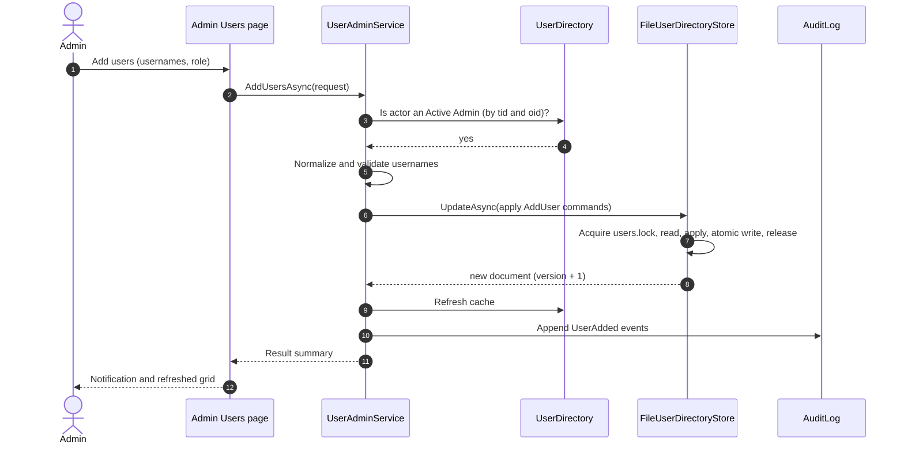

**Settings page:** replace the Authentication access card with a read-only **Your access** card that shows the username, role, and status. Admins also see a link to `/admin/users`.

**Access denied page:** show *"Your account (username) has not been granted access. Contact an administrator."* If `UserManagement:SupportContact` is set, show it too. Never list Admin names.

### 5.9 Guard Rails (enforced in `UserDirectory`, not only in the UI)

| Rule | Error message |
|------|---------------|
| An Admin cannot remove, disable, or demote **themselves** | "You cannot change your own access." |
| At least one **Active Admin** must remain | "At least one active administrator is required." |
| Bootstrap entries cannot be removed, disabled, or demoted | "This administrator is configured by deployment settings." |
| Usernames must be unique (case-insensitive) | Reported as "Already exists" |
| Max `UserManagement:MaxUsers` (default 1000) | "User limit reached." |
| Each command re-checks the actor's role from the directory | Rejected and audited as `UnauthorizedAdminAction` |
| Writes are refused when the persistent volume is not mounted | "Persistent storage is unavailable. Changes cannot be saved." |
| Commands are idempotent | No-op, no audit entry |

### 5.10 Bootstrap and Migration

At startup, `DirectoryBootstrapper` runs under `users.lock`:

1. **If `users.json` does not exist:** create it.
   - Add a Pending record with `role: Admin` and `isBootstrap: true` for each username in `UserManagement:BootstrapAdmins` (for example `admin1@contoso.com` and `admin2@contoso.com`).
   - If `UserManagement:MigrateLegacyAllowList` is true and `Security:UsernameAllowListEnabled` is true, add each username from `Security:AllowedUsernames` as a Pending `User`, unless it is already a bootstrap Admin. For example, two bootstrap Admins and a legacy list of six usernames become:

     | Username | Role |
     |----------|------|
     | admin1@contoso.com | Admin (bootstrap) |
     | admin2@contoso.com | Admin (bootstrap) |
     | user@fabrikam.onmicrosoft.com | User |
     | user1@contoso.com | User |
     | user2@contoso.com | User |
     | user3@contoso.com | User |
     | user4@contoso.com | User |
     | user5@contoso.com | User |

   - Audit `DirectorySeeded`, including the counts.
2. **If it exists:** re-add any bootstrap usernames that are missing, as Pending Admins (audited). If a bootstrap user exists but was demoted or disabled through a direct file edit, restore Admin and Active. This is the break-glass path: set the env var and restart.
3. **If `BootstrapAdmins` is empty and no file exists:** log `Critical`. Every sign-in is denied (fail closed), and this is shown on the setup page.

### 5.11 Audit Log

Each line is a JSON object:

```json
{
  "timestampUtc": "2026-10-09T10:10:00Z",
  "event": "RoleChanged",
  "replica": "azinventory-dev--abc123-7d9f",
  "actor": { "tenantId": "...", "objectId": "...", "username": "admin1@contoso.com" },
  "target": { "id": "0b9c...", "username": "user1@contoso.com" },
  "before": { "role": "User" },
  "after": { "role": "Admin" },
  "correlationId": "00-4bf92f3577b34da6a3ce929d0e0e4736-00f067aa0ba902b7-01"
}
```

- **Events:** `DirectorySeeded`, `UserAdded`, `UserRemoved`, `UserDataDeleted`, `RoleChanged`, `UserDisabled`, `UserEnabled`, `BindingReset`, `UserBound`, `BindingMismatch`, `SignInDenied`, `UnauthorizedAdminAction`, `UserDataExpired`.
- The replica name comes from the `CONTAINER_APP_REPLICA_NAME` env var, with `Environment.MachineName` as the fallback. Each replica appends only to its own file, using `FileMode.Append` and one `WriteAsync` plus `Flush` per line. This avoids interleaved writes on SMB.
- `SignInDenied` is rate-limited to one entry per username per hour.
- Each event is also logged through `ILogger` with structured properties.
- Audit files are kept for `Persistence:AuditRetentionDays` (default 365).

### 5.12 Configuration

```json
"UserManagement": {
  "BootstrapAdmins": "admin1@contoso.com, admin2@contoso.com",
  "MigrateLegacyAllowList": true,
  "DirectoryRefreshSeconds": 60,
  "RevalidationMinutes": 5,
  "MaxUsers": 1000,
  "SupportContact": ""
}
```

Azure environment variable on `azinventory-dev`: `UserManagement__BootstrapAdmins=<comma-separated admin UPNs>` (the values are in the deployment's private `appsettings.Org.json`). After the migration is verified, remove `Security__UsernameAllowListEnabled` and `Security__AllowedUsernames`, and replace the matching lines in `AppHost.cs` and `BlazorAzureInventorySolution.AppHost/appsettings.json`.

### 5.13 File Change Summary (Feature 2)

| Action | File |
|--------|------|
| New | `Services/Auth/AppRoles.cs` |
| New | `Services/Auth/UserDirectoryGuard.cs`, `RoleClaimsTransformation.cs`, `CookieRevalidation.cs`, `DirectoryRevalidatingAuthStateProvider.cs` |
| New | `Services/Users/IUserDirectoryStore.cs`, `FileUserDirectoryStore.cs`, `UserDirectory.cs`, `UserAdminService.cs`, `AuditLog.cs`, `DirectoryBootstrapper.cs` |
| New | `Models/Users/UserRecord.cs`, `UserDirectoryDocument.cs`, `AuditEvent.cs` |
| New | `Components/Pages/Admin/Users.razor`, `Components/Pages/Admin/AddUsersDialog.razor` |
| Edit | `Program.cs`: policies, guard, claims transformation, cookie events, revalidating provider, bootstrapper |
| Edit | `Components/Layout/NavMenu.razor`: Admin link |
| Edit | `Components/Pages/Settings.razor`: remove the allow-list editor, add Your access |
| Edit | `Components/Pages/AccessDenied.razor`: new message |
| Edit | `Models/Options/Options.cs`: `UserManagementOptions`. Mark the `SecurityOptions` allow-list properties obsolete. |
| Delete | `Services/Auth/SecuritySettingsStore.cs`. After migration, delete `Services/Auth/UsernameGuard.cs` or reduce it to helpers. |
| Edit | `BlazorAzureInventorySolution.AppHost/AppHost.cs` and `appsettings.json` |

---

## 6. How the Features Fit Together at Runtime

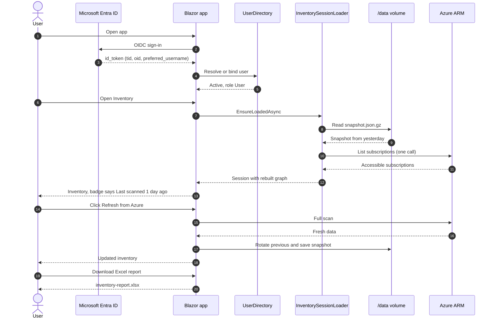

---

## 7. Further Recommendations

### 7.1 Persist Data Protection Keys on the Volume (SEC-015)

Today the key ring is lost on every restart. All auth cookies become invalid, so everyone is signed out, and replicas cannot share cookies.

```csharp
builder.Services.AddDataProtection()
    .SetApplicationName("BlazorAzureInventory")
    .PersistKeysToFileSystem(new DirectoryInfo(paths.DataProtectionDirectory));
```

| Item | Value |
|------|-------|
| Location | `/data/system/dataprotection/` |
| Packages | None. This is built into ASP.NET Core. |
| At-rest protection | **No Key Vault** (decision). Linux has no DPAPI, so key files are stored **unencrypted** on the share. The ASP.NET Core runtime logs a warning about this at startup; that warning is expected. |
| Mitigations | Dedicated storage account used only for this share. Azure Storage encryption at rest. Account key known only to the ACA environment. `dir_mode=0700` and `file_mode=0600` mount options. Share soft delete. |
| Residual risk | Anyone with the storage account key or Contributor on the storage account can read the keys and forge auth cookies. Restrict who holds Contributor or Owner on the resource group. Document this as an accepted risk in `Docs/SecurityReview.md` (SEC-015 becomes "persisted, not encrypted at rest by the app"). |
| Development | Same code, using the local `RootPath` |

### 7.2 Enable Multiple Replicas

The Azure Files share is mounted on every replica, so saved data, users, audit, and Data Protection keys are shared automatically.

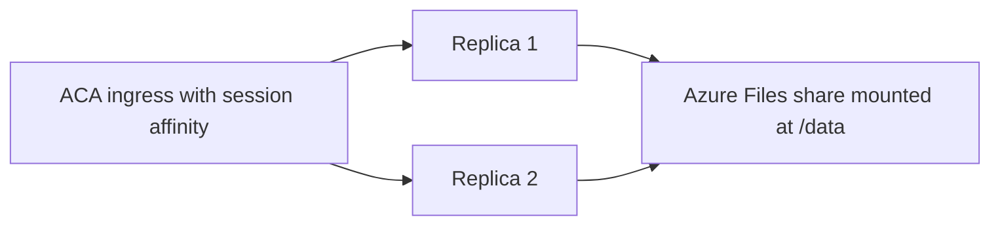

| Requirement | How |
|-------------|-----|
| Shared Data Protection keys | Section 7.1 (**prerequisite**) |
| Blazor Server circuits stay on one replica | Turn on **session affinity (sticky sessions)** on the `azinventory-dev` ingress |
| Per-user inventory available on any replica | Feature 1. A cache miss on another replica loads from `/data`. |
| User directory consistent | `FileLease` for writes, `LastWriteTimeUtc` polling for reads (5.5) |
| Retention job runs once | `system/maintenance.lock` lease (4.10) |
| Audit log | One file per replica (5.11) |
| MSAL token cache | Keep the in-memory cache with sticky sessions. If a replica is lost, the user does one silent re-sign-in or consent through the existing `ConsentHandler`. |
| Tag proposals | Stay in memory. Sticky sessions keep the user on the same replica. |
| Rate limits | Per replica (section 7.3). Acceptable with sticky sessions. |
| AppHost | Change `MaxReplicas` from 1 to 3 and update the comment |

### 7.3 Rate Limiting and Per-User Quotas (SEC-003, SEC-004)

ASP.NET Core's `UseRateLimiter` only sees HTTP requests. Blazor Server interactions travel over the SignalR circuit, so **expensive operations need app-level quotas** as well.

| Operation | Limit (default) | Enforced in |
|-----------|-----------------|-------------|
| Scan (Refresh from Azure) | 1 concurrent per user, 6 per user per hour | `Inventory.razor` before `Orchestrator.ScanAsync`, and inside the orchestrator as defense in depth |
| Scans app-wide | 3 concurrent per replica | `SemaphoreSlim` in `UserQuotaService` |
| Excel report generation | 1 concurrent per user, 10 per user per hour | `ReportExportService` |
| AI chat turns | 30 per user per 10 minutes | `ChatService.SendAsync` |
| Default provider tokens (app-owned key) | 200,000 per user per day | `ChatService`, using `ChatResponse.Usage`. Applies only when `UsesDefaultKey` is true. |
| Anonymous HTTP endpoints (`/signin-oidc`, `/MicrosoftIdentity/Account/*`) | 20 per IP per minute | `AddRateLimiter` fixed window, partitioned by remote IP |
| Authenticated HTTP endpoints (`/account/logout`, tenant access) | 30 per user per minute | `AddRateLimiter`, partitioned by `tid:oid` |

**Implementation**
- `UserQuotaService` (singleton) wraps `PartitionedRateLimiter<string>` from `System.Threading.RateLimiting`, using token buckets keyed by `tid:oid`.
- Returns `QuotaResult(bool Allowed, TimeSpan? RetryAfter)`. The UI shows *"Scan limit reached. Try again in 12 minutes."*
- Configuration section `Quotas` with an `AdminsExempt` flag (default `false`).
- Counters are kept in memory per replica.

```json
"Quotas": {
  "AdminsExempt": false,
  "Scans": { "PerUserPerHour": 6, "MaxConcurrentPerUser": 1, "MaxConcurrentGlobal": 3 },
  "Reports": { "PerUserPerHour": 10 },
  "Chat": { "TurnsPerUserPer10Minutes": 30, "DefaultProviderTokensPerUserPerDay": 200000 },
  "Http": { "AnonymousPerIpPerMinute": 20, "AuthenticatedPerUserPerMinute": 30 }
}
```

### 7.4 Product Features

#### 7.4.1 Change Tracking ("What changed since my last scan?")

This uses `snapshot.previous.json.gz` from Feature 1.

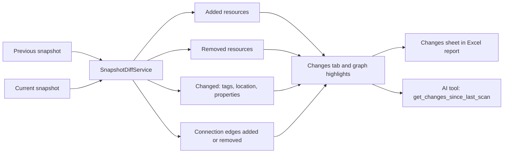

- `SnapshotDiffService.Compare(previous, current)` returns a `SnapshotDiff` with:
  - `Added` and `Removed`, by resource ID,
  - `Changed`, per resource: tag diffs and property key diffs, ignoring volatile keys from the config list `ChangeTracking:IgnoredProperties`,
  - `ConnectionsAdded` and `ConnectionsRemoved`, by `(source, target, type)` from both rebuilt graphs.
- Previous scans are compared only for subscriptions in both snapshots, after the access filter is applied to both.
- **UI:** a **Changes** tab on `Inventory.razor` with counts in the tab header. In `Graph.razor`, highlight changed nodes (CSS classes `node-added` and `node-changed` passed to `graph-view.js`).
- **AI:** add a read-only tool so the chat can answer "what changed?".

#### 7.4.2 Downloadable Excel and CSV Reports

These replace scheduled and emailed reports. Users download on demand.

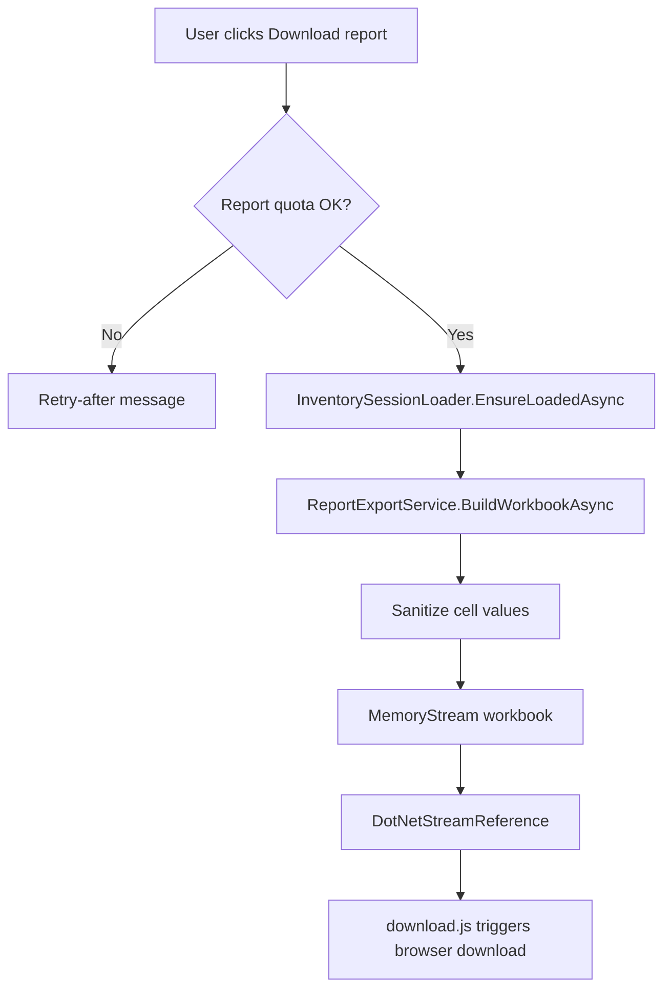

**Excel workbook: `inventory-report-{yyyyMMdd-HHmm}.xlsx`**

| Sheet | Contents |
|-------|----------|
| Summary | Scan time, scope (tenants and subscriptions), counts per resource kind, issue count, "Data as of" note, generated-by user |
| Web & Function Apps | Same columns as `WebAppsGrid`, plus slot count and tags |
| SQL | Servers and databases |
| Storage | Accounts and container counts |
| Container Apps | Same columns as `ContainerAppsGrid` |
| Registries | Same columns as `RegistriesGrid` |
| Other | Cosmos, Redis, Service Bus, Key Vault |
| Connections | One row per `CONNECTS_TO` and `REFERENCES_SECRET` edge: source app, target, setting key, source file, confidence. No values. |
| Tags | One row per resource-tag pair: resource, kind, tag name, tag value |
| Scan Issues | Stage, resource, kind, message |
| Changes | Added, removed, and changed resources since the previous scan (only when a previous snapshot exists) |

**Additional exports**
- **CSV** per inventory grid (toolbar button on each tab), using the same columns as the matching sheet.
- **Graph JSON** export of the current `GraphDocument` from `Graph.razor`.
- **Admin only:** export the user list (`/admin/users`) to Excel. It includes usernames, roles, statuses, and last sign-in, but no tenant or object IDs.

**Implementation**
- Package: **ClosedXML** (MIT). Pin the version and check it with the NuGet supply-chain tooling.
- `ReportExportService` (scoped) builds the workbook from the in-memory session. It **never calls Azure**.
- Formatting: each sheet is an Excel table with a header row, autofilter, and frozen top row. Column widths are adjusted for the first 500 rows only, for performance.
- Delivery: `DotNetStreamReference` plus a small module `wwwroot/js/download.js` (compatible with the existing CSP `script-src 'self'`). This needs no new HTTP endpoint and no CSRF surface.
- Size cap: `Reports:MaxRows` per sheet (default 200,000). Truncation is noted on the Summary sheet.
- **Security: formula injection.** Prefix any cell value that starts with `=`, `+`, `-`, `@`, tab, or carriage return with `'`, in both Excel and CSV. Write all values as text, never as formulas.
- Reports contain only snapshot data, which has no secret values. Add the report builder to the secret-leak unit test.
- Reports are not stored on the volume. They are generated on demand and streamed.

### 7.5 Other Recommendations (Not in This Plan's Scope)

From `Docs/SecurityReview.md` and the codebase review:

- **SEC-007:** Prompt-injection links in AI output. Restrict link targets in `MarkdownRenderer` to Azure portal and Learn domains, or render them as plain text.
- **SEC-009 / SEC-016 / SEC-017:** Logout CSRF, HTTP hardening (HSTS, cookie `Secure`, `AllowedHosts`), and removing the template pages (`/counter`, `/weather`).
- **SEC-014:** Pin the Azure MCP Server image by digest in `AzureMcpServer/Dockerfile`.
- **Observability:** Add an Azure Monitor OpenTelemetry exporter in `ServiceDefaults` and readiness and liveness probes in production.
- **CI/CD:** Automate the manual build (Podman), push, and `containerapp update` flow, including the volume definition, with an image vulnerability scan.

---

## 8. Implementation Phases

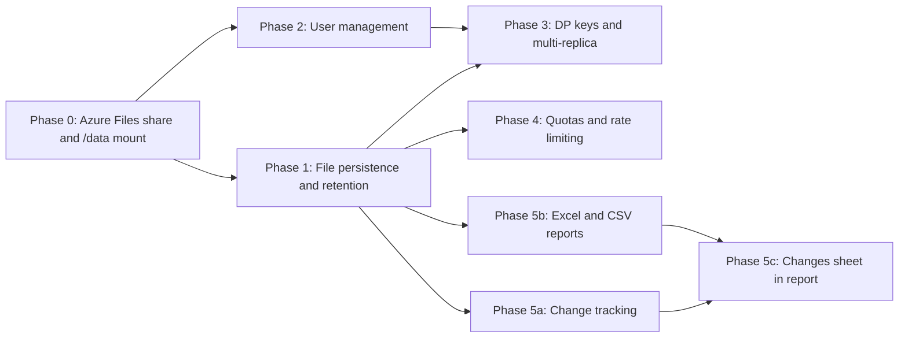

| Phase | Deliverables | Exit criteria |
|-------|--------------|---------------|
| **0** | Storage account and share, environment storage, volume mounted at `/data`, env vars, local `RootPath` | A file written to `/data` survives a revision restart. The `persistence-volume` health check is healthy. |
| **1** | Section 4 complete | Restarting the app keeps each user's inventory. A new tab shows saved data with no scan. Lost subscription access hides that data. Inactive data is deleted after 90 days (tested with a short retention value). |
| **2** | Section 5 complete, migration done | The two bootstrap Admins can open `/admin/users`. The legacy users are listed. A removed user loses access within `RevalidationMinutes`. The audit log has entries. The legacy env vars are removed. |
| **3** | Section 7.1 and 7.2 | Users stay signed in across a restart. Two replicas run with sticky sessions without errors. |
| **4** | Section 7.3 | Quota messages appear when limits are exceeded. The default AI key usage is capped per user. |
| **5a-5c** | Section 7.4 | Changes tab works. The Excel and CSV downloads open correctly in Excel. The formula-injection tests pass. |

---

## 9. Testing Plan

Tests go in `BlazorAzureInventory.Tests` (xUnit + bUnit, following `Fixture.cs` and `TagTestHost.cs`). File-based tests use a unique temp directory per test as `RootPath` and delete it afterwards.

| Area | Test cases |
|------|------------|
| `UserKey` / `PersistencePaths` | Valid GUIDs produce lower-case paths. Non-GUID, empty, `../`, or absolute values throw. Every built path stays under the root. |
| `AtomicFile` | The target is replaced completely. A simulated failure mid-write leaves the original intact. No `.tmp` remains after success. |
| `FileLease` | A second acquire waits and then succeeds after release. A stale lock (expired TTL) is taken over. Cancellation works. |
| Serialization | Round trip of a fixture `InventorySnapshot` gives equal data. Tags and properties are case-insensitive after load. Enums are strings. Computed properties are not written. No fixture secret values appear in the output. The `summary` header is readable without reading the whole file. |
| `SnapshotAccessFilter` | Removes inaccessible subscriptions and their RGs, resources, app configs, and issues. Keeps the rest. Reports the removed count. |
| `InventorySessionLoader` | Cache hit does no file I/O. Cache miss loads once with concurrent callers. Context failure means no data shown (fail closed). Corrupt file is treated as no data. Owner mismatch is refused. |
| Save path | Save after a successful scan, with rotation to previous. No save after a cancelled scan. A save failure does not fail the scan. A tag change triggers one debounced save without rotation. |
| Retention | A directory older than `RetentionDays` (by `lastaccess.json`) is deleted. A recent one is kept. Unexpected names are skipped. Orphan `.tmp` files are removed. The lease prevents a parallel run. |
| `PersistentVolumeCheck` | Parses sample `mountinfo` content (cifs, nfs4, overlay). Falls back to `NullUserDataStore` when not mounted and required. |
| `UserDirectory` resolve | Bound Active is allowed. Disabled is denied. Pending binds. Mismatched oid is denied. Bootstrap creates an Admin. Unknown user is denied. The `email` claim is ignored. |
| Guard rails | No self-demotion. Last Admin protected. Bootstrap locked. Duplicate username is a no-op. Max users enforced. Writes refused without the volume. |
| Concurrency | Two parallel `UpdateAsync` calls both apply, and `version` increases by 2. |
| Migration | Empty store plus legacy list seeds 2 Admins and 6 Users (section 5.10). An existing file is not reseeded. A missing bootstrap Admin is re-added. |
| Audit | One file per replica. Lines are valid JSON. Merged read is sorted by time. |
| Authorization (bUnit) | The Admin link shows only for the Admin role. `/admin/users` is denied for the User role. `Settings.razor` no longer renders the allow-list editor. |
| Revalidation | The provider returns false after Disabled or a role change. |
| Quotas | The 7th scan in an hour is blocked. Concurrent scan blocked. Admin exemption follows config. |
| Reports | Workbook has the expected sheets and headers. Cells starting with `=`, `+`, `-`, `@` are prefixed. Row cap is applied and noted. No secret fixture values appear. |

**Manual verification checklist (dev environment)**
1. Scan, restart the revision, reopen `/inventory`. Data and badge appear with no scan.
2. Remove your Reader role from one subscription, then reload. That subscription is hidden and the banner is shown.
3. As a bootstrap Admin, add a test user. The user signs in, the status becomes Active, and the audit shows `UserAdded` and `UserBound`.
4. Disable that user while their browser is open. They lose access within 5 minutes.
5. Try to remove yourself or the other bootstrap Admin. Both are blocked.
6. Download the Excel report. Check every sheet, and check that a resource tag value starting with `=` is shown as text.
7. Delete my saved data. The files are gone and the next visit shows the empty state.
8. Temporarily remove the volume mount from a test revision. The admin banner appears, the health check is unhealthy, and the app still works in memory.

---

## 10. Deployment and Rollout

Deployment stays **manual**, as today. Do not use `aspire deploy`; it would create a new environment, ACR, identities, and a duplicate MCP app.

1. **Phase 0, persistent volume:**
   - Create the dedicated storage account and the `azinventory-data` file share.
   - Add it as ReadWrite Azure Files storage on `<aca-environment>`. If the environment is VNet-integrated, allow outbound TCP 445 from its subnet. If the storage account firewall is enabled, allow that subnet (service endpoint `Microsoft.Storage`) or use a private endpoint.
   - Add the volume `data` with the mount options from section 4.2, and the mount at `/data`, to the `azinventory-dev` template.
2. **Configure:** add `Persistence__RootPath=/data`, `Persistence__RequirePersistentVolume=true`, and `UserManagement__BootstrapAdmins=<comma-separated admin UPNs>`. **Keep** `Security__UsernameAllowListEnabled` and `Security__AllowedUsernames` for the first deploy, because the bootstrapper reads them.
3. **Deploy the image** with the existing Podman-based flow.
4. **Verify:** the health check is healthy, `/data/system/users.json` exists with 8 entries, and both Admins can open `/admin/users` after signing in.
5. **Communicate:** existing users sign in once to bind. Nothing else changes for them.
6. **Clean up:** remove the legacy `Security__*` allow-list env vars. Update `AppHost.cs` and `BlazorAzureInventorySolution.AppHost/appsettings.json`.
7. **Phase 3 (later):** turn on sticky sessions and raise `MaxReplicas`. The Data Protection keys are already on the shared volume.

**Rollback:** the previous image ignores `/data` and uses the legacy env vars, if they are still present. This is why step 6 waits until the new version is verified.

---

## 11. Risks and Mitigations

| Risk | Impact | Mitigation |
|------|--------|------------|
| Volume not mounted (misconfiguration or a new revision without the volume) | Data silently lost on restart | `PersistentVolumeCheck` at startup, health check, admin banner, admin writes refused (4.12) |
| Saved data shows resources the user can no longer access | Information disclosure | Re-validate subscriptions on load and fail closed (4.9) |
| Data Protection keys unencrypted on the share | Cookie forgery by someone with storage access | Dedicated account, restricted RBAC on the resource group, accepted risk documented (7.1) |
| SMB latency or a transient error | Slow load or failed save | In-memory cache stays primary for active sessions. Saves are async and best effort, with notification. |
| `users.json` corruption or accidental deletion | Lockout | Atomic writes, last-known-good cache, share soft delete, bootstrap Admins re-seeded at startup |
| Concurrent writes from several replicas | Lost updates | `FileLease` with `CreateNew`, version counter, per-replica audit files |
| Recreated account reuses a UPN | Wrong person gets access | Bind by `oid`. Mismatch is denied and needs an Admin to **Reset binding**. |
| Large tenants produce big snapshots | Slow load, share growth | Gzip, streaming, size cap, 90-day retention, share quota monitoring |
| Graph builder changes break old snapshots | Errors after upgrade | The graph is rebuilt, not stored. `schemaVersion` on the envelope. Incompatible files are treated as no data. |
| Stale data mistaken for live data | Wrong decisions | "Last scanned" badge with a stale style. "Data as of" on the report Summary sheet. |
| Admin role misread as Azure privilege | Confusion | UI text: "Admin manages app access only. Azure permissions are unchanged." |

---

## 12. Open Questions

1. **Storage account backing the `/data` mount:** use a new dedicated account in the deployment's resource group (recommended, see 4.2), or put the share in an existing account? Either way the app only sees `/data`.

**Resolved:** share quota 1 GiB (4.2.1). Audit log kept 365 days on `/data` (5.11).
