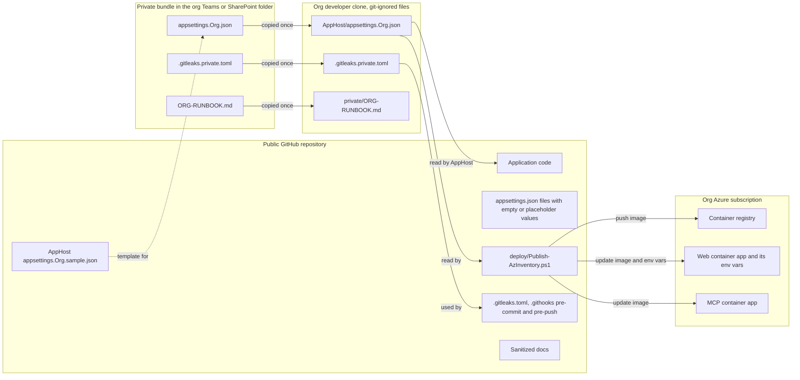
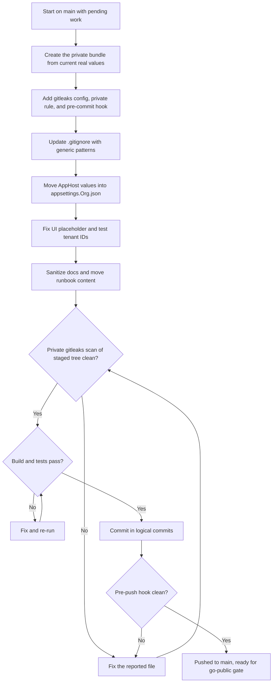
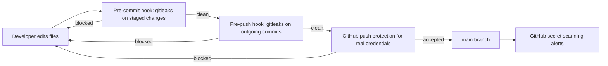
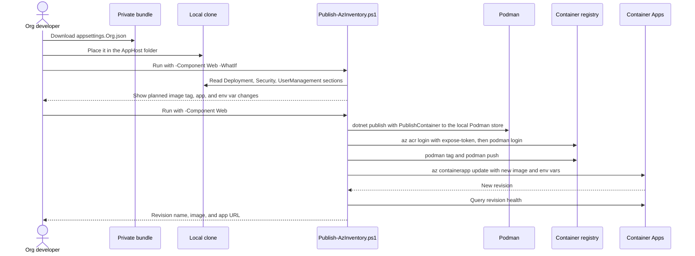
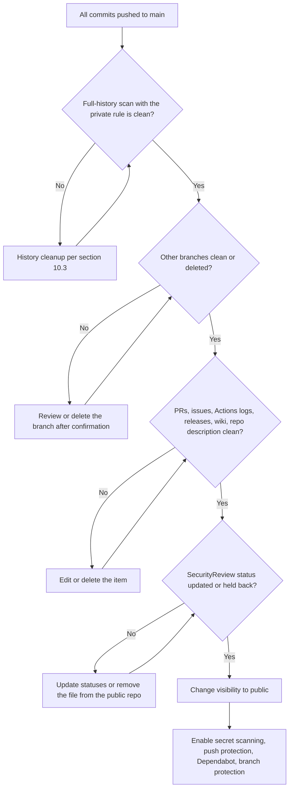
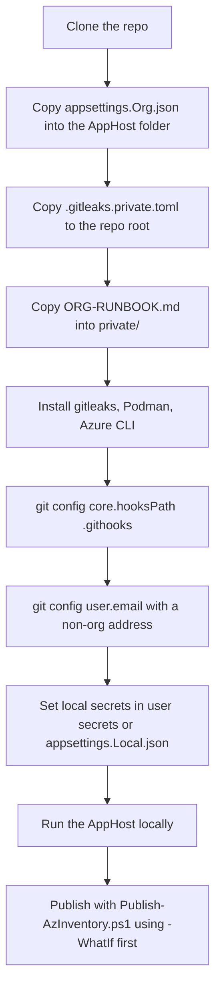

# Public Release and Organization-Specific Configuration Plan

## 1. Purpose

Make this repository safe to publish on GitHub without exposing anything that identifies the organization that hosts the production instance, while keeping every feature working for that organization and letting its developers keep publishing to their own Azure environment.

This document **intentionally contains no organization identifiers**. It calls the hosting organization **"the org"** throughout. The real values are listed only in the private bundle described in section 5.

The pattern used here is the standard "public core, private overlay" approach used by most open source projects that also run an internal deployment:

- The public repository holds generic code, generic defaults, and a **sample** configuration file with placeholders.
- Each deployment keeps its own **overlay** configuration file. The file is git-ignored and shared through an access-controlled channel.
- Automated scanners block org identifiers before they reach a commit, a push, or the main branch.

## 2. Decisions

| Topic | Decision |
|---|---|
| Where org values live | A git-ignored `appsettings.Org.json` in the AppHost folder. The canonical copy is shared out-of-band in a private bundle (org Teams or SharePoint folder; Key Vault is optional for the JSON). |
| Org-specific docs | Sanitize the public docs with placeholders. Move the org-specific runbook content into `ORG-RUNBOOK.md` in the private bundle. |
| Second allowed tenant and its personal test domain | Treat as confidential. Remove from the public repo; move to `appsettings.Org.json`. |
| Pending uncommitted feature work | Sanitize everything, then commit all pending work to `main` in logical commits. |
| Leak prevention | gitleaks pre-commit and pre-push hooks with a private org-identifier rule. GitHub CI is not used. GitHub secret scanning and push protection once the repo is public. |
| Repository visibility | Private today. It becomes public only after the go-public gate in section 10 passes. |
| `.gitignore` | Uses only **generic** names (`appsettings.Org.json`, `/private/`, `.gitleaks.private.toml`). The org name must not appear in `.gitignore`, file names, branch names, or commit messages. |

## 3. Current State (verified)

### 3.1 Git history

The committed history was checked on all local and remote-tracking branches, including `origin/copilot/continue-working-in-cloud`:

- No commit contains the org name, the org email domain, the org tenant ID, either subscription ID, the Container Apps default domain, or colleague usernames.
- **One commit** on `main` contains the second allowed tenant's test account in the legacy `Security:AllowedUsernames` setting of `BlazorAzureInventory/appsettings.json`. A later commit removed it. Because that tenant is treated as confidential, the history cleanup in section 10.3 is needed before the repo goes public.
- Commit author and committer emails are personal addresses, not org addresses.
- gitleaks' default rules flag fake keys and tokens in the unit tests. The public config allowlists them for the test project only.

Every other org identifier exists only in uncommitted working-tree files. The job is to sanitize those files before their first commit and to prevent regressions.

### 3.2 Inventory of org identifiers in the working tree

| File | Approx. lines | What it contains | Action |
|---|---|---|---|
| `BlazorAzureInventorySolution.AppHost/appsettings.json` | 9-17 | Two allowed tenant IDs, two bootstrap admin UPNs | Reset to empty values; move real values to `appsettings.Org.json` |
| `BlazorAzureInventorySolution.AppHost/AppHost.cs` | 66 | Hard-coded web container app name used by the org deployment | Read from `Deployment:WebAppName` with a generic default |
| `BlazorAzureInventory/Components/Pages/Admin/AddUsersDialog.razor` | 10 | Placeholder example emails using the org domain | Use `alice@contoso.com` and `bob@contoso.com` |
| `BlazorAzureInventory.Tests/FeatureTests.cs` | 19 | Real org tenant ID in a test claim | Use `Fixture.TenantId` |
| `BlazorAzureInventory.Tests/UserDirectoryTests.cs` | 12 | Real org tenant ID as a test constant | Use `Fixture.TenantId` (or a fake GUID) |
| `Docs/persistence-and-user-management-plan.md` | 17-37, 168-218, 268-269, 575, 667-691, 857-911, 987, 1005, 1188, 1203-1205, 1236 | Org name, Container Apps environment and subnet names, subscription display name, resource group, storage account, colleague UPNs and display names, tenant ID, personal test-tenant domain | Replace with placeholders (section 7.2); move the org-specific rollout steps to `ORG-RUNBOOK.md` |
| `Docs/SecurityReview.md` | 8, 221-243, 919 | Generic app name only, but **every finding is marked Open** for an internet-facing deployment | See section 7.3 and open decision D1 |
| `README.md` | 66 | Says the web app name is hard-coded in `AppHost.cs` | Document `Deployment:WebAppName` and `appsettings.Org.json` |

Values that are **not** org identifiers and stay as they are:

- `UserSecretsId` GUIDs in the `.csproj` files (they only name a local folder).
- Azure built-in role definition IDs in `RoleSelfAssignmentService.cs` (public, the same in every tenant).
- `contoso`, `fabrikam`, and all-same-digit GUIDs used in tests, docs, and mockups.
- `Docs/mockups/*.png` (checked: Contoso-branded sample data only).
- Links to the public `ADefWebserver` GitHub repositories in `Docs/implementation-plan.md`.

### 3.3 Where the org values must end up

| Value category | Used by | New home |
|---|---|---|
| Allowed tenant IDs | AppHost (publish) and web app (`Security:AllowedTenantIds`) | `appsettings.Org.json` and the web container app's environment variables |
| Bootstrap admin UPNs | AppHost and web app (`UserManagement:BootstrapAdmins`) | `appsettings.Org.json` and the web container app's environment variables |
| Support contact | Web app (`UserManagement:SupportContact`) | `appsettings.Org.json` |
| Subscription, resource group, environment, registry, app names, identity names | Manual deployment | `appsettings.Org.json` (`Deployment` section) |
| Storage account, file share, subnet, federated credential names, known deployment quirks, current user list | Operators | `ORG-RUNBOOK.md` |
| Org identifier deny list | gitleaks pre-commit and pre-push hooks | `.gitleaks.private.toml` (git-ignored, in the private bundle) |
| Client IDs and secrets for local development | AppHost and web app | Unchanged: user secrets or the existing git-ignored `appsettings.Local.json` |

The running org deployment already holds its runtime values as container app environment variables. Image-only updates keep them, so **nothing in Azure has to change** for this work.

## 4. Target Architecture

### 4.1 Repository and configuration structure



### 4.2 Files added or changed

| Path | Tracked | Purpose |
|---|---|---|
| `.gitignore` | Yes | Adds `appsettings.Org.json`, `/private/`, `.gitleaks.private.toml` |
| `BlazorAzureInventorySolution.AppHost/appsettings.json` | Yes | Generic defaults only |
| `BlazorAzureInventorySolution.AppHost/appsettings.Org.sample.json` | Yes | Template with placeholders |
| `BlazorAzureInventorySolution.AppHost/appsettings.Org.json` | **No** | Real org values |
| `BlazorAzureInventorySolution.AppHost/AppHost.cs` | Yes | Loads the org file; reads `Deployment:WebAppName` |
| `deploy/Publish-AzInventory.ps1` | Yes | Generic build, push, and update script driven by the org file |
| `.gitleaks.toml` | Yes | Public gitleaks rules (defaults plus allowlist) |
| `.gitleaks.private.toml` | **No** | Extends the public config with the org identifier rule |
| `.githooks/pre-commit` | Yes | Runs gitleaks on staged changes |
| `.githooks/pre-push` | Yes | Runs gitleaks on the commits about to be pushed |
| `private/ORG-RUNBOOK.md` | **No** | Local copy of the org runbook |
| `Docs/deployment.md` | Yes | Generic deployment guide with placeholders (content moved out of the persistence plan) |

## 5. The Private Bundle

### 5.1 Contents

| File | Content |
|---|---|
| `appsettings.Org.json` | Section 6.2 shape with real values |
| `.gitleaks.private.toml` | Section 8.2 shape with the real deny-list regex |
| `ORG-RUNBOOK.md` | Real environment, subscription, resource group, registry, identity, federated credential, storage, subnet, and app names; the deployed URLs; the manual volume setup; known quirks (cross-subscription AcrPull warning, the `CONTAINER1016` push workaround, why `aspire deploy` is not used); the bootstrap admins and current user list; the org-specific rollout steps moved out of the persistence plan |

### 5.2 Storage and access

- **Canonical location:** a dedicated folder in the org's Teams or SharePoint site, shared only with the developers who deploy. SharePoint gives version history and access audit.
- **Optional:** also store `appsettings.Org.json` as a Key Vault secret (for example `azinventory-org-settings`) when a script or pipeline needs to fetch it without a person. Grant `Key Vault Secrets User` to the deploying developers.
- **Never** attach the bundle to GitHub issues, PRs, gists, Copilot chats in public repos, or public wiki pages.
- The bundle has **no secrets** today (tenant IDs and UPNs are confidential, not credentials). Keep client secrets and AI keys in user secrets or Key Vault, as before.

### 5.3 Updating the bundle

1. Edit the local copy, test it (local run or `-WhatIf` publish).
2. Upload it to the canonical folder, replacing the old version.
3. Post a short note in the team channel so colleagues refresh their copy.

## 6. AppHost Changes

### 6.1 Configuration layering

```mermaid
flowchart TB
    subgraph Run["Run mode, highest priority at the bottom"]
        R1["appsettings.json"]
        R2["appsettings.Development.json"]
        R3["appsettings.Org.json, optional, inserted"]
        R4["appsettings.Local.json, optional, inserted"]
        R5["User secrets"]
        R6["Environment variables"]
        R7["Command line"]
        R1 --> R2 --> R3 --> R4 --> R5 --> R6 --> R7
    end

    subgraph Publish["Publish mode, highest priority at the bottom"]
        P1["appsettings.json"]
        P2["User secrets, env vars, command line"]
        P3["Aspire deploy saved state"]
        P4["appsettings.Org.json, optional, appended"]
        P1 --> P2 --> P3 --> P4
    end
```



- **Run mode:** insert `appsettings.Org.json` right before `appsettings.Local.json`, so a developer's local file and user secrets still win. This reuses the existing insertion logic.
- **Publish mode:** the existing comment in `AppHost.cs` explains that inserting a source reloads every source and breaks the one-shot deploy-state source. So in publish mode, **append** the org file instead. Appending only loads the new source. As a side effect the org file wins over environment variables during publish, which is acceptable because the org controls that file.

### 6.2 `appsettings.json` (tracked) and `appsettings.Org.sample.json` (tracked)

`BlazorAzureInventorySolution.AppHost/appsettings.json` after cleanup:

```json
{
  "Logging": {
    "LogLevel": {
      "Default": "Information",
      "Microsoft.AspNetCore": "Warning",
      "Aspire.Hosting.Dcp": "Warning"
    }
  },
  "Security": {
    "AllowedTenantIds": []
  },
  "UserManagement": {
    "BootstrapAdmins": ""
  },
  "Deployment": {
    "WebAppName": "azinventory-web"
  }
}
```

`BlazorAzureInventorySolution.AppHost/appsettings.Org.sample.json`:

```json
{
  "Security": {
    "AllowedTenantIds": [ "<tenant-id>" ]
  },
  "UserManagement": {
    "BootstrapAdmins": "admin1@contoso.com, admin2@contoso.com",
    "SupportContact": "<support email or URL>"
  },
  "Deployment": {
    "SubscriptionId": "<subscription-id>",
    "ResourceGroup": "<resource-group>",
    "ContainerAppEnvironment": "<container-apps-environment>",
    "WebAppName": "<web-container-app>",
    "McpAppName": "<mcp-container-app>",
    "WebImageRepository": "azinventory-web",
    "McpImageRepository": "azinventory-mcp",
    "Registry": {
      "Name": "<acr-name>",
      "SubscriptionId": "<acr-subscription-id>"
    }
  }
}
```

The org copy sets `WebAppName` to the name of the existing org web container app, so `aspire publish` output for the org stays identical to today.

### 6.3 `AppHost.cs` changes

Replace the run-mode block that inserts `appsettings.Local.json` with:

```csharp
JsonConfigurationSource AppHostJson(string path) => new()
{
    FileProvider = new PhysicalFileProvider(builder.AppHostDirectory),
    Path = path,
    Optional = true
};

if (builder.ExecutionContext.IsRunMode)
{
    sources.Insert(settingsIndex + 1, AppHostJson("appsettings.Org.json"));
    sources.Insert(settingsIndex + 2, AppHostJson("appsettings.Local.json"));
}
else
{
    // Appended, not inserted: inserting reloads the one-shot deploy-state source.
    builder.Configuration.Add(AppHostJson("appsettings.Org.json"));
}
```

Pass the support contact through to the web app next to the bootstrap admins:

```csharp
.WithEnvironment("UserManagement__BootstrapAdmins", builder.Configuration["UserManagement:BootstrapAdmins"] ?? "")
.WithEnvironment("UserManagement__SupportContact", builder.Configuration["UserManagement:SupportContact"] ?? "")
```

Replace the hard-coded name in the web `PublishAsAzureContainerApp` callback:

```csharp
app.Name = builder.Configuration["Deployment:WebAppName"] ?? "azinventory-web";
```

Everything else in `AppHost.cs` stays as is (tenant ID loop, sticky sessions, replica limits, persistence variables).

### 6.4 Verification

- `dotnet run --project BlazorAzureInventorySolution.AppHost` with and without `appsettings.Org.json`: the web resource in the Aspire dashboard shows the expected `UserManagement__BootstrapAdmins` value.
- `aspire publish` with the org file: the generated web container app has the org app name and `Security__AllowedTenantIds__0..n`. Without the org file: generic name and no tenant variables.
- Confirm `aspire publish` and `aspire deploy` still start without the "stream source" error after the publish-mode append. If they fail, fall back to passing org values through `Parameters` or environment variables in publish mode and document it in the README.

## 7. Sanitization Steps

### 7.1 Process



### 7.2 Placeholder map for docs

Use these replacements consistently in `Docs/persistence-and-user-management-plan.md` and any other doc:

| Category | Replacement |
|---|---|
| Org name in prose | "the organization" |
| Container Apps environment name | `<aca-environment>` |
| Environment subnet name | `<aca-subnet>` |
| Subscription display name | `<subscription>` |
| Resource group | `<resource-group>` |
| Storage account | `<storage-account>` |
| Org UPNs of admins | `admin1@contoso.com`, `admin2@contoso.com` |
| Org UPNs of regular users | `user1@contoso.com` to `user5@contoso.com` |
| Real person display names | `Alex Morgan` (matches the mockups) |
| Org tenant ID | `aaaaaaaa-aaaa-aaaa-aaaa-aaaaaaaaaaaa` |
| Second tenant ID and its `onmicrosoft.com` domain | `cccccccc-cccc-cccc-cccc-cccccccccccc`, `user@fabrikam.onmicrosoft.com` |
| Web container app name `azinventory-dev` | Keep. It is generic and does not identify the org |

Content to **move** (not just rewrite) into `ORG-RUNBOOK.md`:

- The "Current state, checked against the deployed app" list (environment storage, subscription, resource group, VNet integration).
- The org-specific rollout steps (storage account creation in the org resource group, subnet egress rules, the exact environment variables with real admins).
- The real current user list and the bootstrap admin list.

In the public doc, replace each moved block with a one-line pointer such as "Organization-specific values live in the deployment's private runbook."

Generic content (how Azure Files volumes work, why `aspire deploy` cannot add volumes to an existing environment, mount options, uid 1654) stays public and moves to `Docs/deployment.md` where it fits better.

### 7.3 `Docs/SecurityReview.md`

The file has no org identifiers apart from the generic app name. The risk is different: every finding in the summary table is marked **Open**, and the review describes how to exploit them on an internet-facing instance. Before it goes public:

1. Update the **Status** column for findings resolved by the pending persistence and user management work (for example the allow-list findings replaced by the user directory, audit logging, quotas, and the persisted Data Protection key ring).
2. Mark the remaining findings with their real status.
3. Remove the org-specific assumptions in "Assumptions (from stakeholder answers)" if they reveal hosting details.

See open decision D1 for when to publish it.

### 7.4 Code and test edits

| File | Change |
|---|---|
| `AddUsersDialog.razor` | `Placeholder="alice@contoso.com&#10;bob@contoso.com"` |
| `FeatureTests.cs` | Replace the tenant ID string in the `tenantid` claim with `Fixture.TenantId` |
| `UserDirectoryTests.cs` | `private const string Tenant = Fixture.TenantId;` |
| `README.md` | Under Configuration, add a row for `appsettings.Org.json` (git-ignored, org overlay, see the sample file). Replace the sentence about the hard-coded web app name with `Deployment:WebAppName` |

## 8. Leak Prevention

### 8.1 Layers



The org identifier rule must never be committed, because the rule itself would contain the identifiers. It exists only in the git-ignored `.gitleaks.private.toml`, which developers get from the private bundle. `--redact` stops gitleaks from printing the match.

GitHub CI is not used, so the hooks are the only place the org rule runs. The pre-push hook is the last check before anything reaches GitHub; it also catches commits made with the pre-commit hook bypassed.

### 8.2 gitleaks configuration

`.gitleaks.toml` (tracked):

```toml
title = "Blazor Azure Inventory"

[extend]
useDefault = true

[[allowlists]]
description = "Vendored minified libraries"
paths = ['''BlazorAzureInventory/wwwroot/lib/''']

[[allowlists]]
description = "Fake keys and tokens in unit tests"
targetRules = ["generic-api-key", "jwt"]
paths = ['''BlazorAzureInventory\.Tests/''']
```

`.gitleaks.private.toml` (git-ignored, in the private bundle) is a standalone copy of the public file plus the org rule. It does not use `[extend] path`, because an extended config does not inherit the base file's allowlists:

```toml
title = "Blazor Azure Inventory - org rules"

# ... same [extend] and [[allowlists]] as .gitleaks.toml ...

[[rules]]
id = "org-identifier"
description = "Identifier of the hosting organization"
regex = '''(?i)(<org-name>|<org-email-domain>|<tenant-id-1>|<tenant-id-2>|<subscription-id-1>|<subscription-id-2>|<aca-default-domain-prefix>|<acr-name>|<storage-account>|<aca-environment>|<colleague-username-prefixes>)'''
```

Notes:

- Build the regex from every value in the private bundle. Escape dots. Use whole GUIDs, not prefixes, to avoid false positives.
- When `.gitleaks.toml` changes, copy the change into `.gitleaks.private.toml`.
- Pin a gitleaks version (currently 8.30.1) on developer machines.

### 8.3 Hooks

`.githooks/pre-commit` (tracked, runs under Git for Windows' bundled shell) scans staged changes:

```sh
#!/bin/sh
config=.gitleaks.toml
[ -f .gitleaks.private.toml ] && config=.gitleaks.private.toml

if ! command -v gitleaks >/dev/null 2>&1; then
  echo "gitleaks is not installed. Install it (winget install gitleaks) or commit with the hook disabled at your own risk."
  exit 1
fi

gitleaks git --pre-commit --staged --redact --no-banner --config "$config"
```

`.githooks/pre-push` (tracked) scans exactly the commits about to be pushed, for each pushed branch:

- Existing remote branch: the range `<remote tip>..<local tip>`.
- New branch, or a remote tip that is not known locally (for example after a history rewrite): every commit not already on that remote.
- Without `.gitleaks.private.toml` it warns and scans with the generic rules only.

Each developer enables both hooks once per clone:

```powershell
git config core.hooksPath .githooks
```

External contributors' pull requests are not scanned by the org rule, so review them before merging.

### 8.4 GitHub CI

Not used. The hooks above replace the earlier `leak-scan` GitHub Actions workflow and its `ORG_DENYLIST_REGEX` secret, which were removed.

### 8.5 GitHub settings (after the repo becomes public)

| Setting | Where | Value |
|---|---|---|
| Secret scanning | Repo Settings, Advanced Security | On (free for public repos) |
| Push protection | Same page | On |
| Custom secret scanning pattern for the org rule | Same page | Needs GitHub Secret Protection, which applies to organization-owned repos. This repo is owned by a personal account, so gitleaks enforces the org rule instead. Add the custom pattern if the repo moves to a GitHub organization with Secret Protection |
| Dependabot alerts | Same page | On |
| Branch protection on `main` | Settings, Branches | Block force pushes (after the history cleanup) |
| Keep my email private and block pushes that expose it | Each contributor's GitHub email settings | On |

### 8.6 Commit identity

Every developer sets a non-org commit email for this repo, because author emails are public:

```powershell
git config user.email "<personal-or-github-noreply-address>"
```

The current history already uses non-org addresses (verified).

## 9. Generic Deploy Script

### 9.1 Purpose

Today the org deployment is manual and the steps live in one person's notes. `deploy/Publish-AzInventory.ps1` turns those steps into a generic script. It holds no org values; it reads everything from `appsettings.Org.json`.

### 9.2 Publish flow



### 9.3 Parameters

| Parameter | Default | Meaning |
|---|---|---|
| `-SettingsPath` | `BlazorAzureInventorySolution.AppHost/appsettings.Org.json` | Org overlay file |
| `-Component` | `Web` | `Web`, `Mcp`, or `All` |
| `-Tag` | Current UTC time as `yyyyMMddHHmmss` | Image tag |
| `-SkipEnvSync` | Off | Update the image only |
| `-WhatIf` | Off | Print every command without running it (`SupportsShouldProcess`) |

### 9.4 Steps

1. Load the JSON file. Fail with a clear message if it is missing or a required `Deployment` value is empty or still a `<placeholder>`.
2. Check that `az` and `podman` are on the path and that `az account show` works.
3. **Web image:** `dotnet publish BlazorAzureInventory -c Release --os linux --arch x64 -t:PublishContainer -p:LocalRegistry=Podman -p:ContainerRepository=<WebImageRepository> -p:ContainerImageTag=<tag>`. Publishing straight to ACR fails with `CONTAINER1016`, so always go through Podman.
4. **MCP image:** `podman build -t <McpImageRepository>:<tag> AzureMcpServer`.
5. **Registry login:** `az acr login --name <Registry.Name> --subscription <Registry.SubscriptionId> --expose-token --query accessToken -o tsv`, piped to `podman login <loginServer> --username 00000000-0000-0000-0000-000000000000 --password-stdin`. Do not print or store the token.
6. `podman tag` and `podman push` to `<loginServer>/<repository>:<tag>`.
7. **Env sync (web only, unless `-SkipEnvSync`):**
   - Build `Security__AllowedTenantIds__0..n` from `Security:AllowedTenantIds`.
   - Read the app's current env var names. Remove any `Security__AllowedTenantIds__k` where `k >= n` (`--remove-env-vars`), so removing a tenant from the file removes it from the app.
   - Set `UserManagement__BootstrapAdmins` and, when present, `UserManagement__SupportContact`.
8. `az containerapp update --name <app> --resource-group <ResourceGroup> --subscription <SubscriptionId> --image <loginServer>/<repository>:<tag> [--set-env-vars ...] [--remove-env-vars ...]`. Pass each `NAME=value` as its own argument so values with commas and spaces stay intact.
9. Print the new revision name and its health state from `az containerapp revision list`.

The script must not touch identities, federated credentials, volumes, ingress, or scale settings. Those stay one-time manual steps in `ORG-RUNBOOK.md`.

### 9.5 First run against the live org app

1. Run with `-Component Web -WhatIf` and compare the planned env vars with the live app's env vars. They must match.
2. Run without `-WhatIf`. Confirm sign-in, the admin users page, and a saved scan still work.

## 10. Commit Plan and Go-Public Gate

### 10.1 Commits to `main`

Each commit must build, pass `dotnet test BlazorAzureInventory.Tests`, and pass the private gitleaks hook. If the pending feature work cannot be split cleanly (for example `Program.cs` touches several features), merge commits 3 and 4.

| # | Message | Contents |
|---|---|---|
| 1 | `chore(Security): Add gitleaks config, pre-commit hook, and leak-scan workflow` | `.gitleaks.toml`, `.githooks/pre-commit`, `.github/workflows/leak-scan.yml`, `.gitignore` additions |
| 2 | `feat(AppHost): Load organization settings from git-ignored appsettings.Org.json` | `AppHost.cs`, AppHost `appsettings.json`, `appsettings.Org.sample.json`, `README.md` |
| 3 | `feat(Users): Replace username allow list with persisted user directory and admin pages` | `Models/Users`, `Services/Users`, `Services/Auth` changes and deletions, `Components/Pages/Admin`, `AccessDenied.razor`, related `Program.cs` and options changes, `UserDirectoryTests.cs`, `GuardTests.cs` |
| 4 | `feat(Persistence): Persist scans and add change tracking, quotas, and reports` | `Services/Persistence`, `Services/Changes`, `Services/Quotas`, `Services/Reports`, `ChangesPanel.razor`, `ScanAgeBadge.razor`, `download.js`, remaining component and model changes, `PersistenceTests.cs`, `FeatureTests.cs` |
| 5 | `feat(Deploy): Add generic publish script driven by appsettings.Org.json` | `deploy/Publish-AzInventory.ps1` |
| 6 | `docs: Add sanitized persistence plan, deployment guide, and public release plan` | `Docs/persistence-and-user-management-plan.md`, `Docs/deployment.md`, this document, and `Docs/SecurityReview.md` if decision D1 allows |

Before every commit, review `git status` and confirm that `appsettings.Org.json`, `.gitleaks.private.toml`, and `private/` are listed as ignored, not staged.

### 10.2 Go-public gate



Gate commands, run from the repo root with the private rule present:

```powershell
git fetch --all --prune
gitleaks git --redact --no-banner --config .gitleaks.private.toml --log-opts="--all" .
git log --all --format="%an <%ae> | %cn <%ce>" | Sort-Object -Unique
```

Also check by hand on GitHub: every PR title, description, and comment; issues; workflow run logs; releases; the wiki; the repo description and topics. Check the remote branch `copilot/continue-working-in-cloud` and delete it only after the owner confirms it is no longer needed.

### 10.3 History cleanup

Needed for the one historical finding in section 3.1, and for anything else the gate finds.

1. Write a replacement file for `git filter-repo --replace-text` in `private/` (never commit it).
2. Run `git filter-repo` on a fresh mirror clone.
3. Get explicit approval before force-pushing; every colleague must re-clone afterwards.
4. Ask GitHub Support to purge cached views and PR refs if the data was ever pushed while the repo was public.
5. Rotate anything that was a real credential.

## 11. Colleague Onboarding



Add a short, generic version of this list to `Docs/deployment.md` ("If you deploy for an organization, get your organization's private bundle from your team").

## 12. Testing and Acceptance Criteria

| # | Check | Expected |
|---|---|---|
| 1 | Private gitleaks scan of all tracked files and full history | No findings |
| 2 | `git check-ignore -v` on `appsettings.Org.json`, `.gitleaks.private.toml`, `private/ORG-RUNBOOK.md` | All ignored |
| 3 | Check `.gitignore`, tracked file names, and branch names against the private deny list | Only generic names |
| 4 | Fresh clone without the bundle: build, test, run the AppHost | Works with generic defaults; no org values anywhere |
| 5 | Clone with the bundle: run the AppHost | Bootstrap admins and tenant allow list match the org deployment |
| 6 | `aspire publish` with the org file | Web app name and tenant env vars match the live app |
| 7 | `Publish-AzInventory.ps1 -WhatIf` | Planned env vars equal the live app's env vars |
| 8 | Real publish to the org environment | New revision healthy; sign-in, admin users page, saved scans, chat, graph, and tags all work |
| 9 | Commit a test file containing an org identifier with the hook on | Commit blocked |
| 10 | Push a branch with an org identifier (throwaway local branch) | Pre-push hook blocks the push |
| 11 | `dotnet test BlazorAzureInventory.Tests` | All tests pass with fake tenant IDs |

## 13. Risks and Mitigations

| Risk | Mitigation |
|---|---|
| A colleague commits an org value in a new file | Pre-commit and pre-push hooks with the private rule |
| The deny list itself leaks | Kept only in a git-ignored file in the private bundle; `--redact` on all scans |
| A colleague loses the org file and deploys with generic defaults | The script refuses to run with missing or placeholder values; `-WhatIf` shows the env var diff first |
| Generic AppHost default opens sign-in to all tenants in a fresh public deployment | Documented in the README and `SecurityReview.md` (SEC-002). Optional follow-up: log a warning in publish mode when `Security:AllowedTenantIds` is empty |
| Publishing the security review exposes open findings | Decision D1 |
| Line numbers in this plan drift as files change | Search by category in section 3.2, not only by line |
| `aspire publish` behaves differently after appending a config source | Verification in section 6.4, with a documented fallback |

## 14. Open Decisions

| ID | Question | Recommendation |
|---|---|---|
| D1 | Publish `Docs/SecurityReview.md` now, after updating finding statuses, or keep it in the private bundle until the open High and Medium findings are fixed? | **Resolved 2026-10-11:** statuses updated against the code; both High findings are fixed, so the review is committed |
| D2 | Keep the canonical `appsettings.Org.json` only in Teams or SharePoint, or also in Key Vault? | Teams or SharePoint now. Add Key Vault when a pipeline deploys without a person |
| D3 | Move deployment to a GitHub Actions workflow with a protected `org` environment and OIDC to Azure? | Out of scope for this plan. The script is designed so a workflow can call it later |
