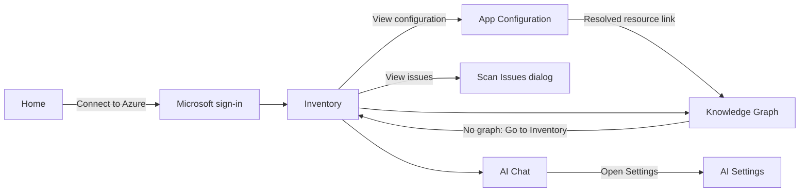

# Blazor Azure Inventory: Screen Descriptions for Mockups

This document describes every screen in **BlazorAzureInventory** so that UI mockups can be produced. It is based on [implementation-plan.md](implementation-plan.md).

## UI Technology

- **All UI is built with Radzen Blazor components** (`Radzen.Blazor`). Mockups should match the look of the standard Radzen theme (Material-style, for example the `material` or `standard` Radzen theme) and use Radzen components wherever a control is shown.
- The one exception is the **graph canvas** on the Graph screen. Radzen has no network-graph component, so the canvas is drawn with **Cytoscape.js** (a node-and-edge diagram with positions computed on the server). Node glyphs are Fluent UI System Icons (MIT). Everything around the canvas (toolbar, filters, side panels) is Radzen.
- Icons are Material Icons (the Radzen default), for example `login`, `logout`, `account_circle`, `refresh`, `search`.
- The app is a desktop-first web app. Mockups should target roughly 1440 x 900, with a note on how panels collapse on narrower screens.

## Global Rules for All Mockups

- **Secret values are never shown.** Any setting value, connection string, password, or API key appears only as `••••••`. Only identifiers are visible: server names, database names, storage account names, container names, vault names, secret names, setting keys.
- The app is **read-only** against Azure. There are no Create, Edit, or Delete buttons for Azure resources.
- Use realistic, fictional sample data. Suggested names: tenant `Contoso`, subscriptions `Contoso Production` and `Contoso Dev`, resource groups `rg-shop` and `rg-data`, web apps `shop-web` and `billing-api`, function app `orders-func`, slot `shop-web/staging`, SQL server `contoso-sql` with databases `orders` and `customers`, storage account `contosodata` with containers `uploads` and `product-images`, container app `catalog-api`, registry `contosoacr`, Key Vault `contoso-kv`, Redis `contoso-cache`, Service Bus `contoso-bus`, an external SQL host `10.0.0.5/hr`.

---

## Screen List

| # | Screen | Route | Requires Sign-In |
|---|---|---|---|
| 1 | Application shell (layout, header, navigation) | all | no |
| 2 | Home / landing | `/` | no |
| 3 | Not authorized (sign-in required) | any protected route | no |
| 4 | Inventory | `/inventory` | yes |
| 5 | Scan issues dialog | dialog over Inventory | yes |
| 6 | App Configuration | `/appconfiguration?id=...` | yes |
| 7 | Knowledge Graph | `/graph` | yes |
| 8 | AI Chat | `/chat` | yes |
| 9 | Settings (AI provider settings) | `/settings` | yes |
| 10 | Not Found and Error | `/not-found`, `/Error` | no |
| 11 | Resource Properties popup (Tags tab) | dialog over Inventory, Graph, App Configuration, and Chat | yes |
| 12 | Tag connections dialog | dialog over Inventory | yes |

---

## 1. Application Shell

The shell wraps every page.

**Components:** `RadzenLayout`, `RadzenHeader`, `RadzenSidebar`, `RadzenBody`, `RadzenPanelMenu`, `RadzenSidebarToggle`, `RadzenComponents` (hosts dialogs, notifications, tooltips).

**Header (`RadzenHeader`), left to right:**

- `RadzenSidebarToggle` (hamburger icon).
- App title: **Azure Inventory** with a small cloud or graph icon.
- Right-aligned **login display**:
  - **Signed out:** a primary `RadzenButton` **Connect to Azure** with a `login` icon.
  - **Signed in:** a `RadzenStack` with an `account_circle` `RadzenIcon`, the user's display name (`RadzenText`, Body2), and a small light `RadzenButton` **Sign out** with a `logout` icon.

**Sidebar (`RadzenSidebar` with `RadzenPanelMenu`):**

| Menu Item | Icon | Notes |
|---|---|---|
| Home | `home` | Always visible |
| Inventory | `inventory_2` | Signed in only |
| Graph | `hub` | Signed in only. Shown disabled with a tooltip "Run a scan first" until a scan finishes |
| Chat | `chat` | Signed in only. Disabled until a scan finishes |
| Settings | `settings` | Signed in only |

**Body:** the current page. Toast notifications (`RadzenNotification`) appear top-right.

---

## 2. Home / Landing

**Purpose:** explain the app and start sign-in.

### 2a. Signed-Out State

- Centered hero `RadzenCard`:
  - Heading (`RadzenText`, H3): **Map your Azure estate**.
  - Subtext: "Sign in with Microsoft Entra ID to inventory your Web Apps, Function Apps, databases, storage, and containers, see how they connect, and ask questions with AI."
  - Large primary `RadzenButton` **Connect to Azure** (`login` icon).
  - Small note (`RadzenText`, Caption): "Read-only. Secret values are never stored or displayed."
- Below the hero, a `RadzenRow` of three feature `RadzenCard`s, each with an icon, title, and one sentence:
  1. **Inventory** - lists resources across all your subscriptions.
  2. **Knowledge Graph** - shows which apps connect to which databases, storage, and vaults.
  3. **AI Chat** - ask questions like "Which apps use the orders database?"

### 2b. Signed-In State

- Same hero, but the button becomes **Go to Inventory** (`arrow_forward` icon), and the greeting reads "Welcome back, {name}".
- If a scan exists in the session, show a small `RadzenCard` "Last scan" with the timestamp, the scope (for example "1 tenant, 2 subscriptions"), and buttons **Open Graph** and **Open Chat**.

---

## 3. Not Authorized (Sign-In Required)

Shown in place of any protected page when the user is not signed in.

- Centered `RadzenCard` with a `lock` icon.
- Heading: **Sign in required**.
- Text: "Connect to Azure to view this page."
- Primary `RadzenButton` **Connect to Azure**.

---

## 4. Inventory

**Purpose:** choose subscriptions, run a scan, and browse the discovered resources. This is the main screen.

### 4.1 Layout (top to bottom)

#### Header Row (`RadzenStack`, horizontal)

- Page title (`RadzenText`, H4): **Inventory**.
- **Subscription picker:** a multi-select, filterable `RadzenDropDown` with chips, grouped by tenant. Example groups: "Contoso (contoso.onmicrosoft.com)" containing "Contoso Production" and "Contoso Dev". All enabled subscriptions are selected by default.
  - A tenant that needs extra consent or MFA appears as a disabled group with a small `RadzenButton` link **Grant access** next to it.
- Primary `RadzenButton` **Scan** (`play_arrow` icon).
- Danger-outline `RadzenButton` **Cancel** (`stop` icon). Visible only while a scan is running.
- Right-aligned caption: "Last scanned: 2026-10-03 12:00 UTC".

#### Scan Progress Panel (visible while scanning)

- `RadzenProgressBar` (determinate) with a percentage.
- `RadzenText` showing the stage and current item, for example "Reading app settings (14 / 32): billing-api".
- Stages, in order: Resolving subscriptions, Querying Resource Graph, Listing blob containers, Reading app settings, Reading config files, Reading Container Apps, Analyzing connections, Building graph.

#### Scan Issues Alert (visible when a scan produced issues)

- Warning `RadzenAlert`: "3 resources could not be fully read. Results are partial." with a **View issues** link that opens the Scan Issues dialog (screen 5).

#### Summary Cards

A `RadzenRow` of small `RadzenCard`s, each with an icon, a large count, and a label:

| Card | Example |
|---|---|
| Web Apps | 6 (plus "2 slots" caption) |
| Function Apps | 3 |
| SQL | 2 servers / 5 databases |
| Storage | 4 accounts / 17 containers |
| Container Apps | 2 |
| Registries | 1 |
| Other | 5 (Cosmos, Redis, Service Bus, Key Vault) |

#### Resource Tabs (`RadzenTabs`)

One tab per resource family. Each tab contains a `RadzenDataGrid` with column filtering, sorting, paging, and column resizing (simple filter row under the header). Rows that have children show an expand arrow.

### 4.2 Tab: Web & Function Apps

| Column | Example |
|---|---|
| Name | `shop-web` |
| Kind | `RadzenBadge`: App / Function / Slot |
| Subscription | Contoso Production |
| Resource Group | rg-shop |
| Location | East US |
| State | Running |
| Default host | shop-web.azurewebsites.net |
| Settings status | `RadzenBadge`: Read (green), AccessDenied (red), NotScanned (gray), Error (orange). Tooltip explains the required RBAC role, for example "Requires Website Contributor" |
| Config files status | Same badge style |
| Connections | 4 |
| Actions | `RadzenButton` (small, light) **View configuration** (`tune` icon) |

**Row expansion:** a nested grid of deployment slots (Name, State, Default host, Settings status, Connections, **View configuration**).

### 4.3 Tab: SQL

| Column | Example |
|---|---|
| Server | contoso-sql |
| FQDN | contoso-sql.database.windows.net |
| Subscription | Contoso Production |
| Resource Group | rg-data |
| Location | East US |
| Databases | 3 |

**Row expansion:** databases grid with Name (`orders`), SKU (`S1`), Status (`Online`), Consumers (count of apps that connect, shown as a clickable number).

### 4.4 Tab: Storage

| Column | Example |
|---|---|
| Account | contosodata |
| Kind | StorageV2 |
| SKU | Standard_LRS |
| HNS enabled | No |
| Location | East US |
| Containers | 6 |
| Consumers | 3 |

**Row expansion:** containers grid with Name (`uploads`), Public access (`None`), Last modified, Consumers.

### 4.5 Tab: Container Apps

| Column | Example |
|---|---|
| Name | catalog-api |
| Environment | cae-shop |
| Image(s) | contosoacr.azurecr.io/catalog-api:1.4.2 |
| Registry | contosoacr |
| Env var count | 12 |
| Connections | 3 |

**Row expansion:** environment variable grid with Name, Source (`value` or `secretRef`), Value (always `••••••`), Detected target (for example "SQL: contoso-sql/orders").

### 4.6 Tab: Registries

Columns: Name, Login server, SKU, Consumers.

### 4.7 Tab: Other

Columns: Type (`RadzenBadge`: Cosmos DB, Redis, Service Bus, Key Vault), Name, Endpoint host, Consumers.

### 4.8 States to Mock

- **Before first scan:** header row, an info `RadzenAlert` "Select subscriptions and click Scan to start", summary cards showing dashes.
- **Scanning:** progress panel visible, Scan button disabled, Cancel visible, grids show a loading overlay.
- **Completed with results:** as described above.
- **Completed with issues:** warning alert visible.

---

## 5. Scan Issues Dialog

A `RadzenDialog` opened from the Inventory warning alert.

- Title: **Scan issues (3)**.
- `RadzenDataGrid` with columns:

| Column | Example |
|---|---|
| Resource | billing-api |
| Stage | Reading app settings |
| Kind | `RadzenBadge`: AccessDenied, NotFound, Throttled, Timeout, ConsentRequired, Unexpected |
| Message | "403: Requires Microsoft.Web/sites/config/list/action (Website Contributor)" |

- Footer: `RadzenButton` **Close**.

---

## 6. App Configuration

**Purpose:** show every configuration entry for one Web App, Function App, slot, or Container App, and which Azure resources those entries point to. Opened from **View configuration** on the Inventory screen.

### 6.1 Header

- Breadcrumb (`RadzenBreadCrumb`): Inventory > shop-web.
- Title (`RadzenText`, H4): **shop-web**.
- Metadata row: Kind badge (Web App), Resource group (`rg-shop`), Detected environment (`Production`).
- Status chips (`RadzenBadge`): "Settings: Read", "Config files: Read".
- **Slot selector:** `RadzenDropDown` with "Production" and "staging".
- `RadzenSwitch` **Only entries with references**.

### 6.2 Configuration Entries Grid (`RadzenDataGrid`)

| Column | Example | Notes |
|---|---|---|
| Key | ConnectionStrings:Orders | |
| Source | App Service connection string | Other values: App setting, appsettings.json, appsettings.Production.json, Container env var, Container secret |
| File | appsettings.json | Blank when not from a file |
| Value | `••••••` | **Always masked** |
| Overridden | check icon | Shown when a higher-precedence source replaces this entry. Overridden rows appear struck through or dimmed |
| Slot sticky | check icon | |
| Secret-like | warning icon | Tooltip: "Looks like a secret stored as plain text. Consider Key Vault." |
| Key Vault ref | key icon | |
| Detected type | `RadzenBadge`: SQL Database, Storage Account, Blob Container, Cosmos DB, Redis, Service Bus, Key Vault, Container Registry, External | |
| Target | contoso-sql.database.windows.net / orders | Identifier only |
| Resolved resource | link "orders (contoso-sql)" | Links to the Inventory row or the graph node. Shows "External" in gray when not matched |

Example rows:

- `ConnectionStrings:Orders` -> SQL Database `contoso-sql/orders`, resolved.
- `Storage` -> Storage Account `contosodata`, resolved, Secret-like warning.
- `Uploads:Uri` -> Blob Container `contosodata/uploads`, resolved.
- `ApiKey` -> Key Vault `contoso-kv`, secret `api-key`, Key Vault ref icon.
- `ConnectionStrings:Legacy` -> External `10.0.0.5/hr`, Medium confidence.
- `Logging:LogLevel:Default` -> no type, no target.

---

## 7. Knowledge Graph

**Purpose:** an interactive diagram of resources and their connections. It has two modes. **Overview** shows the whole estate in a simplified form (child resources are folded into their parent). **Focus** shows one resource, its direct neighbours, and optional expansions. See [Knowledge-Graph-Performance-UX-Plan.md](Knowledge-Graph-Performance-UX-Plan.md) for the design.

### 7.1 Layout

A header row, then a `RadzenSplitter` with three resizable, collapsible panes.

#### Header

- Title **Knowledge Graph**, the scan-age badge, and the scope description (for example "1 tenant, 1 subscription").
- **Show changes (n)** appears when the scan differs from the previous one. **Copy link** appears in Focus mode. If clipboard access is unavailable, it opens a Radzen modal dialog **Copy graph link** with the explanation "Clipboard access was unavailable. Copy this link manually.", a read-only link field that receives focus, and **Close**. Tab stays inside the dialog. Esc, a click on the overlay, or **Close** closes it, and focus returns to **Copy link**. The `more_vert` overflow menu holds **Rebuild graph** and **Export JSON**.
- A breadcrumb in Focus mode: **Overview › contoso-web › contoso-sql**. Each segment is a button. The last one is the current page.

#### Left Pane: Filters (about 280 px)

- **Search:** `RadzenAutoComplete` "Find a node...". Picking a resource opens Focus mode for it.
- **Active filters:** removable chips for every non-default filter (for example "Only connected x") and **Reset all**. Shown only when a filter is active.
- **Scope:** multi-select `RadzenDropDown` for Subscriptions and another for Resource groups, with **Reset**.
- **Resource types:** grouped by category (Apps, Data, Storage, Messaging, Secrets, Registry, External, Scope). Each group has a tri-state checkbox and expands to the individual types, each with a colour swatch. **Select all** resets the selection.
- **Tags** (collapsible `RadzenPanel`): tag name and value inputs with a 300 ms debounce and **Clear**.
- **Advanced** (collapsible `RadzenPanel`): `RadzenSwitch` toggles for *Only connected nodes* (on by default), *Hide external*, *Hide emulator*, *Show low-confidence edges*, and *Show child resources*. In Focus mode, changing *Hide emulator* or *Show low-confidence edges* rebuilds the Focus view on the server, so the affected neighbours disappear or come back, and the Focus centre is selected again. Expansions that no longer add anything are dropped, with a notification. Other filters only hide or show what is already drawn.

#### Center Pane: Graph Canvas

- Toolbar above the canvas: **Fit** (`fit_screen`). On the right, the caption "Showing 142 of 1,034 nodes" (`aria-live="polite"`).
- The **Cytoscape.js canvas** fills the rest of the pane. Positions are computed on the server and cached per session, so the diagram appears already laid out and there is no physics button.
- Every node is a circle filled with the type colour and a white Fluent UI System Icon in the middle (the `External` node uses a dark glyph on grey). Node size grows with the number of connections. The label sits under the node and is drawn only when it is readable. Collapsed children are shown as a label suffix, for example `contoso-sql (+3 db)`.

| Node type | Fluent icon | Colour |
|---|---|---|
| WebApp | `globe` | `#0078D4` |
| WebAppSlot | `globe` | `#69AFE5` |
| FunctionApp | `flash` | `#F2A900` |
| ContainerApp | `cube` | `#008575` |
| ContainerRegistry | `box_multiple` | `#004E46` |
| SqlServer | `server` | `#2E7D32` |
| SqlDatabase | `database` | `#66BB6A` |
| StorageAccount | `storage` | `#7B1FA2` |
| BlobContainer | `folder` | `#CE93D8` |
| StorageQueue | `list` | `#AB47BC` |
| CosmosAccount | `data_usage` | `#5C6BC0` |
| RedisCache | `top_speed` | `#D32F2F` |
| ServiceBusNamespace | `arrow_routing` | `#455A64` |
| KeyVault | `key` | `#C8A400` |
| ExternalService (for example SendGrid) | `cloud`, one shared node per service | per-service colour (SendGrid `#1A82E2`) |
| External | `link` | `#9E9E9E` |
| Tenant | `building` | `#BDBDBD` |
| Subscription | `receipt` | `#BDBDBD` |
| ResourceGroup | `group` | `#BDBDBD` |

| Edge type | Style |
|---|---|
| CONNECTS_TO | solid blue `#0078D4` with an arrow |
| REFERENCES_SECRET | solid gold `#C8A400` with an arrow |
| PULLS_IMAGE_FROM | solid teal `#008575` with an arrow |
| Low-confidence edge | 35% opacity |

- Edges never carry a text label. Parallel edges between the same two nodes are merged, and their width grows with the count.
- Hovering or selecting a node fades every node and edge that is not a neighbour. Hovering shows a plain-text tooltip with the name and type.
- **Overview** hides structural edges (CONTAINS, HAS_SLOT, HOSTS_DATABASE, HAS_CONTAINER, HAS_QUEUE) and scope nodes. **Focus** shows the centre (largest node), its one-hop neighbours, SQL servers and storage accounts as containers around their databases, containers, and queues, and aggregate nodes such as `SendGrid (+48 apps)`.
- A collapsible **Legend** overlay at the bottom left lists each icon with its product name.
- Suggested mockup scene: `shop-web` connects to `orders` (under `contoso-sql`), `uploads` (under `contosodata`), and `contoso-kv`. `orders-func` connects to `contosodata` and `contoso-bus`. `catalog-api` pulls from `contosoacr` and connects to `contoso-cache`. `billing-api` connects to the external node `10.0.0.5/hr`.

#### Right Pane: Node Properties (about 340 px)

A `RadzenCard` for the selected node:

- Header: node label (`orders`), type badge (SQL Database), and a link **Open in Azure portal** (`open_in_new` icon).
- Buttons: **Focus** (`center_focus_strong`), **Expand** (`open_in_full`, Focus mode only, disabled with a reason when the node cannot be expanded), and **Open details**.
- **Talks to:** shown only when the Focus centre is selected (matched without regard to the URL's casing). It lists the centre's dependencies grouped by category (for example Data, Secrets, External), with setting keys (for example `ConnectionStrings:Orders`). Setting keys only, never values. Each item is clickable and focuses that resource. If there are none, the panel says "No connections detected." Other selected nodes have no "Talks to" section.
- Opening a Focus link or picking a Search result selects the Focus centre, so the panel shows its details and "Talks to" without a click.
- **Aggregate card:** selecting a `+N more` node (for example `+60 more apps`) shows a card with that label, the text "Not shown in this Focus view.", and a **Hidden resources (N)** list of every hidden resource, sorted by name, with setting keys only. Each item is clickable and focuses that resource. The card has no Focus, Expand, or Open details buttons. If a later expansion draws one of the hidden resources, it leaves the list and the count drops by one.
- **Properties** and **Connections (n):** collapsed `RadzenPanel`s. Properties is a list of key/value pairs. Connections is a grid with Direction, Edge type, Other node, and Setting keys.
- When an edge is selected, the panel shows its Source and Target and lists every merged underlying connection.
- Empty state: "Select a node to see its details."

### 7.2 URL format

The URL describes the mode, so links can be shared and bookmarked, and browser Back and Forward work.

| URL | Mode |
|---|---|
| `/graph` | Overview |
| `/graph?focus=<resource-id>` | Focus on one resource |
| `/graph?focus=<resource-id>&expand=<resource-id>&expand=<resource-id>` | Focus plus expanded neighbours, in breadcrumb order |

- Values are URL-encoded ARM resource IDs. Existing `graph?focus=` links (for example from the Inventory grids) now open Focus mode instead of the full graph.
- Filters are not part of the URL.
- Invalid, duplicate, or unknown `expand` values are dropped and a notification says how many. At most 20 expansions are kept.
- A resource that is not in the signed-in user's scan shows the notification "This resource is not in your current scan." and falls back to the Overview.
- A `focus` value that is a scope node opens the Overview filtered to that scope and removes `focus` from the URL. A resource group sets both its subscription and its name, so a same-named group in another subscription is not shown.

### 7.3 States to Mock

- **No graph yet:** an info `RadzenAlert` "No graph available. Run a scan first." with a primary `RadzenButton` **Go to Inventory and Scan**. The canvas area is empty.
- **Rendering:** a `RadzenProgressBarCircular` over the canvas with "Rendering graph...".
- **Overview with a node selected:** as described above.
- **Focus with an expansion:** a breadcrumb with two resource segments, **Copy link** visible, and the Focus centre selected with its "Talks to" list.
- **Focus with an aggregate selected:** a `+60 more apps` node selected and the aggregate card listing the hidden apps.
- **Copy link fallback:** the **Copy graph link** dialog over the page, with the link field focused.
- **Filtered:** active-filter chips in the left pane and a count caption such as "Showing 491 of 1,034 nodes".

---

## 8. AI Chat

**Purpose:** ask natural-language questions about the scanned estate. The AI uses graph tools and live, read-only Azure tools.

### 8.1 Layout

- Page title (`RadzenText`, H4): **Ask about your Azure estate**.
- Context caption: "Using scan from 2026-10-03 12:00 UTC (1 tenant, 2 subscriptions). Provider: Azure OpenAI, model gpt-4o."
- **Banners** (`RadzenAlert`), shown only when they apply:
  - Warning: "No AI provider configured for this session." with a link button **Open Settings**.
  - Info: "Live Azure tools unavailable. Answers use the last scan only."
- **Message list:** a scrollable area filling most of the page.
  - **User messages:** right-aligned `RadzenCard` bubbles in the primary color.
  - **Assistant messages:** left-aligned `RadzenCard` bubbles with rendered Markdown (headings, bullet lists, tables, inline code). Show a typing indicator while the answer streams.
  - **Tool call cards:** between messages, a collapsible `RadzenPanel` per tool call. Collapsed header: tool icon, tool name (for example `FindConsumers` or `azmcp_resourcehealth_availability-status_get`), and a result summary ("3 results"). Expanded body: an argument summary (for example `resource: orders`).
- **Input area** (docked at the bottom): a multi-line `RadzenTextArea` "Ask a question...", a primary `RadzenButton` **Send** (`send` icon), and a light `RadzenButton` **Clear chat** (`delete_sweep` icon). While a response is in progress, Send becomes **Stop**.
- **Empty state:** suggested question chips (`RadzenButton`, light, small):
  - "Which apps use the orders database?"
  - "Which storage accounts are shared by several apps?"
  - "Which databases does no app reference?"
  - "Which apps keep secrets in plain app settings?"
  - "Is contoso-sql healthy?"

### 8.2 Sample Conversation for the Mockup

1. User: "Which apps use the orders database, and is it healthy?"
2. Tool card: `FindConsumers` - 2 results.
3. Tool card: `azmcp_resourcehealth_availability-status_get` - 1 result.
4. Assistant: "Two apps connect to **orders** on **contoso-sql**: `shop-web` (setting `ConnectionStrings:Orders`) and `orders-func` (setting `SqlConnection`). The database is currently **Available**."

---

## 9. Settings (AI Provider Settings)

**Purpose:** let each user enter their own AI provider and API key for the current session. Based on the ported `AIServiceSettingsEditor` component, restyled with Radzen. When `AI:DefaultProvider` is configured in appsettings, its values pre-fill the form and its key is used (never displayed) until the user enters their own; the default key is only sent to the configured endpoint host.

### 9.1 Layout

- Page title: **AI Settings**.
- Info `RadzenAlert`: "Your API key is kept only for this session, is encrypted in memory, and is never saved."
- A `RadzenTemplateForm` inside a `RadzenCard` with `RadzenFormField` controls:

| Field | Control | Visible For |
|---|---|---|
| Provider | `RadzenDropDown`: OpenAI, Azure OpenAI, Microsoft Foundry, Anthropic, Google AI | All |
| API key | `RadzenPassword`. After saving, shows `••••••••a1b2` (last 4 characters only). When the default key applies, shows "Using the default key configured for this app" | All |
| Endpoint | `RadzenTextBox`, for example `https://contoso.openai.azure.com/` | Azure OpenAI, Foundry |
| API version | `RadzenTextBox` | Azure OpenAI |
| Deployment / path | `RadzenTextBox` | Azure OpenAI, Foundry |
| Foundry protocol | `RadzenDropDown`: Chat Completions, Responses, Anthropic Messages | Foundry |
| Model | `RadzenDropDown` with a small **Refresh models** icon button next to it | All |

- Inline validation message under Endpoint, for example "Endpoint must use https and be an Azure OpenAI or Foundry host."
- Button row: secondary `RadzenButton` **Test Connection** (`network_check` icon) and primary `RadzenButton` **Save**.
- **Status card** (`RadzenCard` below the form): a success state ("Connected. Model gpt-4o supports tool calling.") with a green check, or an error state ("Connection failed: 401 Unauthorized.") with a red icon.

---

## 10. Not Found and Error

- **Not Found:** centered `RadzenCard` with a `search_off` icon, "Page not found", and a **Go Home** button.
- **Error:** centered `RadzenCard` with an `error` icon, "Something went wrong", a request ID caption, and a **Go Home** button. Never show stack traces or setting values.
- **Reconnect modal** (Blazor Server connection loss): a small modal "Connection lost. Reconnecting..." with a spinner and a **Retry** button.

---

## 11. Resource Properties Popup

Opened by clicking any resource name: Inventory grid rows (including slots, databases, and containers), the **Tags** count column, a Graph node (double-click or **Open details**), the Source or Target of a selected Graph edge, the App Configuration title, and resource links in assistant chat messages.

- **Header:** a type swatch, the resource name, a type badge, and an **Open in Azure portal** link.
- **Tabs:** **Overview** (name, type, subscription, resource group, location, endpoint, resource ID, scan time), **Properties (n)** (filterable list with copy buttons), **Connections (n)** (direction, edge, node link, setting keys), and **Tags (n)**.
- **Tags tab:** a table of Name, Value, Status (`Added`, `Changed`, `Removed`), and Actions (edit, delete, undo). Above it: **Add tag**, **Generate connection tags**, and a filter box. **Review changes (n)** shows the diff, and then **Save** writes it. Generated `conn-*` tags show a "Generated" badge. Values that look like secrets show a warning icon.
- **States to mock:** editable; read-only for Reader users ("You need Tag Contributor..."); not taggable (blob container); conflict alert with **Reload** and **Keep mine**; saved toast; stale-scan warning.

## 12. Tag Connections Dialog and Proposal Card

- **Tag connections...** on the Inventory toolbar opens a dialog with Subscription, Resource group, and Resource types filters, a count of resources in scope, and **Preview changes**.
- The preview (and an AI chat proposal) is a **proposal card**: a title, status badge, counts, reason, a collapsible warnings panel, and a table of resources with checkboxes, change counts (`+2 ~1 -0`), an expandable per-tag diff, and a **Review** button that opens the popup on the Tags tab. The footer has **Discard** and **Apply N changes**. While applying, a progress bar is shown, then a result icon for each row (saved, conflict, forbidden or policy, error).

---

## Navigation Flow

